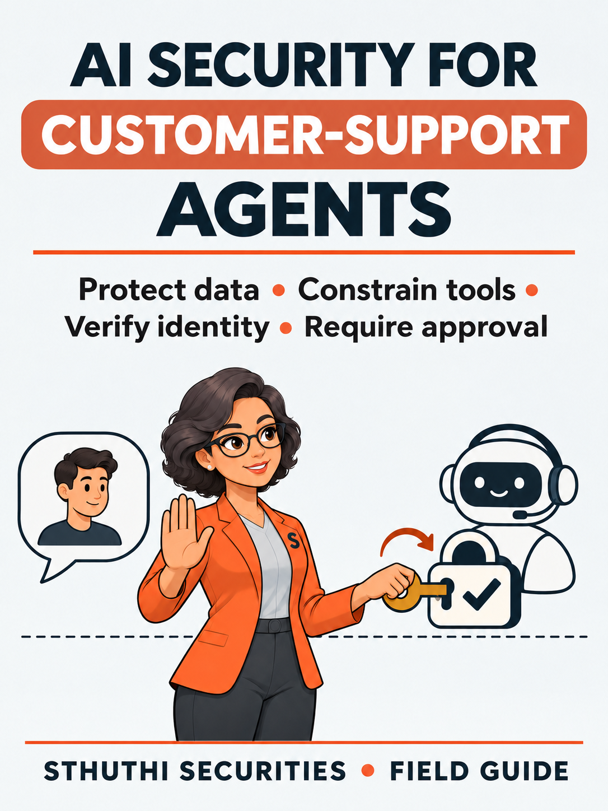

# AI Security for Customer-Support Agents

## Protect customer data, tool access, identity, memory, and high-impact actions in AI-assisted support

**A Sthuthi Securities field guide**  
Published by Sthuthi Technologies, LLC  
Edition 1.0 — 4 November 2026

---

## Who this guide is for

This guide is written for product, engineering, security, support, privacy, and operations teams deploying language-model agents in customer service. Its purpose is to define trust boundaries and tests for support agents that read customer records, retrieve knowledge, call tools, and propose or perform business actions.

This is educational material, not legal advice, an audit opinion, a certification, or authorization to test a system. Penetration testing and security assessment require written permission from the system owner. Contract, privacy, employment, sector, and regional requirements should be reviewed with qualified advisers.

## How to use it

Read the operating model first. Complete the worksheets against one real product or customer request. Then use the technical field modules to challenge the scope and evidence. Keep dated copies of decisions and artifacts. Replace examples with facts from your own system.

The guide distinguishes an observation from an inference and a recommendation. A source can state what a framework contains. It cannot prove that a company operates a control. That proof must come from the company’s own records and testing.

# Part I — The operating model

## 1. Model the agent as a system

Inventory users, model providers, prompts, retrieval stores, memory, tools, queues, support records, identity tokens, logs, and human approvals. Draw data and authority flows, not only model calls.

### Evidence to retain

Keep a dated record of the input, the decision, the person who approved it, the system boundary, exceptions, and the artifact that verifies completion. A policy without an operating record shows intent. A screenshot without context may show a setting but not its coverage, duration, or exception path. Pair the two where the decision depends on both design and operation.

### Review questions

- What business or customer decision does this work support?
- Which product, environment, entity, users, and data are included?
- What would make the record stale or misleading?
- Who can explain how the control works and where it fails?
- Which exception needs a separate risk decision?
- What evidence would an independent reviewer need to reproduce the conclusion?

## 2. Separate identity from conversation

Bind every read and action to verified user, tenant, role, and case context. Do not accept identity, permission, or ownership merely because text in the conversation asserts it.

### Evidence to retain

Keep a dated record of the input, the decision, the person who approved it, the system boundary, exceptions, and the artifact that verifies completion. A policy without an operating record shows intent. A screenshot without context may show a setting but not its coverage, duration, or exception path. Pair the two where the decision depends on both design and operation.

### Review questions

- What business or customer decision does this work support?
- Which product, environment, entity, users, and data are included?
- What would make the record stale or misleading?
- Who can explain how the control works and where it fails?
- Which exception needs a separate risk decision?
- What evidence would an independent reviewer need to reproduce the conclusion?

## 3. Give tools narrow contracts

Expose purpose-specific operations with typed inputs, server-side authorization, bounded amounts, idempotency, audit records, and safe failure. Avoid a general administrative tool.

### Evidence to retain

Keep a dated record of the input, the decision, the person who approved it, the system boundary, exceptions, and the artifact that verifies completion. A policy without an operating record shows intent. A screenshot without context may show a setting but not its coverage, duration, or exception path. Pair the two where the decision depends on both design and operation.

### Review questions

- What business or customer decision does this work support?
- Which product, environment, entity, users, and data are included?
- What would make the record stale or misleading?
- Who can explain how the control works and where it fails?
- Which exception needs a separate risk decision?
- What evidence would an independent reviewer need to reproduce the conclusion?

## 4. Treat all text as untrusted

System instructions, user prompts, tickets, attachments, retrieved pages, summaries, and tool output can contain hostile or misleading instructions. Keep data and instruction channels distinct where the architecture permits.

### Evidence to retain

Keep a dated record of the input, the decision, the person who approved it, the system boundary, exceptions, and the artifact that verifies completion. A policy without an operating record shows intent. A screenshot without context may show a setting but not its coverage, duration, or exception path. Pair the two where the decision depends on both design and operation.

### Review questions

- What business or customer decision does this work support?
- Which product, environment, entity, users, and data are included?
- What would make the record stale or misleading?
- Who can explain how the control works and where it fails?
- Which exception needs a separate risk decision?
- What evidence would an independent reviewer need to reproduce the conclusion?

## 5. Require approval for material actions

Define which refunds, account changes, disclosures, credential operations, and outbound messages require a person. Show the proposed action, target, reason, and material fields at approval time.

### Evidence to retain

Keep a dated record of the input, the decision, the person who approved it, the system boundary, exceptions, and the artifact that verifies completion. A policy without an operating record shows intent. A screenshot without context may show a setting but not its coverage, duration, or exception path. Pair the two where the decision depends on both design and operation.

### Review questions

- What business or customer decision does this work support?
- Which product, environment, entity, users, and data are included?
- What would make the record stale or misleading?
- Who can explain how the control works and where it fails?
- Which exception needs a separate risk decision?
- What evidence would an independent reviewer need to reproduce the conclusion?

## 6. Minimize data and secrets

Limit records provided to the model, redact or tokenize where appropriate, prevent secrets from entering prompts, choose retention settings, and restrict logs and evaluation datasets.

### Evidence to retain

Keep a dated record of the input, the decision, the person who approved it, the system boundary, exceptions, and the artifact that verifies completion. A policy without an operating record shows intent. A screenshot without context may show a setting but not its coverage, duration, or exception path. Pair the two where the decision depends on both design and operation.

### Review questions

- What business or customer decision does this work support?
- Which product, environment, entity, users, and data are included?
- What would make the record stale or misleading?
- Who can explain how the control works and where it fails?
- Which exception needs a separate risk decision?
- What evidence would an independent reviewer need to reproduce the conclusion?

## 7. Test goals, permissions, memory, and failure chains

Test goal hijack, tool misuse, identity abuse, prompt injection through retrieved content, memory poisoning, unexpected code paths, cross-agent communication, cascading failure, and misplaced human trust.

### Evidence to retain

Keep a dated record of the input, the decision, the person who approved it, the system boundary, exceptions, and the artifact that verifies completion. A policy without an operating record shows intent. A screenshot without context may show a setting but not its coverage, duration, or exception path. Pair the two where the decision depends on both design and operation.

### Review questions

- What business or customer decision does this work support?
- Which product, environment, entity, users, and data are included?
- What would make the record stale or misleading?
- Who can explain how the control works and where it fails?
- Which exception needs a separate risk decision?
- What evidence would an independent reviewer need to reproduce the conclusion?

## 8. Build deterministic evaluation fixtures

Use known users, tenants, records, permissions, tool responses, and expected outcomes. Record the model, prompt, tools, configuration, attempt count, and evidence so results can be compared.

### Evidence to retain

Keep a dated record of the input, the decision, the person who approved it, the system boundary, exceptions, and the artifact that verifies completion. A policy without an operating record shows intent. A screenshot without context may show a setting but not its coverage, duration, or exception path. Pair the two where the decision depends on both design and operation.

### Review questions

- What business or customer decision does this work support?
- Which product, environment, entity, users, and data are included?
- What would make the record stale or misleading?
- Who can explain how the control works and where it fails?
- Which exception needs a separate risk decision?
- What evidence would an independent reviewer need to reproduce the conclusion?

## 9. Monitor and contain production failures

Record security-relevant decisions without collecting unnecessary customer content. Rate-limit tools, detect abnormal action patterns, support a kill switch, preserve evidence, and rehearse rollback.

### Evidence to retain

Keep a dated record of the input, the decision, the person who approved it, the system boundary, exceptions, and the artifact that verifies completion. A policy without an operating record shows intent. A screenshot without context may show a setting but not its coverage, duration, or exception path. Pair the two where the decision depends on both design and operation.

### Review questions

- What business or customer decision does this work support?
- Which product, environment, entity, users, and data are included?
- What would make the record stale or misleading?
- Who can explain how the control works and where it fails?
- Which exception needs a separate risk decision?
- What evidence would an independent reviewer need to reproduce the conclusion?

# Part II — Working records

## Worksheet 1: Agent boundary map

Complete one row for each material product, control, artifact, request, or decision. Add rows rather than compressing several different scopes into one answer.

| Field | Entry | Evidence or owner |
|---|---|---|
| Actor/component |  |  |
| Data received |  |  |
| Authority |  |  |
| Trust assumption |  |  |
| Control |  |  |
| Owner |  |  |

### Quality check

- The entry names a product or system rather than “the platform” when several products exist.
- Dates describe the evidence period, not merely the day the file was uploaded.
- Exceptions and unknowns remain visible until resolved.
- The owner can explain the control and is accountable for refresh.
- Sensitive records have a disclosure decision and expiry where needed.

## Worksheet 2: Tool contract review

Complete one row for each material product, control, artifact, request, or decision. Add rows rather than compressing several different scopes into one answer.

| Field | Entry | Evidence or owner |
|---|---|---|
| Tool |  |  |
| Purpose |  |  |
| Caller identity |  |  |
| Authorization |  |  |
| Limits |  |  |
| Approval and audit |  |  |

### Quality check

- The entry names a product or system rather than “the platform” when several products exist.
- Dates describe the evidence period, not merely the day the file was uploaded.
- Exceptions and unknowns remain visible until resolved.
- The owner can explain the control and is accountable for refresh.
- Sensitive records have a disclosure decision and expiry where needed.

## Worksheet 3: AI security test case

Complete one row for each material product, control, artifact, request, or decision. Add rows rather than compressing several different scopes into one answer.

| Field | Entry | Evidence or owner |
|---|---|---|
| Goal |  |  |
| Adversarial input |  |  |
| Precondition |  |  |
| Expected control |  |  |
| Observed result |  |  |
| Evidence |  |  |

### Quality check

- The entry names a product or system rather than “the platform” when several products exist.
- Dates describe the evidence period, not merely the day the file was uploaded.
- Exceptions and unknowns remain visible until resolved.
- The owner can explain the control and is accountable for refresh.
- Sensitive records have a disclosure decision and expiry where needed.

# Part III — Worked case: Helio Support

Helio Support is a customer-support platform whose agent summarizes tickets, retrieves account data, drafts replies, issues limited refunds, and escalates cases. The example is fictional. It shows how to apply the records without suggesting that one control set fits every company.

## Starting condition

The team had useful technical controls but fragmented proof. Sales answers lived in old questionnaires, diagrams did not name dates or environments, and remediation records did not consistently link to verification. The team chose one current enterprise request as the boundary and refused to describe controls outside that product as if they were universal.

### Decision 1: Model the agent as a system

The team applied this step to Helio Support. Inventory users, model providers, prompts, retrieval stores, memory, tools, queues, support records, identity tokens, logs, and human approvals. Draw data and authority flows, not only model calls. They recorded the system and evidence boundary, named one owner, and wrote down the exception that could change the conclusion. The resulting record was short enough to review in a meeting and detailed enough to prevent a later answer from silently changing scope.

### Decision 2: Separate identity from conversation

The team applied this step to Helio Support. Bind every read and action to verified user, tenant, role, and case context. Do not accept identity, permission, or ownership merely because text in the conversation asserts it. They recorded the system and evidence boundary, named one owner, and wrote down the exception that could change the conclusion. The resulting record was short enough to review in a meeting and detailed enough to prevent a later answer from silently changing scope.

### Decision 3: Give tools narrow contracts

The team applied this step to Helio Support. Expose purpose-specific operations with typed inputs, server-side authorization, bounded amounts, idempotency, audit records, and safe failure. Avoid a general administrative tool. They recorded the system and evidence boundary, named one owner, and wrote down the exception that could change the conclusion. The resulting record was short enough to review in a meeting and detailed enough to prevent a later answer from silently changing scope.

### Decision 4: Treat all text as untrusted

The team applied this step to Helio Support. System instructions, user prompts, tickets, attachments, retrieved pages, summaries, and tool output can contain hostile or misleading instructions. Keep data and instruction channels distinct where the architecture permits. They recorded the system and evidence boundary, named one owner, and wrote down the exception that could change the conclusion. The resulting record was short enough to review in a meeting and detailed enough to prevent a later answer from silently changing scope.

### Decision 5: Require approval for material actions

The team applied this step to Helio Support. Define which refunds, account changes, disclosures, credential operations, and outbound messages require a person. Show the proposed action, target, reason, and material fields at approval time. They recorded the system and evidence boundary, named one owner, and wrote down the exception that could change the conclusion. The resulting record was short enough to review in a meeting and detailed enough to prevent a later answer from silently changing scope.

### Decision 6: Minimize data and secrets

The team applied this step to Helio Support. Limit records provided to the model, redact or tokenize where appropriate, prevent secrets from entering prompts, choose retention settings, and restrict logs and evaluation datasets. They recorded the system and evidence boundary, named one owner, and wrote down the exception that could change the conclusion. The resulting record was short enough to review in a meeting and detailed enough to prevent a later answer from silently changing scope.

## Completed-case review

Before closing the work, the team compared every external claim with the evidence register, removed unsupported absolute language, and recorded the remaining gaps. Each planned improvement had an owner and internal date, but the customer-facing answer described the current condition. The final package preserved the questions, supplied artifacts, decisions, and commitments so the next review could start from a verified record.

# Part IV — Technical and evidence field modules

These modules answer recurring questions that appear across customer reviews, program design, penetration-test planning, and AI-agent assessment. Use only the modules that match the product and decision in scope.

## Field module 1: AI Security Assessment vs Web Application Pentest

*Primary keyword: AI security assessment vs penetration test. Originally prepared for the Sthuthi Securities knowledge base; revised here as a book module.*

**A web application penetration test checks the code, APIs, identity, sessions, authorization, and business logic around an AI feature. An AI security assessment also tests model behavior, retrieved content, prompt injection, tenant separation, tool permissions, approval gates, memory, and consequential actions.** AI products usually need both surfaces assessed.

The model is one component inside a larger system. A secure API can still return the wrong customer's document if retrieval filters fail. A resistant model can still call an over-permissioned refund tool. A successful jailbreak can be harmless if the system has no protected rule or connected action. Scope the complete workflow.

#### What the traditional web application test still needs to cover

Adding an LLM does not remove ordinary application risk. The assessment should still examine:

- authentication, session handling, and account recovery;

- server-side authorization and tenant boundaries;

- API object and function permissions;

- file uploads, parsing, rendering, and storage;

- input validation and output encoding;

- secrets, tokens, logs, and error handling;

- business workflows and administrative actions;

- cloud and third-party integration boundaries.

The [OWASP Web Security Testing Guide](https://owasp.org/projects/web-security-testing-guide) remains relevant. Its application and API techniques address the software that collects prompts, retrieves data, calls the model, and executes the result.

#### What the AI assessment adds

#### Direct and indirect prompt injection

Direct injection comes from the user. Indirect injection comes from content the system retrieves or processes: documents, tickets, webpages, emails, tool output, or database records. The [OWASP GenAI Security Project's prompt-injection guidance](https://genai.owasp.org/glossary/prompt-injection/) explains why instructions and data enter the same model context.

#### Retrieval and tenant separation

A RAG system may enforce access at ingestion, indexing, retrieval, or response time. The test should identify which layer makes the final authorization decision and whether another tenant's content can enter the context. Vector similarity is not an access-control rule.

#### System instructions and sensitive context

System-prompt exposure is material when the prompt contains secrets, private rules, or information that enables a more serious attack. Do not store credentials in prompts. Treat model context as observable to an adversarial user unless stronger controls establish otherwise.

#### Tool permissions and approval gates

List every tool the AI can call, the identity used, available operations, accepted arguments, affected systems, and actions requiring human approval. Then test whether malicious user or retrieved instructions can redirect the tool. See [how to test AI agent tool permissions](/blog/test-ai-agent-tool-permissions).

#### Memory and cross-session behavior

Check whether personal, tenant, or task context survives longer than intended and whether one user's data influences another user's session. Memory stores need the same explicit ownership and retention rules as other application data.

#### Model and provider boundaries

Record the model, version, system configuration, moderation, provider settings, data-use terms, and regional processing that affect the test. The [NIST AI Risk Management Framework](https://www.nist.gov/itl/ai-risk-management-framework) treats AI risk across design, development, deployment, use, and evaluation rather than as one prompt-level check.

#### Use a broken rule, not a strange response, to define findings

An AI test produces many surprising outputs. A confirmed security finding needs more:

- **Expected rule:** what the system should prevent.

- **Tested configuration:** application, model, prompts, tools, permissions, and data state.

- **Observed outcome:** the sanitized trace and downstream action.

- **Material impact:** data exposure, unauthorized action, privilege change, fraud, code execution, or another real consequence.

- **Reproducibility and limits:** how often it worked and where the result does not generalize.

Read [why a jailbreak is not automatically a security finding](/blog/ai-jailbreak-vs-security-finding) for the complete decision model.

#### AI feature add-on or standalone assessment?

#### Use an AI feature add-on when

- AI provides chat, summary, classification, or recommendations inside an existing product;

- the model has limited or no tool access;

- the application remains the primary security boundary;

- a few AI-specific scenarios can be added to a normal app test.

#### Use a standalone AI assessment when

- AI is central to the product's function;

- RAG, vector stores, memory, or data ingestion carry sensitive information;

- the system plans or calls tools;

- multiple agents pass work or authority between them;

- model output changes records, sends messages, moves money, or controls infrastructure;

- the assessment needs versioned adversarial scenarios and AI-specific evidence.

The [OWASP Top 10 for LLM Applications](https://owasp.org/projects/top-10-for-large-language-model-applications) covers prompt injection, sensitive information disclosure, improper output handling, excessive agency, system-prompt leakage, vector and embedding weaknesses, and other AI application risks. Use it as a risk reference, not as proof that ten generic prompts tested your product.

#### How to scope the combined assessment

Map one or two critical workflows from user intent to final action. Identify every component crossed: interface, API, orchestration layer, model, retrieval source, memory store, tool, approval service, and downstream system. For each boundary, write the identity and expected rule.

| Boundary | Question | Evidence |
| --- | --- | --- |
| User to application | Who is signed in and which tenant? | Session and account trace |
| Application to retrieval | Which records may enter context? | Query filters and returned record IDs |
| Context to model | Can untrusted content become instruction? | Sanitized prompt and retrieved content |
| Model to tool | Which operations and arguments are allowed? | Tool call and permission decision |
| Tool to action | Was approval required and recorded? | Approval and action log |

Sthuthi's published [AI Security Assessment](/services/ai-security-assessment) covers one application, two critical workflows, and up to five connected tools. Larger multi-agent, model-pipeline, or infrastructure work needs a separate scope.

#### Frequently asked questions

#### Can a normal penetration test find prompt injection?

It may find obvious cases, but an AI assessment adds indirect content, retrieval, tool, memory, model, and action scenarios that a standard application scope may not include.

#### Does an AI assessment replace a web application pentest?

No. The AI workflow still depends on application, API, identity, cloud, and data controls. Combine the scopes or state their boundaries clearly.

#### Is model safety the same as application security?

No. Model safety may address harmful or disallowed content. Application security focuses on protected data, authority, integrity, availability, and actions in the deployed system. They can overlap but require different rules and evidence.

#### Should we test the production model?

Test a representative configuration with fake data where possible. If production is required, agree on data boundaries, tool restrictions, cost limits, monitoring, and stop conditions first.

## Field module 2: Why an AI Jailbreak Is Not Automatically a Security Finding

*Primary keyword: AI jailbreak security finding. Originally prepared for the Sthuthi Securities knowledge base; revised here as a book module.*

**An AI jailbreak is not automatically a security finding.** It becomes one when the tested system violates an explicit security rule, the result can be reproduced under a recorded configuration, and the outcome creates material impact such as private-data exposure or an unauthorized action.

Models can produce surprising, inaccurate, rude, or policy-breaking text. Some outputs are safety or quality issues. Some are useful observations. A security report needs a traceable connection to confidentiality, integrity, availability, authority, or another agreed business rule.

#### Jailbreak, prompt injection, and finding are different terms

#### Jailbreak

A jailbreak commonly means persuading a model to bypass behavioral or content restrictions. The result might violate a model policy without compromising application data or authority.

#### Prompt injection

Prompt injection uses malicious instructions to redirect a model or application. It may arrive directly from the user or indirectly through retrieved content. The [OWASP GenAI Security Project](https://genai.owasp.org/glossary/prompt-injection/) explains the structural problem: trusted and untrusted instructions can enter the same context.

#### Security finding

A finding records a tested rule, target, configuration, action trace, observed outcome, impact, severity rationale, limits, and reviewer decision. The prompt is only one part of that evidence.

#### The three-part finding test

#### 1. A defined rule was broken

Write the expected rule before testing. Examples:

- A customer may retrieve only records owned by their tenant.

- The agent must obtain approval before issuing a refund over $100.

- Retrieved documents must not change the agent's tool policy.

- The model must not receive production credentials.

- A user may not cause the agent to send a message as another employee.

“The model should never say anything unexpected” is not a testable security rule. Tie the rule to data, identity, authority, system state, or a defined safety requirement.

#### 2. The outcome is reproducible and attributable

Record the application build, model and version, system instructions, retrieval state, tools, permissions, user role, tenant, test data, request trace, and observed action. Repeat the scenario enough to understand whether the result is stable, intermittent, or dependent on hidden state.

AI behavior is probabilistic. Reproducibility does not always mean identical wording. It means the same material rule can be violated under a documented scenario with a meaningful success rate.

#### 3. The impact is material

Material impact can include:

- another customer's private record enters the response;

- a tool creates, changes, deletes, sends, or purchases without authorization;

- the attacker gains a credential, token, or privileged operation;

- untrusted model output reaches a code, query, template, or browser execution sink;

- the attack causes meaningful financial or resource consumption;

- a required safety control fails in the deployed use case.

#### Examples: observation or confirmed finding?

| Observed behavior | Likely treatment | Reason |
| --- | --- | --- |
| Model reveals a generic system instruction | Observation or low-risk finding | Impact depends on whether the instruction contains protected information or enables another attack |
| Model produces disallowed fictional content | Safety finding if the product has that requirement | May not be an application-security issue without a protected system rule |
| Retrieved document instructs agent to send a private file externally | Security finding | Indirect injection caused an unauthorized tool action |
| User obtains another tenant's order through the agent | Security finding | Customer-data boundary was broken |
| Model claims a refund occurred, but no tool was called | Quality or integrity issue | Material impact depends on downstream reliance and workflow |

#### System-prompt leakage needs context

The [OWASP Top 10 for LLM Applications](https://owasp.org/projects/top-10-for-large-language-model-applications) includes system-prompt leakage as a risk area. The security impact depends on content. A prompt containing API keys is a secret-management failure. A prompt exposing internal tool names may aid follow-on attacks. A prompt containing ordinary behavioral instructions may have limited impact.

Do not treat secrecy of the system prompt as the main control. Design the application so prompt knowledge does not grant access to data or tools.

#### Severity should follow impact and control failure

Traditional severity systems can inform the discussion, but AI application findings need product context. Consider the required user access, reliability, affected tenants, data sensitivity, tool authority, human approval, detectability, reversibility, and downstream consequences.

Document uncertainty. If the tester cannot establish that the action occurred, label the result as needing review rather than presenting a model statement as proof. Sthuthi's [illustrative sample report](/sample-report) separates observation, expected result, impact, remediation, and retest.

#### How to write the finding

Use a title that names the broken outcome: “The support agent could retrieve another customer's order,” not “Prompt injection.” Then record:

- the expected ownership or approval rule;

- the tested user, tenant, application, model, and tool versions;

- the sanitized request, retrieved context, tool call, and server response;

- the material business impact;

- the recommended server-side or architectural control;

- limits and success rate;

- review state and reviewer;

- the corrected-path retest evidence.

The [NIST AI RMF](https://www.nist.gov/itl/ai-risk-management-framework) provides a broader structure for governing, mapping, measuring, and managing AI risk. Use individual adversarial tests inside that lifecycle rather than treating a jailbreak count as the whole program.

#### Frequently asked questions

#### Is every prompt injection a vulnerability?

No. Prompt injection is an attack technique. The vulnerability and severity depend on which trusted rule or boundary the deployed application fails to enforce.

#### Is system-prompt leakage always a security issue?

No. Assess what the prompt contains and what the disclosure enables. Credentials and protected data should never be placed there.

#### Can guardrails fix prompt injection?

Guardrails can reduce some behaviors. They should not be the only control protecting data or consequential tools. Enforce authorization and approvals outside the model.

#### How should a jailbreak be retested?

Repeat the recorded scenario against the corrected application and configuration. Verify the server-side rule or tool boundary, not merely a different wording from the model.

## Field module 3: How to Test an AI Agent’s Tool Permissions and Approval Gates

*Primary keyword: AI agent security testing. Originally prepared for the Sthuthi Securities knowledge base; revised here as a book module.*

**Test an AI agent's tools by tracing every consequential action through five controls: identity, permission, argument validation, approval, and evidence.** Then attempt to redirect those actions through user prompts, retrieved content, tool output, memory, and cross-tenant references.

The model should propose an action. A deterministic service should decide whether the action is permitted. If the model's text is the final authorization layer, prompt injection can become application authority.

#### 1. Inventory every tool and operation

Create a tool register before testing. Include the tool name, downstream system, allowed operations, identity used, data reachable, argument schema, approval requirement, rate or cost limit, logging, and rollback method.

| Tool | Operations | Identity | Approval | Rollback |
| --- | --- | --- | --- | --- |
| Order lookup | Read order by ID | Delegated customer | No | Not applicable |
| Refund | Create refund | Scoped service role | Required above threshold | Finance reversal |
| Email | Draft and send | Named mailbox | Required for external send | Recall where supported |
| CRM | Read and update account | Support integration | Required for ownership change | Version history |

Include MCP components, plugins, browser automation, code execution, databases, ticketing systems, file stores, messaging, and administrative APIs. A tool that appears read-only may still expose private data or trigger expensive work.

#### 2. Identify whose authority the agent uses

An agent can operate as:

- the signed-in user through delegated authorization;

- a shared service account;

- a privileged application identity;

- a workflow-specific temporary identity;

- a human operator who approves and executes the action.

Test whether the tool receives the user and tenant context needed to enforce ownership. A shared privileged token can erase the boundary established by the application. The server must not trust a tenant ID or user ID merely because the model supplied it.

#### 3. Apply least privilege to each operation

Do not grant an agent a general CRM administrator role when it needs to add a note. Separate read, draft, create, update, send, delete, and administrative operations. Limit resources, fields, tenants, amounts, destinations, and time windows.

The [OWASP Top 10 for LLM Applications](https://owasp.org/projects/top-10-for-large-language-model-applications) describes excessive agency as a risk involving excessive functionality, permissions, or autonomy. The remedy is not only a stronger prompt. Reduce authority in the tools and identities outside the model.

#### 4. Validate arguments outside the model

Treat tool arguments as untrusted input. Validate types, formats, ownership, amounts, destinations, state transitions, and allowed values in ordinary application code. Resolve sensitive object references on the server when possible rather than accepting raw IDs from model output.

Test:

- another tenant's object ID;

- negative, excessive, or boundary amounts;

- unexpected recipients or destinations;

- hidden additional arguments;

- duplicate and replayed actions;

- out-of-order state changes;

- unescaped model output reaching queries, templates, or commands.

#### 5. Put approval gates around consequences

Approval should show the human what will happen: target, action, important arguments, source, and consequence. “Allow agent?” is not meaningful approval. Bind the approval to the exact action so the agent cannot change the arguments afterward.

Test whether the agent can:

- split one high-value action into smaller actions below a threshold;

- substitute the destination after approval;

- reuse an old approval;

- misrepresent the action in the approval preview;

- continue after denial or timeout;

- trigger the action through a different tool path.

#### 6. Test direct and indirect instructions

Direct tests place the malicious instruction in the user conversation. Indirect tests place it in content the agent is expected to read: an email, support ticket, uploaded document, webpage, tool response, calendar event, code comment, or retrieved record.

The [OWASP prompt-injection definition](https://genai.owasp.org/glossary/prompt-injection/) explains the difference. Test both because an agent may trust retrieved content more than an obviously hostile user message.

#### 7. Verify logs are usable

For each attempted action, record:

- organization, user, tenant, and session;

- application, agent, model, prompt, and tool versions;

- the proposed operation and sanitized arguments;

- retrieved content or tool output that influenced the decision;

- permission and approval decisions;

- downstream request and observed result;

- cost, timing, and error state;

- reviewer and evidence digest.

Do not store secrets or unnecessary private data merely to improve debugging. Use identifiers, redaction, access control, retention, and controlled evidence views.

#### 8. Plan cancellation and rollback

Long-running agents need a kill switch that stops new operations and invalidates queued authority. Consequential tools need idempotency and a recovery path. Test what happens when the agent fails between steps, loses network access, receives a duplicate event, or is cancelled after partial execution.

The [NIST AI RMF](https://www.nist.gov/itl/ai-risk-management-framework) encourages risk management across the AI lifecycle. Cancellation, incident handling, monitoring, and recovery belong in the deployed-system assessment, not only the model evaluation.

#### Core adversarial scenarios

- **Cross-tenant lookup:** ask the agent to retrieve another customer's object by reference.

- **Indirect tool redirection:** place instructions inside a document the agent summarizes.

- **Approval substitution:** approve one target and attempt execution against another.

- **Privilege confusion:** compare the signed-in user's authority with the tool's service identity.

- **Replay:** repeat the same approved action and observe idempotency.

- **Partial failure:** interrupt a multi-step task and inspect state and recovery.

- **Cost abuse:** request repeated or recursive work within safe test limits.

- **Log evasion:** attempt an action through an alternate path and verify the record.

Our [AI Security Assessment](/services/ai-security-assessment) scopes two critical workflows and up to five connected tools. The assessment records the expected rule and downstream result; model output alone does not establish a finding.

#### Frequently asked questions

#### Should an AI agent use the user's credentials?

Use delegated, scoped authority where practical. Avoid sharing raw user credentials with the model. The downstream service should receive enough trusted identity context to enforce permissions.

#### Are confirmation dialogs enough?

No. The preview must accurately describe the exact action, and the server must bind approval to immutable arguments and enforce authorization again at execution.

#### Can prompt instructions enforce permissions?

No. Prompts can guide behavior, but deterministic code and downstream services must enforce access and approval rules.

#### What should a retest prove?

Repeat the recorded attack against the corrected tool boundary. Verify the system denies or safely contains the action and that the evidence record captures the decision.

## Field module 4: API Pentest vs Web Application Pentest: What Each Scope Covers

*Primary keyword: API pentest vs web application pentest. Originally prepared for the Sthuthi Securities knowledge base; revised here as a book module.*

**A web application penetration test follows user-facing workflows through the browser and the application behind them. An API penetration test works from the API inventory, credentials, roles, objects, and business operations directly.** They overlap, but a web test does not automatically cover every API endpoint or client.

The correct scope depends on how the product is built and sold. If one browser application is the only API client, a combined test may be efficient. If mobile apps, partners, service accounts, and customer integrations use the same API, the API needs its own coverage plan.

#### The practical difference

| Area | Web application pentest | API pentest |
| --- | --- | --- |
| Starting point | User journeys and browser behavior | Endpoint inventory and API operations |
| Identity | Login, sessions, recovery, browser tokens | API keys, OAuth, service credentials, bearer tokens |
| Authorization | Roles and actions visible through the app | Object and function rules across every included operation |
| Business logic | Multi-step UI workflows | Direct calls, sequence changes, automation, bulk operations |
| Input surface | Forms, files, URLs, client-rendered content | Parameters, bodies, headers, schemas, GraphQL operations |
| Coverage risk | May miss unused or partner endpoints | May miss browser-only behavior and client-side failures |

#### What a web application penetration test covers

A web application test examines the system as a user and attacker encounter it through the browser. The assessor reviews public entry points, authentication, sessions, account recovery, role changes, tenant boundaries, file handling, input processing, client-side behavior, and application-specific workflows.

The [OWASP Web Security Testing Guide](https://owasp.org/projects/web-security-testing-guide) organizes these areas into practical testing domains. Its business-logic section matters because high-impact failures often follow valid requests in the wrong order, with the wrong identity, or against another customer's object.

During a web test, the assessor will also see API requests made by the browser. Those requests should be tested. The limit is inventory: the browser reveals the endpoints used by the tested workflows, not necessarily every endpoint the API exposes.

#### What an API penetration test covers

An API test begins with a defined inventory: hosts, versions, protocols, operations, schemas, authentication methods, roles, object types, and sensitive business flows. The tester sends requests directly rather than relying on the interface to generate them.

The [OWASP API Security Top 10](https://api-security.owasp.org/) puts broken object-level authorization first. The question is simple: if Account A changes an identifier to one owned by Account B, does the server reject it? The same discipline applies to function-level authorization: can a lower-privilege identity call an administrative operation directly?

An API scope may also cover:

- REST, GraphQL, gRPC, SOAP, or event-driven interfaces where supported;

- API keys, OAuth clients, machine identities, and service-to-service credentials;

- mass assignment and object-property authorization;

- rate limits, resource consumption, and cost-amplifying requests;

- bulk operations, exports, imports, and automation;

- versioning, deprecated endpoints, and undocumented operations;

- unsafe trust in third-party API responses.

#### The largest overlap is authorization

Both scopes should test authentication and authorization, but they approach coverage differently. The web test asks whether a user can misuse the product's workflows. The API test asks whether each included operation enforces the identity, role, tenant, object, and state rules the product depends on.

Suppose a support application lets an agent search orders. The web test may manipulate the order reference inside the normal search flow. The API test should also enumerate related endpoints: order detail, export, refund, note history, attachments, and bulk search. A secure browser route does not compensate for an unprotected export endpoint.

#### When a web test is enough

A web application scope may be enough when:

- the browser application is the only meaningful API client;

- the included workflows exercise the sensitive endpoints;

- there are few roles and no separate machine identities;

- the report need concerns the product rather than the complete API platform;

- the scope clearly states which API behavior was and was not tested.

Do not describe this as a complete API penetration test. State that the backing endpoints used by the included web workflows were assessed.

#### When the API needs its own scope

Create a separate or combined API scope when:

- customers or partners integrate directly;

- mobile, desktop, or IoT clients use endpoints the browser does not;

- service accounts or OAuth clients have distinct permissions;

- GraphQL exposes a broad schema;

- deprecated versions remain reachable;

- bulk operations or sensitive business flows can be called directly;

- the auditor or customer explicitly asked for API testing.

#### How to scope a combined assessment

Use one written system map. List the browser workflows, API operations, roles, tenants, and credentials. Mark which endpoints each client uses. Identify the expected authorization rule for sensitive objects and functions. Then allocate testing time to both workflow abuse and endpoint coverage.

Our [web application penetration-test scoping guide](/blog/how-to-scope-web-application-penetration-test) provides the complete checklist. The [OWASP ASVS](https://owasp.org/www-project-application-security-verification-standard/) can help define application security requirements, while the API Top 10 highlights recurring API risks. Neither replaces a product-specific threat model and role matrix.

#### What the report should say

The report must separate completed web and API coverage. It should list the application, hosts, API versions, operations or collections, roles, tenants, and excluded clients. Findings should name the affected workflow and endpoint, show the sanitized request and response, explain the expected rule, and record the server's observed decision.

Read [what a useful penetration-test report contains](/blog/what-a-penetration-test-report-should-contain) before reviewing proposals. A list of generic vulnerability names is not enough to prove which product rules were tested.

#### Frequently asked questions

#### Does a web application penetration test include APIs?

It normally tests API calls used by the included browser workflows. It does not automatically cover every endpoint, API version, client, or service credential.

#### Is API testing only automated?

No. Tools help enumerate and replay requests, but authorization, workflow, and business-impact testing require human reasoning and product context.

#### Do we need to provide an OpenAPI specification?

It helps establish inventory, but it may be incomplete. Provide the specification, collections, GraphQL schema, authentication details, role matrix, and known undocumented or deprecated routes.

#### Should mobile APIs be included in a web test?

Only when the written scope includes them. A mobile client may use different endpoints, tokens, device assumptions, or versions and often deserves explicit coverage.

## Field module 5: How to Scope a Web Application Penetration Test

*Primary keyword: web application penetration test scope. Originally prepared for the Sthuthi Securities knowledge base; revised here as a book module.*

**A useful web application penetration-test scope names the application, backing APIs, environments, authenticated roles, tenant boundaries, sensitive workflows, allowed testing actions, exclusions, dates, deliverables, and retest terms.** If one of those is missing, quotes will not be comparable and coverage will be ambiguous.

Good scoping is not administrative overhead. It controls safety, cost, testing depth, and the meaning of the final report. “Test our web app” can describe a three-day unauthenticated review or weeks of authenticated business-logic work. The tester needs enough detail to estimate effort without collecting secrets or customer records during sales.

#### Start with the decision the report must support

Write one sentence that explains why the assessment exists. Examples:

- An enterprise customer requires an independent application test before contract signature.

- An auditor asked for evidence that authenticated access controls were tested.

- The product now supports refunds and administrators want the approval flow tested.

- A new multi-tenant architecture needs an independent check before migration.

The decision determines the evidence. A launch review may prioritize high-risk workflows and release blockers. A customer-requested report may need an executive summary and defined remediation status. A regulated scope may need particular systems, tester qualifications, or dates.

#### 1. Name the application boundary

List the exact hosts, application names, and environment. Include alternate domains used for authentication, file delivery, administration, or regional deployments. State which systems are owned by your organization and which are operated by third parties.

The [OWASP Web Security Testing Guide](https://owasp.org/projects/web-security-testing-guide) covers configuration, identity, authentication, authorization, sessions, input validation, error handling, cryptography, business logic, client-side behavior, and APIs. That breadth is useful, but the guide is not a substitute for naming your specific product boundary.

> **Do not use a wildcard as the scope.** “Everything under example.com” can include marketing systems, vendors, abandoned hosts, and services the client is not authorized to test.

#### 2. Decide whether the backing API is included

A web application test normally exercises the endpoints used by the browser. That does not automatically cover every API endpoint, mobile route, partner API, service credential, GraphQL operation, or deprecated version. If the API is a product in its own right, give it a separate inventory and role matrix.

Read [API pentest versus web application pentest](/blog/api-pentest-vs-web-application-pentest) before combining the scopes. The [OWASP API Security Top 10](https://api-security.owasp.org/) highlights broken object and function authorization, unrestricted resource consumption, sensitive business flows, inventory problems, and unsafe third-party API use. Those risks often require endpoint and role coverage beyond the browser's normal path.

#### 3. Map roles, accounts, and tenants

Provide a role matrix showing what each account should be allowed to view and do. Common roles include unauthenticated user, customer member, customer administrator, support agent, finance operator, partner, and internal administrator. Add two test tenants when customer isolation matters.

| Role | Expected access | High-risk actions |
| --- | --- | --- |
| Customer member | Own tenant records | Export, file access, API tokens |
| Customer admin | Own tenant users and settings | Invite, role change, integration setup |
| Support agent | Assigned customer cases | Impersonation, resets, private records |
| Finance operator | Approved billing workflows | Refunds, payout details, credits |

Do not send passwords in the scoping form or ordinary email. Record the account types first, then arrange a controlled credential handoff after the scope and authorization are agreed. Sthuthi's [security and data-handling page](/security) explains this boundary.

#### 4. Identify the workflows where failure has material impact

Page count is a weak estimate of application complexity. A six-page product may contain payments, file imports, account recovery, administrative impersonation, and cross-tenant search. A hundred-page documentation portal may have little authenticated logic.

List the workflows that can expose data, change authority, move money, execute code, publish content, or connect another system. For each workflow, state the expected rule. A tester can then check whether the server enforces it rather than merely recording that the interface hides a button.

#### 5. Choose the access model

#### Black-box testing

The tester begins with public information and no authenticated context. This can model an outside attacker, but it may spend time rediscovering facts the team already knows and may provide shallow coverage of authenticated controls.

#### Gray-box testing

The tester receives representative accounts, architecture context, and agreed test data. For most authenticated SaaS products, this produces better coverage per testing hour because the assessor can compare roles and tenants directly.

#### Source-assisted testing

The tester can inspect selected source, configuration, or API definitions to target complex controls. This can be valuable for authorization middleware, cryptographic use, or unusual workflows. It should not be described as a complete secure-code review unless the scope and effort support that claim.

[NIST SP 800-115](https://csrc.nist.gov/pubs/sp/800/115/final) describes several testing and examination techniques and their limitations. Choose the access model based on the objective, not on which label sounds more adversarial.

#### 6. Define the environment and test data

A test environment should represent production controls closely enough for the result to matter. Confirm authentication, authorization, feature flags, integrations, and data shape. Use representative fake data where possible. If production testing is necessary, identify sensitive operations that require notice or approval.

State whether emails, webhooks, SMS messages, payments, refunds, deletion, file processing, third-party API calls, and background jobs are safe to trigger. Provide sandbox credentials for payment or messaging providers when those workflows are in scope.

#### 7. Write allowed actions, exclusions, and stop conditions

Written authorization should name the target, owner, test window, source addresses where relevant, allowed techniques, request limits, contacts, and stop conditions. Explicitly address denial-of-service testing, social engineering, persistence, destructive actions, data export, cloud metadata access, and third-party systems.

Cloud rules may add constraints. Review the provider's policy, such as the [AWS penetration-testing policy](https://aws.amazon.com/security/penetration-testing/), before fieldwork. Client authorization does not grant permission to attack a vendor's independent service.

#### 8. Define deliverables before testing starts

A strong report should include:

- scope, dates, targets, versions, roles, and exclusions;

- methodology and completed coverage;

- executive summary written for the decision maker;

- finding title, affected workflow, evidence, reproduction, and impact;

- severity rationale and recommended change;

- limitations and remaining untested areas;

- report version and reviewer;

- retest result tied to new evidence.

Ask for a redacted sample. Our [sample report](/sample-report) shows the minimum chain from observation to fix and retest. The [OWASP Application Security Verification Standard](https://owasp.org/www-project-application-security-verification-standard/) can help teams describe security requirements, while the WSTG provides testing techniques. Neither should be pasted into a report as proof that every check was completed.

#### 9. Agree on retesting

Define how long the included retest remains available, which findings it covers, whether design changes create a new scope, and what evidence marks a finding verified. Retesting should repeat the relevant scenario against the corrected version and record the observed result. “Developer says fixed” is a remediation status, not verification.

#### Scoping checklist

- Business reason and deadline

- Named application, domains, and environment

- Included API endpoints or inventory

- Roles, test accounts, and tenant pairs

- Critical workflows and expected rules

- Third-party services and ownership

- Allowed actions and explicit exclusions

- Request limits, contacts, and stop conditions

- Report recipients and required format

- Retest window and acceptance evidence

#### Frequently asked questions

#### How long does a web application penetration test take?

It depends on roles, workflows, APIs, integrations, and reporting needs. Sthuthi's standard launch scope is roughly ten business days after access and authorization are ready, but the written scope controls the estimate.

#### How many test accounts should we provide?

Provide at least one account for each material role and two representative tenants when isolation matters. More accounts may be needed for invitation, approval, support, or payment workflows.

#### Should the API be a separate test?

Use a separate API scope when it has endpoints, clients, credentials, roles, or business flows that the web application does not exercise.

#### Can the tester use production customer data?

Avoid it. Use representative fake data where possible. If production evidence is unavoidable, define collection, redaction, access, retention, and deletion before testing.

## Field module 6: What a Useful Penetration-Test Report Should Contain

*Primary keyword: penetration test report example. Originally prepared for the Sthuthi Securities knowledge base; revised here as a book module.*

**A useful penetration-test report states exactly what was tested, shows reproducible evidence for each finding, explains material impact, recommends a specific fix, records limitations, and adds retest evidence after remediation.** A list of scanner alerts and generic CVSS text is not enough.

The report serves several readers. Executives need the decision and risk. Engineers need enough evidence to reproduce and fix the issue. Auditors and customers need scope, dates, independence, and remediation status. A good report separates those needs without hiding technical detail.

#### 1. Document identity and version

The cover and document metadata should identify:

- client and assessed system;

- assessment type;

- testing dates and report date;

- report version and change history;

- assessor and reviewer;

- distribution and confidentiality marking;

- engagement or authorization reference.

Versioning matters after retesting. Readers must be able to distinguish the original findings from later verification and understand which application version each result describes.

#### 2. Scope, authorization, and exclusions

List the exact applications, hosts, APIs, versions, environments, roles, tenants, workflows, and testing window. State the access model and whether the work was black-box, gray-box, or source-assisted. Record major exclusions such as cloud infrastructure, mobile clients, denial-of-service, social engineering, physical access, or third-party systems.

[NIST SP 800-115](https://csrc.nist.gov/pubs/sp/800/115/final) treats planning as part of security testing. The report should connect the completed work to the approved plan. Read [how to scope a web application penetration test](/blog/how-to-scope-web-application-penetration-test) for the input checklist.

> **Coverage must be falsifiable.** A reader should be able to identify what remains untested. “The application was tested against industry standards” is too vague.

#### 3. Methodology and completed coverage

Name the testing references and explain how they were adapted. The [OWASP Web Security Testing Guide](https://owasp.org/projects/web-security-testing-guide) is a useful technique reference. The [OWASP API Security Top 10](https://api-security.owasp.org/) highlights recurring API risks. Neither proves that a tester completed every listed check.

Summarize completed coverage by area: authentication, authorization, sessions, input handling, files, business logic, APIs, integrations, client-side behavior, configuration, and other agreed objectives. Note stopped, blocked, or incomplete checks and why they could not be completed.

#### 4. Executive summary

The executive summary should answer:

- What system and decision did the assessment address?

- What material risks were confirmed?

- Which controls worked as expected?

- What should management do next?

- What was outside scope or remained untested?

A severity count alone is not an executive summary. One cross-tenant authorization failure may matter more than many low-risk configuration observations.

#### 5. Finding title and status

Use a title that names the broken outcome: “A customer could download another tenant's invoice,” not “IDOR” or “OWASP A01.” Technical classifications can appear below the title.

Keep status fields separate:

- **Review state:** draft, needs review, confirmed, rejected.

- **Remediation state:** open, in progress, ready for retest, risk accepted.

- **Verification state:** not retested, fixed and verified, still present, partially fixed.

A client saying “fixed” should not automatically change the verification result.

#### 6. Affected workflow and expected rule

Name the user, role, tenant, object, action, and workflow. Then state the rule the system should enforce. For example: “A signed-in customer may retrieve only orders owned by the same tenant.” This gives the engineer and retester a stable target even when implementation changes.

#### 7. Reproducible evidence

Evidence should contain enough detail to establish the result without exposing unnecessary sensitive data:

- target and application version;

- test identity and preconditions;

- sanitized request, action, or command;

- observed response or downstream state;

- expected response or rule;

- timestamps and relevant correlation identifiers;

- screenshots or traces where they add information;

- artifact digest and source-tool version where appropriate.

Redact tokens, secrets, customer records, and unrelated personal data. A screenshot is not automatically better evidence than a concise request and response. Use the artifact that proves the control failure.

#### 8. Reproduction steps

Write steps that a developer can follow in a safe environment. Include the starting role and data state. Avoid vague phrases such as “intercept the request and change the ID” when multiple IDs, encodings, or endpoints exist.

For a multi-step business-logic issue, show the sequence and state changes. For an AI finding, include the relevant model, system configuration, retrieved content, tool call, and material action. See [why model output alone may not establish impact](/blog/ai-jailbreak-vs-security-finding).

#### 9. Business and technical impact

Explain what a successful attacker can read, change, create, delete, execute, approve, or deny. State who is affected and the required access. Separate demonstrated impact from plausible escalation. Do not write “full account takeover” when the test proved only profile-field modification.

#### 10. Severity and rationale

A numeric score can help consistency, but the report must explain product context. The [FIRST CVSS v4.0 specification](https://www.first.org/cvss/v4.0/specification-document) defines a common scoring model. Use it accurately and add the business context it does not know: data sensitivity, tenant count, transaction value, detectability, and operational safeguards.

Record uncertainty and assumptions. Severity should be reviewable, not an unexplained color.

#### 11. Recommended fix

Recommend the control, not only a symptom patch. For an object-authorization failure, the recommendation may be to enforce tenant ownership in a shared server-side authorization layer, add negative tests across roles, and remove client-supplied authority. “Sanitize input” would not address that cause.

Where helpful, separate immediate containment from durable correction. Do not include a code patch the assessor has not tested or pretend there is one universal fix for every architecture.

#### 12. Owner and remediation record

Assign a team or named role, target date, tracking reference, and management decision. If risk is accepted, record the approver, reason, duration, and review date. Keep client operational notes separate from the assessor's original evidence.

#### 13. Retest result

A retest should state:

- the corrected application and version;

- date and tester;

- the repeated scenario;

- new observed result;

- whether the original impact remains;

- new limitations or partial fixes;

- updated verification status.

Our [illustrative report](/sample-report) shows a cross-customer order lookup changing from HTTP 200 to HTTP 403 after an ownership check was added. The example is labeled demo data; it demonstrates report structure rather than client history.

#### 14. Limitations and remaining risk

No test proves that a system is secure. State time limits, inaccessible features, unavailable roles, blocked integrations, rate constraints, environment differences, and untested systems. “No confirmed findings” means no finding was confirmed in the completed checks. It does not mean the business is safe from every attack.

#### Report evaluation checklist

- Exact targets, dates, versions, roles, and exclusions

- Named methodology with completed coverage

- Executive decision and remaining limits

- Product-specific finding titles

- Expected rule and affected workflow

- Sanitized, reproducible evidence

- Demonstrated impact and severity rationale

- Specific recommended control

- Owner and remediation state

- Retest evidence and report version history

#### Frequently asked questions

#### Should a penetration-test report include every tool output?

No. Include evidence that supports confirmed findings and coverage. Raw tool output can contain false positives, secrets, or irrelevant data and may belong in a controlled appendix.

#### Is a clean report better than one with findings?

Not necessarily. Evaluate scope, depth, evidence, and limitations. A report with zero findings from shallow coverage is not stronger than a report that found and verified meaningful fixes.

#### Can we share the report with customers?

Follow the agreement, confidentiality marking, and access controls. Many organizations share a redacted version, executive summary, or controlled trust-center copy.

#### What is the difference between remediation and retesting?

Remediation is the client's change. Retesting is the assessor's independent check of the corrected system using the relevant recorded scenario.

## Field module 7: Security Questionnaire Evidence Checklist for SaaS Teams

*Primary keyword: security questionnaire evidence checklist. Originally prepared for the Sthuthi Securities knowledge base; revised here as a book module.*

**A safe security-questionnaire process connects every answer to current evidence, a named owner, an approval date, and a review date.** If the evidence is missing or the question does not match your system, flag it for review. Do not generate a confident “yes” from a policy template.

Questionnaires are part of enterprise sales, but the answers can become contractual representations. The goal is not to finish the spreadsheet as quickly as possible. The goal is to give the buyer an accurate view of the system while identifying gaps that need a technical or operational fix.

#### Build the answer library before the next deal

Store approved answers by topic, not by customer spreadsheet. Each record should include:

- the standard question or control topic;

- the approved answer in plain language;

- systems and products the answer applies to;

- supporting evidence and where it is stored;

- the control or evidence owner;

- approver and approval date;

- next review date;

- exceptions, planned work, and claims you must not make.

Common questionnaire formats such as the [Cloud Security Alliance CAIQ](https://cloudsecurityalliance.org/artifacts/cloud-controls-matrix-v4-1) can help organize topics, but a standard questionnaire is not proof that your controls operate. Map answers to your actual product and evidence.

#### Evidence checklist

#### Company and system description

- legal contracting entity and product names;

- plain-language service description;

- system boundary and architecture diagram;

- data-flow diagram for customer and sensitive data;

- hosting providers and relevant regions;

- subprocessor inventory and purpose;

- named security and privacy contacts.

#### Data classification, use, retention, and deletion

- data categories collected and processed;

- purposes and customer instructions;

- classification policy and handling rules;

- retention schedule by data type;

- deletion workflow, backups, and verification;

- test-data and production-data separation.

#### Encryption and key management

- transport encryption configuration;

- storage encryption by service and data type;

- key-management provider and access model;

- rotation, revocation, recovery, and audit records;

- exceptions where data is not encrypted.

Do not answer “AES-256 everywhere” because a cloud-service marketing page says so. Confirm which storage services, application fields, backups, exports, and endpoints the statement covers.

#### Identity and access

- identity provider and single sign-on coverage;

- multi-factor authentication requirements;

- role definitions and privileged-access process;

- joiner, mover, and leaver evidence;

- periodic access reviews and approvals;

- service accounts, API keys, and machine identities;

- customer authentication and account-recovery controls.

#### Secure development and change management

- code-review and branch-protection rules;

- build, test, and deployment evidence;

- dependency, secret, static, and dynamic testing;

- change approval and emergency-change process;

- separation of development and production access;

- release rollback and artifact verification.

The [NIST Cybersecurity Framework](https://www.nist.gov/cyberframework) can help organize governance and risk outcomes. It does not certify your implementation. Use it to locate evidence and ownership, not as a blanket “compliant” answer.

#### Vulnerability management and penetration testing

- asset and software inventory;

- scan cadence and authenticated coverage;

- triage, severity, ownership, and remediation targets;

- independent penetration-test scope and date;

- redacted report or attestation where permitted;

- retest results and open-risk acceptance.

If the buyer asks for a penetration test, confirm what it must cover. Our guide explains [when SOC 2 and customer reviews lead to penetration testing](/blog/does-soc-2-require-a-penetration-test).

#### Logging, monitoring, and incident response

- security-relevant event sources;

- log access, protection, and retention;

- alert ownership and escalation;

- incident-response plan and contact tree;

- tabletop or exercise record;

- customer-notification decision process;

- post-incident review and corrective action.

#### Availability, backups, and recovery

- service dependencies and criticality;

- backup scope, frequency, protection, and retention;

- restoration test evidence;

- recovery objectives approved by the business;

- business-continuity and disaster-recovery exercises;

- customer communication during an outage.

#### Vendor and subprocessor management

- vendor inventory and risk tier;

- due-diligence records;

- contracts and data-processing terms;

- security review and renewal dates;

- offboarding and access-revocation evidence;

- current public subprocessor notice.

#### AI-specific evidence

- models and providers used in each feature;

- data sent to the model and whether it is used for training;

- model hosting and processing regions;

- tenant separation in retrieval and memory;

- prompt-injection and output-handling controls;

- tools, permissions, approval gates, and action logs;

- human review for consequential output;

- evaluation, monitoring, and incident procedures.

The [NIST AI RMF](https://www.nist.gov/itl/ai-risk-management-framework) and [OWASP Top 10 for LLM Applications](https://owasp.org/projects/top-10-for-large-language-model-applications) provide useful risk categories. Your answer still needs to describe the deployed product.

#### Use five answer states

| State | Meaning | Action |
| --- | --- | --- |
| Supported | Current evidence supports the answer for the stated scope | Attach or reference approved evidence |
| Partially supported | The control applies only to part of the system | State the boundary and exception |
| Planned | Work is approved but not operating | Give an owner and honest target date |
| Not applicable | The question does not fit the product or relationship | Explain why, without using it to hide a gap |
| Needs review | Evidence or ownership is missing | Do not send until the owner resolves it |

#### Review before sending

Route answers to the people who own the facts: engineering for architecture and development controls, IT for workforce identity, legal and privacy for contracts and data rights, finance for insurance, and executive management for risk acceptance. Security or compliance should coordinate consistency, not invent answers on behalf of other owners.

Keep the original customer wording beside the approved response. A slight wording change can alter the claim. “Do administrators use MFA?” is not the same as “Is MFA technically available?”

#### Frequently asked questions

#### Can AI complete a security questionnaire?

It can help map questions to approved source material and draft responses. A named owner must review the result. Unsupported answers should be flagged, never guessed.

#### Should we send our full penetration-test report?

Only under appropriate access and confidentiality controls. Many buyers can begin with a redacted report, executive summary, attestation, or controlled trust-center access.

#### Can we reuse answers?

Yes, when the question, system scope, and current facts match. Keep evidence and review dates so reuse does not preserve an outdated claim.

#### Does a completed questionnaire certify our security?

No. It represents answers to a customer's due-diligence questions. It does not create an audit opinion, certification, or guarantee.

## Field module 8: Does SOC 2 Require a Penetration Test? What to Ask Your Auditor

*Primary keyword: does SOC 2 require a penetration test. Originally prepared for the Sthuthi Securities knowledge base; revised here as a book module.*

**No, SOC 2 does not contain one universal rule that every organization must complete a penetration test.** A test can still become necessary because of your selected controls, risk assessment, system description, auditor's evidence request, or an enterprise customer's contract. Confirm the requirement before buying a test.

The distinction matters. A company can spend money on the wrong scope and still fail to answer the question its auditor or customer asked. A public vulnerability scan, an unauthenticated web test, and a gray-box application penetration test produce different evidence. The name on the invoice does not make them interchangeable.

#### SOC 2 examines controls, not a fixed shopping list

A SOC 2 examination evaluates controls relevant to security, availability, processing integrity, confidentiality, or privacy. The [AICPA's SOC resource library](https://www.aicpa-cima.com/resources/landing/system-and-organization-controls-soc-suite-of-services) publishes the governing guides, Trust Services Criteria, description criteria, and illustrative reports. Those materials do not reduce the examination to a universal list that says every service organization must purchase the same penetration test.

Your organization describes its system and the controls it says are operating. The auditor then tests whether that description is fair and whether the controls meet the applicable criteria. If your risk assessment, control language, customer promise, or auditor request says independent penetration testing occurs, you need evidence that matches that statement.

> **Ask for the exact requirement.** “We need a SOC 2 pentest” is not a scope. Ask which system, control, period, testing method, report contents, and retest evidence the auditor or customer expects.

#### When a penetration test becomes part of the evidence

A penetration test commonly enters a SOC 2 project through one of five paths:

- **Your control says you perform one.** If management has committed to annual independent penetration testing, the auditor will expect dated evidence that the control operated.

- **Your risk assessment calls for it.** An internet-facing application holding customer data may warrant deeper testing than a scanner can provide.

- **The auditor asks how a technical control was validated.** The test may support evidence for access control, change management, vulnerability management, or risk mitigation.

- **A customer contract requires it.** Enterprise procurement often asks for an independent report even when the examination itself does not prescribe one.

- **Your insurer or regulator expects it.** That is a separate requirement and should be scoped separately, even if the resulting report also supports the SOC 2 evidence package.

The [NIST SP 800-115 testing guide](https://csrc.nist.gov/pubs/sp/800/115/final) distinguishes security testing techniques and stresses planning, execution, analysis, and mitigation. That is a useful model for discussing the test with your auditor: define the objective first, then choose the technique.

#### Seven questions to ask your auditor before requesting quotes

#### 1. Which systems must be in scope?

Ask whether the evidence must cover the customer-facing web application, first-party API, mobile application, external infrastructure, cloud environment, or a specific combination. Match the answer to the system description. A report for a marketing site will not establish how an authenticated SaaS product protects tenant data.

#### 2. Does the test need authenticated access?

For a login-gated product, authenticated testing is usually where authorization and business-logic failures appear. Provide separate accounts for important roles and, where relevant, two test tenants. The [OWASP Web Security Testing Guide](https://owasp.org/projects/web-security-testing-guide) covers identity, authentication, authorization, sessions, business logic, client-side behavior, and APIs. A scope that ignores roles may miss the controls buyers care about most.

#### 3. Is a vulnerability scan enough?

Usually not when the request says “penetration test.” Scanners can identify known patterns and exposed software. They do not reliably reason through tenant boundaries, role combinations, approval flows, or application-specific abuse. Ask whether the evidence needs manual testing and whether the vendor must document the manual hours and methodology.

#### 4. Which period must the report cover?

Confirm when testing must occur relative to the examination period. A technically good report with the wrong date may not support the control sample the auditor selected. Also ask whether the auditor wants the original report, a management response, a remediation tracker, or the retest version.

#### 5. What must the report contain?

Request a redacted sample before selecting a vendor. Look for scope and exclusions, target versions, testing dates, methodology, affected workflow, evidence, reproduction steps, impact, severity rationale, recommended fix, and retest history. See our [penetration-test report guide](/blog/what-a-penetration-test-report-should-contain) and [illustrative sample report](/sample-report).

#### 6. Is remediation retesting required?

A finding marked “fixed” by the development team is not the same as a verified retest. Confirm whether the auditor or customer expects independent verification and whether the original vendor must perform it. Sthuthi's [security fixes and retesting service](/services/security-fixes-retesting) keeps remediation state separate from verification evidence.

#### 7. Are there vendor qualifications or independence rules?

Some customers specify insurance, tester certifications, geographic restrictions, data-handling terms, or independence requirements. Collect those before requesting proposals. Do not assume the auditor endorses a vendor merely because a report is formatted for compliance.

#### What a defensible SOC 2 penetration-test scope looks like

For a typical authenticated SaaS product, a defensible starting scope identifies one application, its first-party API, the roles that can perform sensitive operations, two representative tenants, the test environment, the test window, and prohibited actions. It also states whether mobile clients, cloud infrastructure, third-party integrations, social engineering, denial-of-service testing, and source review are excluded.

Cloud-provider rules still apply. For example, review the [AWS penetration-testing policy](https://aws.amazon.com/security/penetration-testing/) before testing hosted services. Written authorization should name the target and allowed activity. “Our application runs on AWS” is not permission to test every related AWS service or third-party system.

#### How to compare SOC 2 penetration-test proposals

| Proposal detail | What to look for |
| --- | --- |
| Target | Named application, API, domains, environment, roles, and tenants |
| Method | Manual testing supported by tools, mapped to an established testing guide |
| Depth | Authorization, sessions, business logic, workflow abuse, and API behavior |
| Deliverables | Executive summary, technical evidence, reproduction, fixes, limits, and report version |
| Retest | Clear window, included findings, evidence standard, and updated report |
| Safety | Written authorization, test window, contacts, rate limits, and stop conditions |

A cheap proposal may be adequate for a small, low-complexity application. An expensive proposal is not automatically deeper. Compare test hours, authenticated roles, assets, exclusions, reporting, and retesting. The useful question is whether the scope tests the controls and risks your evidence must address.

#### Frequently asked questions

#### Is a penetration test mandatory for SOC 2 Type 1?

Not as one universal requirement. A Type 1 report addresses the design of controls at a point in time. Your controls, risks, customer commitments, and auditor requests determine whether a penetration test belongs in the evidence.

#### Is a penetration test mandatory for SOC 2 Type 2?

Again, not universally. Type 2 examines operating effectiveness over a period. If your control says a penetration test occurs during that period, the auditor will expect evidence that it operated as described.

#### Can a vulnerability scan replace a penetration test?

Only if the requirement actually calls for vulnerability scanning. A scan and a penetration test answer different questions. Confirm the requested technique and deliverable with the auditor or customer.

#### Should the test happen in production?

Use a representative test environment when possible. If production testing is necessary, define allowed actions, data restrictions, request limits, monitoring, contacts, and stop conditions in writing.

#### Does the penetration-testing company issue the SOC 2 report?

No. A qualified CPA firm performs the SOC examination and issues the SOC report. A penetration-testing company supplies technical assessment evidence.

# Research claim ledger

Last checked: 4 November 2026

This ledger records source observations used across the Sthuthi Securities guide library. Recommendations in the guides are labeled as recommendations, not attributed requirements.

| ID | Source and observed fact | Version/date | URL |
|---|---|---|---|
| S01 | NIST CSF 2.0 organizes outcomes into Govern, Identify, Protect, Detect, Respond, and Recover and is intended for organizations of all sizes and sectors. | 26 February 2024 | https://www.nist.gov/publications/nist-cybersecurity-framework-csf-20 |
| S02 | NIST CSF 2.0 uses non-prescriptive outcomes and includes legal, regulatory, contractual, governance, supplier, and risk-management outcomes. | Current FAQ checked 4 November 2026 | https://www.nist.gov/cyberframework/faqs |
| S03 | CIS Controls v8.1 contains 18 Controls and 153 Safeguards; CIS says every enterprise should start with Implementation Group 1. | v8.1, 2024 | https://www.cisecurity.org/controls/implementation-groups |
| S04 | FTC guidance recommends knowing and minimizing retained personal data, restricting access, protecting data through its lifecycle, monitoring, managing providers, patching, and maintaining a vulnerability-reporting process. | Current page checked 4 November 2026 | https://www.ftc.gov/business-guidance/resources/start-security-guide-business |
| S05 | NIST SSDF 1.1 groups secure-development work into preparing the organization, protecting software, producing well-secured software, and responding to vulnerabilities. | February 2022 | https://csrc.nist.gov/pubs/sp/800/218/final |
| S06 | OWASP SAMM provides a risk-driven, technology-agnostic way to assess and improve the secure software lifecycle. | Current project checked 4 November 2026 | https://owasp.org/projects/samm |
| S07 | NIST SP 800-115 covers planning, conducting, analyzing, and reporting technical security tests and emphasizes rules of engagement. | September 2008 | https://csrc.nist.gov/pubs/sp/800/115/final |
| S08 | OWASP WSTG is a technique reference, not a rigid checklist; tests should be adapted to architecture, risk, and organizational needs. | v4.2 stable; v5 under development | https://owasp.org/projects/web-security-testing-guide |
| S09 | OWASP API Security Top 10 2023 identifies object-level authorization, authentication, object-property authorization, resource consumption, function authorization, sensitive business flows, SSRF, configuration, inventory, and unsafe API consumption risks. | 2023 | https://owasp.org/projects/api-security-project |
| S10 | AWS permits testing of listed customer-controlled services without prior approval, prohibits testing AWS infrastructure, and prohibits DoS-style activity; some simulations require separate approval. | Current page checked 4 November 2026 | https://aws.amazon.com/security/penetration-testing/ |
| S11 | Microsoft permits testing of owned or explicitly authorized Azure resources without pre-approval but requires compliance with its cloud testing rules and prohibits cross-tenant testing, unauthorized credentials, DoS, and post-exploit activity against Microsoft services. | Current page checked 4 November 2026 | https://learn.microsoft.com/en-us/azure/security/fundamentals/pen-testing |
| S12 | CSA CCM/CAIQ v4.1 was released 27 January 2026; the artifact page describes 207 controls in 17 domains and a yes/no CAIQ assessment questionnaire. | v4.1, 27 January 2026 | https://cloudsecurityalliance.org/artifacts/cloud-controls-matrix-v4-1 |
| S13 | Shared Assessments describes SIG as a third-party risk questionnaire product mapped to standards and sector guidance; the questionnaire is licensed, so the guides do not reproduce it. | Current page checked 4 November 2026 | https://sharedassessments.org/sig/ |
| S14 | AICPA describes SOC as CPA assurance services for system-level or entity-level controls and publishes the Trust Services Criteria, description criteria, and illustrative material. | Current page checked 4 November 2026 | https://www.aicpa-cima.com/resources/landing/system-and-organization-controls-soc-suite-of-services/ |
| S15 | AICPA's SOC 2 description criteria support descriptions of systems examined against security, availability, processing integrity, confidentiality, and privacy criteria. | Revised guidance published 9 July 2025 | https://www.aicpa-cima.com/resources/download/get-description-criteria-for-your-organizations-soc-2-r-report |
| S16 | NIST AI RMF is voluntary and intended to help organizations manage AI risks across design, development, use, and evaluation. | AI RMF 1.0, 26 January 2023 | https://www.nist.gov/itl/ai-risk-management-framework |
| S17 | NIST AI 600-1 describes generative-AI risks and suggested actions organized around Govern, Map, Measure, and Manage. | 26 July 2024 | https://nvlpubs.nist.gov/nistpubs/ai/NIST.AI.600-1.pdf |
| S18 | OWASP's Agentic Security Initiative studies security of autonomous agents and multi-step workflows. Its 2026 Top 10 includes goal hijack, tool misuse, identity abuse, supply-chain problems, unexpected code execution, memory poisoning, insecure inter-agent communication, cascading failures, human-agent trust exploitation, and rogue-agent behavior. | 2026 | https://genai.owasp.org/initiatives/agentic-security-initiative/ |
| S19 | OWASP Agentic AI Threats and Mitigations is a threat-model-based reference for emerging agentic risks and mitigations. | 17 February 2025 | https://genai.owasp.org/resource/agentic-ai-threats-and-mitigations/ |
| S20 | CISA Secure by Design guidance asks software manufacturers to treat customer security as a core business requirement and emphasizes ownership, transparency, and secure defaults. | Current guidance checked 4 November 2026 | https://www.cisa.gov/securebydesign |
| S21 | Microsoft 365 App Certification evidence guidance expects the complete external attack surface in scope and requires critical/high-risk penetration-test findings to be remediated within its stated review window. This is a program-specific requirement, not a universal rule. | Current page checked 4 November 2026 | https://learn.microsoft.com/en-us/microsoft-365-app-certification/docs/seg2_app |
| S22 | CIS Control 18 calls for an established penetration-testing program and periodic external and internal tests based on program requirements. | v8.1 | https://www.cisecurity.org/controls/cis-controls-list |

# Sources and further reading

Sources were checked on 4 November 2026. Version facts are stated where material. Recommendations in this guide are Sthuthi guidance, not attributed requirements.

- [NIST Cybersecurity Framework 2.0](https://www.nist.gov/publications/nist-cybersecurity-framework-csf-20)
- [NIST SP 800-115 Technical Guide to Information Security Testing and Assessment](https://csrc.nist.gov/pubs/sp/800/115/final)
- [NIST SP 800-218 Secure Software Development Framework](https://csrc.nist.gov/pubs/sp/800/218/final)
- [CIS Controls v8.1](https://www.cisecurity.org/controls/v8-1)
- [FTC Start with Security](https://www.ftc.gov/business-guidance/resources/start-security-guide-business)
- [OWASP Web Security Testing Guide](https://owasp.org/projects/web-security-testing-guide)
- [OWASP API Security Project](https://owasp.org/projects/api-security-project)
- [OWASP Software Assurance Maturity Model](https://owasp.org/projects/samm)
- [Cloud Security Alliance CCM and CAIQ v4.1](https://cloudsecurityalliance.org/artifacts/cloud-controls-matrix-v4-1)
- [AICPA System and Organization Controls resources](https://www.aicpa-cima.com/resources/landing/system-and-organization-controls-soc-suite-of-services/)
- [CISA Secure by Design](https://www.cisa.gov/securebydesign)
- [NIST AI Risk Management Framework](https://www.nist.gov/itl/ai-risk-management-framework)
- [NIST AI 600-1 Generative AI Profile](https://nvlpubs.nist.gov/nistpubs/ai/NIST.AI.600-1.pdf)
- [OWASP Agentic Security Initiative](https://genai.owasp.org/initiatives/agentic-security-initiative/)
- [OWASP Agentic AI Threats and Mitigations](https://genai.owasp.org/resource/agentic-ai-threats-and-mitigations/)

# Completion record

| Record | Entry |
|---|---|
| Product or program |  |
| Scope owner |  |
| Executive approver |  |
| Version reviewed |  |
| Review completed |  |
| Open exceptions |  |
| Next review |  |

# About Sthuthi Securities

Sthuthi Securities is the cybersecurity practice of Sthuthi Technologies, LLC. It provides scoped penetration testing, AI security assessment, security remediation support, retesting, and evidence-focused guidance for teams that need clear technical findings and controlled proof.

Internal links: [Sthuthi Securities services](/services) · [Security knowledge base](/blog) · [Sample penetration-test report](/sample-report) · [Resource library](/resources)
