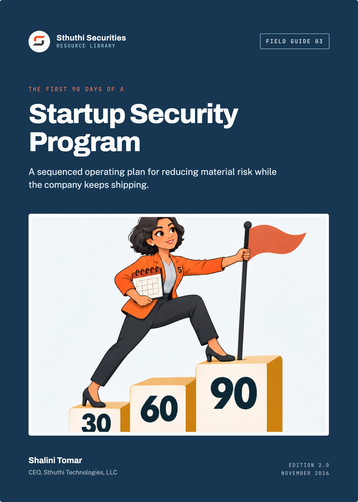
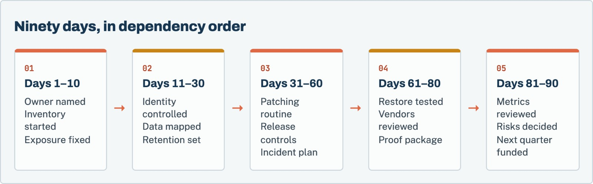

# The First 90 Days of a Startup Security Program

*A sequenced operating plan for reducing material risk while the company keeps shipping*

**Shalini Tomar**, CEO, Sthuthi Technologies, LLC  
Sthuthi Securities · Field Guide 03 · Edition 2.0 · November 2026

---

**The First 90 Days of a Startup Security Program**  
Edition 2.0, November 2026.

© 2026 Sthuthi Technologies, LLC. All rights reserved. No part of this publication may be reproduced or distributed for commercial purposes without written permission from the publisher. You may copy the companion worksheets for internal use within your own organization.

This guide is educational material. It is not legal advice, an audit opinion, a certification, or authorization to test any system. Security testing requires written permission from the system owner. Contract, privacy, employment, sector, and regional obligations should be reviewed with qualified advisers.

ParcelPilot and every other company in the worked examples are fictional. Any resemblance to a real organization is coincidental.

NIST, CIS, CISA, FTC, FIRST, and IETF names are used for identification only and imply no endorsement.

Framework versions, provider policies, and publication dates were checked against primary sources in November 2026. Requirements change; confirm the current edition before relying on a specific clause.

---

# Contents

[**Before you start**](#intro)

**PART I · AUTHORITY AND INVENTORY**

[**01   Set the business outcomes and risk ownership**](#ch1)

  Name the owner, the operator, and the outcomes.

[**02   Days 1–10: establish authority, inventory, and emergency contacts**](#ch2)

  Find every system, account, and secret, then close the doors left open.

**PART II · IDENTITY AND DATA**

[**03   Days 11–20: secure identity, devices, code, and cloud administration**](#ch3)

  MFA, separate admin accounts, and fewer standing privileges.

[**04   Days 21–30: classify data and set retention boundaries**](#ch4)

  Know what data you hold, where, and for how long.

**PART III · OPERATIONS**

[**05   Days 31–45: build vulnerability and patch operations**](#ch5)

  Find, prioritize, fix, and verify on a schedule.

[**06   Days 46–60: add secure development and release evidence**](#ch6)

  Review, checks, separation, and a record of every release.

[**07   Days 61–70: prepare incident response and recovery**](#ch7)

  A short plan, one exercise, and one restore.

**PART IV · CUSTOMERS, REVIEW, AND THE NEXT QUARTER**

[**08   Days 71–80: manage vendors and customer obligations**](#ch8)

  A supplier register and a promise register.

[**09   Days 81–90: test the program and issue the next-quarter plan**](#ch9)

  Measure, decide on residual risk, and fund the next quarter.

[**10   Worked example: ParcelPilot’s first ninety days**](#ch10)

  One company’s ninety days, block by block.

**TOOLS AND REFERENCE**

[**W   Companion worksheet pack**](#worksheets)

  13 worksheets as a separate printable PDF, Word, and Excel download.

[**A   Starter metrics and review cadence**](#appendix-a)

[**B   Policy starter set**](#appendix-b)

[**S   Sources**](#sources)

---

**INTRODUCTION**

# Before you start

*Most startups do not need a security department in their first year. They need ninety days of deliberate work that removes the obvious ways to lose.*

The first person asked to “own security” at a startup usually inherits a mess that nobody made on purpose. Cloud accounts were created by whoever needed them. Two former contractors still have access to the code. The production database password lives in a chat thread from 2024. A customer has just asked for a security questionnaire, and the board wants to know whether the company is “secure”.

None of this means the company is careless. It means it was busy building a product. The job now is to put a small, durable operating system around that product without stopping it from shipping.

This guide is a sequenced plan for doing that in ninety days. It is written for founders, technical leaders, and the first person asked to own security, often an engineer doing it alongside a full-time job. It assumes no dedicated security budget beyond a few tools, and no prior security experience beyond general engineering judgement.

## How the plan is sequenced

The order matters more than the speed. Each block of days produces something the next block depends on. You cannot review access properly until you know which systems exist. You cannot set patching expectations until you know which assets are exposed. You cannot write a useful incident plan until you know who can make decisions and where the important data lives.

*Figure 1. Each block produces the record the next block depends on. Customer-facing proof comes last because it describes controls that now exist.*

If you have less time, keep the order and shorten each block. If you have more help, run blocks in parallel only where the dependency allows it.

## What “done” looks like at day 90

At the end of the plan you should be able to show, from records rather than memory:

- A named executive who owns security risk, and a named operator who runs the program.
- An inventory of systems, accounts, data, and suppliers, with an owner for each.
- Phishing-resistant multi-factor authentication for administrators and enforced MFA for everyone else.
- A routine for finding, prioritizing, and fixing vulnerabilities, with measured timelines.
- Release controls on every path that can change production.
- An incident plan that has been exercised once, and a backup that has been restored once.
- A supplier register and a short, accurate customer-facing security overview.
- A risk register with decisions, and a funded plan for the next quarter.

## How to use the worksheets

Each chapter points to one or more worksheets in the companion pack, which is a separate download in PDF, Word, and Excel formats. Fill them in as you go. By day 90 the completed pack is your program’s first evidence file.

> **A note on scope**
>
> This is educational material, not legal advice or an audit opinion. Sector, privacy, and regional obligations vary. Where a step depends on law or contract, the guide says so; involve qualified advisers there.

---

**PART I · CHAPTERS 1–2**

# Authority and inventory

*Before you change anything, decide who owns the risk, and find out what you are protecting.*

---

**CHAPTER 01 · AUTHORITY AND INVENTORY**

## Set the business outcomes and risk ownership

*A security program without an owner becomes a list of good intentions. Start by naming who decides.*

Security work competes with product work for the same engineers. If nobody with authority has said what the work is for, it loses every time a release date slips. The first task is therefore not technical. It is to agree, in writing, why the company is doing this and who decides when security and delivery conflict.

### Two roles, even if one person holds both

Name an **accountable executive**, usually the CEO or CTO, who owns security risk for the company. This person accepts or rejects residual risk, approves spending, and answers to the board and to customers. Name an **operating owner** who runs the program day to day: maintains the inventory, chases remediation, prepares evidence, and raises decisions to the executive. In a twenty-person company these may be the same person. Write both names down anyway, because the roles will separate as the company grows.

NIST’s Cybersecurity Framework 2.0 added a Govern function in 2024 for exactly this reason: risk strategy, roles, and oversight sit above the technical controls and shape them.[1] You do not need to adopt the framework to borrow the idea.

### Write three to five outcomes

Avoid outcomes like “be secure” or “achieve SOC 2”. Use outcomes the business recognizes and you can verify at day 90:

- No production system or customer data reachable through an account without MFA.
- Every customer-data store identified, owned, and covered by backup that has been restored at least once.
- Critical and known-exploited vulnerabilities on internet-facing systems fixed within an agreed time.
- An accurate security overview ready for enterprise prospects.
- A decision record for every known high risk that is not being fixed this quarter.

### Agree the rules for conflict

Decide now how security work gets time. A common pattern is a fixed share of engineering capacity, for example one engineer-day per week, plus a rule that anything rated critical interrupts planned work. Whatever you choose, write it in the charter and get the executive to sign it.

> **Worksheet 01 · in the companion pack**
>
> **Security charter and ownership.** Use the printable or editable version from the [companion worksheet pack](#worksheets).

### Tell the team

Send a short note to the whole company: who owns security, what will change in the next ninety days, and how to report something suspicious. People will forgive new controls they were warned about. They resent controls that appear without explanation.

**Before you move on**

- [ ] The accountable executive and operating owner are named in writing.
- [ ] Three to five outcomes are agreed and can be verified at day 90.
- [ ] The rule for security work versus delivery work is signed.
- [ ] The company knows who to tell about a security concern.

---

**CHAPTER 02 · AUTHORITY AND INVENTORY**

## Days 1–10: establish authority, inventory, and emergency contacts

*You cannot protect systems you do not know about. Inventory first, then fix what is obviously exposed.*

The first ten days are for finding things. Resist the temptation to start fixing as soon as you find the first problem, unless it is an emergency, such as an exposed credential or a public storage bucket holding customer data. Those you fix immediately. Everything else goes on the list.

### What to inventory

Start with the places where control over the company actually lives:

- **Domains and DNS.** Registrar accounts, DNS providers, and who can change them. Losing a domain means losing email, sign-in, and customer trust together.
- **Identity.** The workforce identity provider, email administrators, and any application that has its own separate user list.
- **Cloud accounts.** Every account, subscription, or project, including the ones created for experiments. Record the root or owner credentials and who holds them.
- **Source code.** Organizations, repositories, administrators, and integrations with write access.
- **Production data stores.** Databases, object storage, search indexes, warehouses, and backups.
- **Secrets.** Where API keys, database credentials, and signing keys are stored, and who can read them.
- **Critical suppliers.** Services that store customer data or that the product cannot run without.
- **Devices.** Laptops and phones that hold company data or can reach production.

The CIS Critical Security Controls start with enterprise asset and software inventory for the same reason: every later control depends on knowing what exists.[2]

> **Worksheet 02 · in the companion pack**
>
> **Asset and account inventory.** Use the printable or editable version from the [companion worksheet pack](#worksheets).

### Fix the obvious exposure

While inventorying, you will find problems. Fix these within the ten days:

- Credentials committed to repositories or pasted in chat. Rotate them, then remove them.
- Storage buckets or databases reachable from the internet without authentication.
- Accounts belonging to people who have left.
- Shared administrator logins with no MFA.
- Internet-facing systems running software that no longer receives security updates.

Record each fix with a date. These are the first entries in your evidence file, and they are often the most important work of the quarter.

### Build the emergency contact sheet

Write one page that answers: if something goes badly wrong at 2 a.m. on a Sunday, who gets called, and how? Include the executive, the operating owner, whoever can change DNS and cloud configuration, your cloud provider’s support route, your domain registrar, legal counsel, and your cyber insurer if you have one. Store a copy somewhere that does not depend on company email or chat, because those may be the systems affected.

> **Worksheet 03 · in the companion pack**
>
> **Emergency contact sheet.** Use the printable or editable version from the [companion worksheet pack](#worksheets).

> **Common day-ten surprise**
>
> Most teams discover at least one cloud account, domain, or SaaS administrator account that nobody currently employed can access. Recovering control of it, through the provider’s ownership verification process, is a priority, not a chore.

**Before you move on**

- [ ] Every domain, cloud account, repository organization, and production data store has a named owner.
- [ ] Exposed credentials have been rotated, and their rotation is recorded.
- [ ] Departed staff and contractors have been removed from every system found.
- [ ] The emergency contact sheet exists outside company email and chat.

---

**PART II · CHAPTERS 3–4**

# Identity and data

*Control who can get in, then decide what data you hold, where it lives, and how long you keep it.*

---

**CHAPTER 03 · IDENTITY AND DATA**

## Days 11–20: secure identity, devices, code, and cloud administration

*Most serious incidents at small companies begin with one stolen login. Make that login much harder to use.*

With the inventory in hand, turn to access. The goal for these ten days is that every route into production or customer data requires a strong, individual identity, and that the most powerful routes are few, logged, and protected with phishing-resistant authentication.

### Centralize workforce identity

Connect business applications to one identity provider through single sign-on wherever the application supports it. When someone leaves, disabling one account should remove most of their access. For applications that do not support SSO, record them in the inventory and add them to the offboarding checklist by name.

### Require strong authentication

Enforce MFA for every workforce account by policy, not by request. For administrators of the identity provider, cloud accounts, code hosting, and DNS, use phishing-resistant methods such as hardware security keys or passkeys. NIST’s current authentication guidance, SP 800-63B-4 from 2025, treats phishing resistance as a central property of strong authentication, and favours these methods over codes sent by SMS.[3]

### Separate everyday and administrator accounts

People who administer cloud or identity systems should do routine work, such as email, documents, and browsing, from an account that cannot change production. Administrative work happens from a separate, more tightly protected account or through time-limited elevation. This single change removes a large class of attacks that start with a phishing email.

### Reduce standing access to production

List everyone who can reach production data directly: through the cloud console, database clients, admin panels, or support tools. Ask whether each person needs that access every day. Where they do not, move them to on-request access that expires and is logged. Keep a small number of break-glass credentials for emergencies, stored securely and tested quarterly.

> **Worksheet 04 · in the companion pack**
>
> **Identity and administrator access review.** Use the printable or editable version from the [companion worksheet pack](#worksheets).

### Protect code and the build path

Require MFA on the code host. Protect main branches so that changes need review and passing checks before merge. Limit who can change repository settings, secrets, and deployment workflows. Review third-party applications and tokens with write access to repositories, and remove the ones nobody can explain.

### Baseline devices

You do not need a full device-management rollout in ten days, but you do need the basics on any laptop that can reach production: full-disk encryption, automatic operating-system updates, a screen lock, and the ability to remove company access if the device is lost. Record which devices meet the baseline.

**Before you move on**

- [ ] MFA is enforced for every workforce account, and administrators use phishing-resistant methods.
- [ ] Administrators use separate accounts or time-limited elevation for administrative work.
- [ ] Standing production access is limited to a short, named list.
- [ ] Main branches are protected and repository write integrations have been reviewed.
- [ ] Every device that can reach production meets the baseline.

---

**CHAPTER 04 · IDENTITY AND DATA**

## Days 21–30: classify data and set retention boundaries

*You cannot lose data you do not hold. Map what you collect, then decide how long to keep it.*

Data work sounds like paperwork. It is the part of the program that most changes the impact of an incident. A breach of a database holding three months of records is a different event from a breach of one holding seven years of records nobody needed.

### Use a small classification scheme

Three or four levels are enough at this stage:

| Level | What it covers | Examples |
|---|---|---|
| Restricted | Data whose exposure causes serious harm to customers or the company | Customer content, credentials, payment references, health or government identifiers |
| Confidential | Internal data that should not be public | Contracts, financials, employee records, source code |
| Internal | Everyday business information | Plans, internal documentation |
| Public | Approved for publication | Marketing site, public documentation |

Then map each data store from your inventory to the highest level of data it holds. A log store that captures request bodies may be Restricted, even though nobody meant it to be.

> **Worksheet 05 · in the companion pack**
>
> **Data classification map.** Use the printable or editable version from the [companion worksheet pack](#worksheets).

### Follow the data, not the org chart

For each Restricted data type, trace where it enters, where it is stored, which services process it, which suppliers receive it, and where it leaves. Look closely at the places teams forget: error tracking, analytics, support tools, data exports in shared drives, AI features that send content to a model provider, and copies of production data used for testing.

### Set retention you can actually enforce

For each data store, decide how long data is kept and what happens when the period ends. Start from what the business and contracts need, and confirm legal requirements with counsel. Then check whether the system can actually delete on that schedule. A retention rule that nobody implements is worse than none, because it is a written promise you are breaking.

Backups need their own line. Most backup systems cannot remove one customer’s records from an existing backup, so deleted data persists until the backup expires. Write that down honestly. It is the answer customers need when they ask about deletion.

> **Worksheet 06 · in the companion pack**
>
> **Retention schedule.** Use the printable or editable version from the [companion worksheet pack](#worksheets).

### Stop collecting what you do not need

The cheapest data control is not collecting the data at all. Review signup forms, event tracking, and logs for fields nobody uses. Remove them. The FTC’s long-standing guidance to businesses makes the same point: do not collect personal information you do not need, and do not keep it longer than you need it.[7]

**Before you move on**

- [ ] Every data store in the inventory has a classification level.
- [ ] Restricted data flows are traced to every supplier and copy.
- [ ] Each store has a retention period and a working deletion method, or a recorded exception.
- [ ] Backup retention is stated honestly.

---

**PART III · CHAPTERS 5–7**

# Operations

*Make vulnerability work routine, put controls on the path to production, and prepare for the day something goes wrong.*

---

**CHAPTER 05 · OPERATIONS**

## Days 31–45: build vulnerability and patch operations

*The aim is not zero vulnerabilities. It is a loop that finds them, ranks them sensibly, and closes them within times you can prove.*

Vulnerability management at a small company fails in one of two ways. Either nobody looks, or someone turns on every scanner at once and produces two thousand findings that nobody can triage. Both end in the same place. Start narrow, measure, and expand.

### Choose your sources

Begin with the sources most likely to matter:

- **Dependency scanning** on every repository, so known-vulnerable libraries are flagged in pull requests.
- **Container and image scanning** if you deploy containers.
- **Cloud configuration checks** for public exposure, logging, and identity misconfiguration.
- **External scanning** of internet-facing hosts and services.
- **A way for outsiders to report issues.** Publish a security.txt file and a short disclosure policy so researchers know where to send what they find.[10]

### Rank by exploitability and exposure

Severity scores such as CVSS are a starting point.[9] Two other questions usually matter more: is this vulnerability being exploited in the wild, and can an attacker reach the affected component? CISA’s Known Exploited Vulnerabilities catalog answers the first question for free.[4] Your inventory answers the second. A medium-rated flaw on an internet-facing login page that appears in the catalog outranks a critical-rated flaw in a library function your code never calls.

### Set timelines you will meet

Pick remediation targets by priority, not just by severity score. Then measure against them from the first week. If the honest median for high-priority items turns out to be forty days, either add capacity or change the target. Publishing numbers you do not meet creates a contradiction a customer or auditor will eventually find.

| Priority | Typical trigger | Target | Exception approved by |
|---|---|---|---|
| Urgent | Known exploited and reachable | Days, not weeks | Accountable executive |
| High | Critical or high severity, reachable | Agreed number of days | Operating owner |
| Normal | Other confirmed findings | Next planned cycle | Team lead |
| Low | Informational, defense in depth | Backlog review | Team lead |

> **Worksheet 07 · in the companion pack**
>
> **Vulnerability targets and backlog tracker.** Use the printable or editable version from the [companion worksheet pack](#worksheets).

### Close the loop

A ticket marked done is not a fixed vulnerability. Scanner findings should disappear on the next scan. Externally reported or penetration-test findings should be retested. Keep the original finding, the fix, and the verification together, with dates.

**Before you move on**

- [ ] Dependency, cloud configuration, and external scanning are running on a schedule.
- [ ] A security contact and disclosure policy are published.
- [ ] Priority considers exploitation and exposure, not just severity.
- [ ] Targets are written down and measured from the first week.

---

**CHAPTER 06 · OPERATIONS**

## Days 46–60: add secure development and release evidence

*Every path that can change production is a path an attacker can use. Put controls on each one.*

By now the most powerful accounts are protected and the obvious vulnerabilities are being worked. The next exposure is the delivery pipeline: the code host, build system, and deployment tooling that can change production on your behalf.

### Map the paths to production

List every way a change can reach production: merges that trigger deployment, manual deploy commands, infrastructure-as-code pipelines, database migrations, feature flags, and direct console changes. Each one needs an owner and a control. Start with the paths that run most often and the ones that bypass review.

### Put a small set of controls on each path

- **Review.** Changes to production code and infrastructure need approval from someone other than the author.
- **Automated checks.** Tests, dependency scanning, secret scanning, and static analysis where it is useful, all required before merge.
- **Separation.** Development and staging cannot reach production data. Production credentials are not available to build jobs that do not need them.
- **Deploy from the pipeline.** Production changes come from the pipeline, not from laptops. Where manual access is necessary, it is time-limited and logged.
- **Rollback.** Every deploy can be reversed, and the team has practised it.

NIST’s Secure Software Development Framework (SP 800-218) groups practices like these into preparing the organization, protecting the software, producing well-secured software, and responding to vulnerabilities.[5] CISA’s Secure by Design work makes a related argument: that the security of a product should not depend on its customers configuring it correctly.[8]

> **Worksheet 08 · in the companion pack**
>
> **Release control checklist.** Use the printable or editable version from the [companion worksheet pack](#worksheets).

### Add design review where it matters

You do not need a threat model for every ticket. You do need a short design review for changes to authentication, authorization, tenant isolation, payment flows, data export, and anything that sends customer data to a new supplier. Thirty minutes with a template is enough. Record the decision.

### Keep release evidence by default

The best evidence is produced as a side effect of normal work: merged pull requests with approvals and passing checks, pipeline logs, and deployment records. Make sure these are retained long enough to answer a customer or auditor question about a release from last year.

**Before you move on**

- [ ] Every path to production is listed, with an owner.
- [ ] Review and automated checks are enforced, not just recommended.
- [ ] Production deploys come from the pipeline, and rollback has been practised.
- [ ] Security-relevant changes get a short, recorded design review.

---

**CHAPTER 07 · OPERATIONS**

## Days 61–70: prepare incident response and recovery

*An incident plan is tested by its first use. Make sure the first use is an exercise, not a real event.*

### Write a short plan

The plan should fit on a few pages and answer:

- Who can declare an incident, and how?
- How is severity decided, and what changes at each level?
- Who leads the response, and who makes decisions about customers, regulators, and law enforcement?
- How is evidence preserved before systems are changed?
- How does the team communicate if email or chat is affected?
- Who contacts the cyber insurer and legal counsel, and when?

NIST revised its incident-response guidance in April 2025. SP 800-61 Revision 3 presents incident response as part of overall cybersecurity risk management, organized around the CSF 2.0 functions, rather than as a stand-alone lifecycle.[6] For a small team, the practical lesson is that preparation and recovery deserve as much attention as the response itself.

> **Worksheet 09 · in the companion pack**
>
> **Incident response quick card.** Use the printable or editable version from the [companion worksheet pack](#worksheets).

### Run one tabletop exercise

Pick a realistic scenario, such as a leaked cloud key used to copy a database, or a support account used to export a customer’s records. Walk through it for an hour with engineering, support, leadership, and whoever handles legal and communications. Write down what you would do at each step, what you did not know, and what you will change. One exercise teaches more than any template.

### Test a restore

Pick the system you most need to recover, usually the primary database, and restore it from backup into an isolated environment. Time the restore. Record what broke. Most teams discover at least one missing permission, undocumented step, or backup that does not contain what they assumed. A successful backup job is not a demonstrated recovery.

> **Worksheet 10 · in the companion pack**
>
> **Restore test record.** Use the printable or editable version from the [companion worksheet pack](#worksheets).

> **Two numbers you will be asked for**
>
> Recovery time objective (how long until the service is back) and recovery point objective (how much data you could lose). Base both on the restore you just timed, not on what the architecture should achieve in theory.

**Before you move on**

- [ ] A short incident plan names decision-makers and an out-of-band communication route.
- [ ] One tabletop exercise is complete and written up.
- [ ] One restore has been timed, and its problems have been fixed or logged.

---

**PART IV · CHAPTERS 8–10**

# Customers, review, and the next quarter

*Manage the suppliers you depend on, describe the program honestly to customers, and turn ninety days of work into a funded plan.*

---

**CHAPTER 08 · CUSTOMERS, REVIEW, AND THE NEXT QUARTER**

## Days 71–80: manage vendors and customer obligations

*Your suppliers hold some of your customers’ data. Your contracts hold some of your promises. Know both.*

By day 70 you know where your data lives. Some of it lives with other companies: your cloud provider, email platform, support desk, analytics, error tracking, and perhaps an AI provider. And some of your obligations live in documents you may never have read closely: customer contracts, data processing agreements, and the security pages on your own website.

### Build a supplier register

For each supplier in the inventory that stores or processes customer data, or that the product cannot run without, record:

- What it does for you, and what data it receives.
- Where it processes that data.
- Who in your company owns the relationship.
- What assurance it offers, such as a SOC 2 report, ISO/IEC 27001 certificate, or a published security page, and when you last looked.
- How you would leave: export path, notice period, and what happens to your data.

Focus on the suppliers that matter. A payroll provider and a cloud host deserve a real review. A font library does not.

> **Worksheet 11 · in the companion pack**
>
> **Supplier register.** Use the printable or editable version from the [companion worksheet pack](#worksheets).

### Read your own promises

Collect every place where the company has made a security commitment: customer contracts and security addenda, data processing agreements, past questionnaire answers, the security page on your website, and sales decks. List each commitment: breach notification timelines, encryption claims, data location, deletion periods, penetration-test frequency, and certifications.

Then compare that list with what is true at day 70. Where a promise exceeds reality, decide whether to change the control or the promise, and who will tell affected customers if a contract is involved. This is uncomfortable work. It is much less uncomfortable than having a customer discover the gap during an incident.

> **The most common mismatch**
>
> A sales or marketing page claims “bank-level encryption” or “SOC 2 compliant” before any report exists. Replace marketing claims with plain, specific statements you can show evidence for.

### Write a short security overview

With the program now in place, write a two- to four-page overview for prospects: the product boundary, hosting and regions, how access is controlled, how data is protected, how vulnerabilities and releases are managed, how incidents are handled, and which suppliers process customer data. Date it and name an owner. It will answer half of most questionnaires on its own.

**Before you move on**

- [ ] Every supplier that holds customer data is in the register with an owner and a last-review date.
- [ ] Every external security promise is listed and checked against reality.
- [ ] Overstated claims have been corrected or scheduled for correction.
- [ ] A dated security overview is ready to share.

---

**CHAPTER 09 · CUSTOMERS, REVIEW, AND THE NEXT QUARTER**

## Days 81–90: test the program and issue the next-quarter plan

*The last ten days are for finding out what the first eighty actually achieved, and deciding what to do next.*

### Check the outcomes against the record

Go back to the outcomes in the charter from chapter 1. For each one, find the evidence that shows it was met, or record that it was not. Do not mark an outcome complete because the work was started. Mark it complete because the record shows the control is operating.

### Look at a few honest numbers

A handful of measurements tells you more than a dashboard full of them:

| Measure | What it shows |
|---|---|
| Accounts without MFA | Whether identity controls actually cover everyone |
| Standing production access count | Whether privilege is shrinking or creeping back |
| Median age of open high-priority vulnerabilities | Whether the remediation loop is keeping up |
| Releases that bypassed review | Whether release controls are real |
| Days since last restore test | Whether recovery is still proven |
| Suppliers overdue for review | Whether the register is being maintained |
| External promises not matched by controls | Whether customers are being told the truth |

### Decide on the risks you are not fixing yet

Some risks will remain open at day 90. That is normal. What matters is that each one has an owner, a written description, the controls already in place, and a decision by the accountable executive to accept it for a stated period, reduce it, or fund a fix. A risk nobody decided on is a risk the company is carrying without knowing it.

> **Worksheet 12 · in the companion pack**
>
> **Risk decision record.** Use the printable or editable version from the [companion worksheet pack](#worksheets).

### Run a light internal check

Ask someone who did not do the work, such as another engineer, an adviser, or an outside assessor, to pick five controls and ask for the evidence. The questions they ask are the questions a customer or auditor will ask next quarter.

### Write the next-quarter plan

The plan for days 91 to 180 should come from what you observed, not from a generic list. Typical candidates include a first independent penetration test, readiness work for a SOC 2 or ISO/IEC 27001 audit if customers require one, broader device management, logging and alerting improvements, and the remediation backlog. Estimate effort, name owners, and get the executive to fund it.

> **Worksheet 13 · in the companion pack**
>
> **Ninety-day control board and next-quarter backlog.** Use the printable or editable version from the [companion worksheet pack](#worksheets).

**Before you move on**

- [ ] Each charter outcome is marked met or not met, with evidence.
- [ ] The seven measures above have current values.
- [ ] Every open high risk has a decision from the accountable executive.
- [ ] The next-quarter plan is owned, estimated, and funded.

---

**CHAPTER 10 · CUSTOMERS, REVIEW, AND THE NEXT QUARTER**

## Worked example: ParcelPilot’s first ninety days

*A fictional 24-person logistics SaaS company with no security employee and its first enterprise prospect.*

ParcelPilot sells shipment-tracking software to mid-sized retailers. It has 24 employees, 15 of them engineers, and runs on one cloud provider in one region. In September a large retailer asked for a security questionnaire and an annual penetration test as a condition of a three-year contract. The CTO, Arjun, became the accountable executive. A senior backend engineer, Mei, became the operating owner, with one day a week protected for the work.

| Starting point | ParcelPilot in September |
|---|---|
| Company | 24 people, 15 engineers, shipment-tracking SaaS for mid-sized retailers |
| Hosting | One cloud provider, one region |
| Trigger | A three-year enterprise contract conditional on a questionnaire and an annual penetration test |
| Owners | Arjun, CTO, accountable executive. Mei, senior backend engineer, operating owner with one protected day a week |

### Days 1–10: what the inventory found

Mei’s inventory turned up four cloud accounts instead of the expected two. One had been created for a 2024 hackathon and still held a copy of production data from that year. Two former contractors retained write access to the main repository. A database password appeared in a pinned chat message. The domain registrar account was in the name of a co-founder who had left the year before.

She rotated the database password and moved it to the secret manager on day 3. She removed the contractors on day 4, deleted the hackathon account’s data copy after confirming nobody needed it on day 6, and started the registrar’s ownership transfer process on day 7. Each fix went into the evidence file with a date.

### Days 11–30: identity and data

The company already used a workforce identity provider, but MFA was optional and seven people had not enrolled. Mei made it mandatory with a one-week warning. The four people with cloud administrator rights received hardware security keys and separate administrator accounts. Standing production database access dropped from nine people to two, with on-request access for the rest.

The data map surprised everyone. The error-tracking service was capturing full request bodies, including recipient addresses and phone numbers. Mei configured scrubbing for those fields, added the service to the supplier register as a processor of Restricted data, and set a 30-day retention on its events. Shipment history had no retention limit at all. Arjun agreed with the head of customer success on 24 months, with longer retention as a contract option.

### Days 31–60: operations

Dependency scanning on the main repositories produced 312 findings on the first run. Mei did not try to fix them all. She filtered to internet-facing services and cross-checked against CISA’s known-exploited catalog, which left 11 items. Nine were fixed within two weeks. Two required a framework upgrade and were scheduled with a recorded risk decision. The team adopted priority targets based on what it measured over that first month.

The release review found that two engineers could still deploy from their laptops with long-lived credentials. Those credentials were revoked, and deploys moved to the pipeline. Branch protection was turned on for the three repositories that could reach production.

### Days 61–70: incident and recovery

The tabletop exercise used the scenario of a leaked API key being used to export customer shipment data. It revealed that nobody knew how to contact the cyber insurer, and that the support team had no way to reach engineering outside business hours. Both went into the incident quick card. The restore test of the primary database took 3 hours 40 minutes, longer than anyone had assumed, because the restore role lacked a permission. That was fixed, and a second test took 1 hour 50 minutes.

### Days 71–90: customers and the next quarter

The supplier register listed 14 suppliers, six of which handled customer data. The review of external promises found that the website claimed data was “encrypted end to end”, which was not accurate for the product’s architecture. The page was rewritten to describe encryption in transit and at rest precisely. The security overview was written in four pages and sent to the retailer with the questionnaire.

At day 90, four of the five charter outcomes were met. The fifth, a timed restore for every customer-data store, was met for the primary database but not yet for the search index. Arjun accepted that gap for 45 days with a named owner. The next-quarter plan funded an independent penetration test of the web application and API before the retailer’s contract start date, device management for all laptops, and the framework upgrade.

> **What made the difference**
>
> Not tools. ParcelPilot added only a secret manager and hardware keys. What made the difference was a protected day each week, an inventory that was finished before fixes started, and an executive who made decisions on the risks that could not be fixed yet.

---

**TOOLS · COMPANION DOWNLOAD**

# The companion worksheet pack

*The 13 worksheets referred to in this guide are a separate download, so you can print them, fill them in, and share them with your team without copying pages out of the book.*

Download the pack from the same page as this guide in the Sthuthi Securities resource library at [sthuthi-tech.com](https://sthuthi-tech.com). It comes in three formats:

- **Printable PDF.** Each worksheet starts on a new A4 page, with lined fields for writing by hand.
- **Editable Word document.** The same worksheets as fill-in tables you can type into.
- **Excel workbook.** One tab per worksheet, with registers set up as working trackers.

| # | Worksheet | Use with |
|---|---|---|
| 01 | Security charter and ownership | Chapter 1 |
| 02 | Asset and account inventory | Chapter 2 |
| 03 | Emergency contact sheet | Chapter 2 |
| 04 | Identity and administrator access review | Chapter 3 |
| 05 | Data classification map | Chapter 4 |
| 06 | Retention schedule | Chapter 4 |
| 07 | Vulnerability targets and backlog tracker | Chapter 5 |
| 08 | Release control checklist | Chapter 6 |
| 09 | Incident response quick card | Chapter 7 |
| 10 | Restore test record | Chapter 7 |
| 11 | Supplier register | Chapter 8 |
| 12 | Risk decision record | Chapter 9 |
| 13 | Ninety-day control board and next-quarter backlog | Chapter 9 |

---

**APPENDIX A · REFERENCE**

# Starter metrics and review cadence

*A small set of measures to carry into the second quarter.*

| Measure | How to collect it | Review |
|---|---|---|
| Workforce accounts without MFA | Identity-provider report | Monthly |
| People with standing production access | Cloud and database role export | Monthly |
| Open high-priority vulnerabilities and median age | Vulnerability tracker | Fortnightly |
| Known-exploited vulnerabilities on exposed assets | Tracker filtered against the CISA catalog | Weekly |
| Releases without required review | Code-host audit log | Monthly |
| Days since last restore test, per critical store | Restore test record | Quarterly |
| Suppliers overdue for review | Supplier register | Quarterly |
| Open risks past their decision date | Risk register | Monthly |
| External promises not matched by controls | Promise list from chapter 8 | Quarterly |

---

**APPENDIX B · REFERENCE**

# Policy starter set

*Short policies that describe what the company actually does. Keep each to one or two pages.*

Write policies after the controls exist, so they describe real practice. Each should name an owner, an approval date, and a review date. A starter set for a company at day 90:

| Policy | What it should cover |
|---|---|
| Information security policy | Scope, roles, the charter outcomes, and how exceptions are approved |
| Access control | SSO, MFA, administrator accounts, production access, joiners, movers, leavers, and reviews |
| Acceptable use | Device baseline, handling of company and customer data, and reporting concerns |
| Data classification and retention | The levels, handling rules, and retention schedule from chapter 4 |
| Vulnerability management | Sources, priority rules, targets, verification, and exceptions |
| Secure development and change | Review, automated checks, environment separation, and release controls |
| Incident response | The plan from chapter 7, roles, severity, and communication |
| Business continuity and backup | Backup scope, restore testing, and recovery objectives |
| Supplier management | The register, review expectations, and onboarding of new processors |

---

**SOURCES · REFERENCE**

# Sources

Sources were checked in November 2026. Recommendations in this guide are Sthuthi Securities guidance, not requirements of any framework listed here unless the text says so.

1. **NIST.** The NIST Cybersecurity Framework (CSF) 2.0. [https://www.nist.gov/publications/nist-cybersecurity-framework-csf-20](https://www.nist.gov/publications/nist-cybersecurity-framework-csf-20)
2. **Center for Internet Security.** CIS Critical Security Controls Version 8.1. [https://www.cisecurity.org/controls/v8-1](https://www.cisecurity.org/controls/v8-1)
3. **NIST.** SP 800-63B-4, Digital Identity Guidelines: Authentication and Authenticator Management, 2025. [https://csrc.nist.gov/pubs/sp/800/63/b/4/final](https://csrc.nist.gov/pubs/sp/800/63/b/4/final)
4. **CISA.** Known Exploited Vulnerabilities Catalog. [https://www.cisa.gov/known-exploited-vulnerabilities-catalog](https://www.cisa.gov/known-exploited-vulnerabilities-catalog)
5. **NIST.** SP 800-218, Secure Software Development Framework (SSDF) Version 1.1. [https://csrc.nist.gov/pubs/sp/800/218/final](https://csrc.nist.gov/pubs/sp/800/218/final)
6. **NIST.** SP 800-61 Rev. 3, Incident Response Recommendations and Considerations for Cybersecurity Risk Management: A CSF 2.0 Community Profile, April 2025. [https://csrc.nist.gov/news/2025/nist-revises-sp-800-61](https://csrc.nist.gov/news/2025/nist-revises-sp-800-61)
7. **U.S. Federal Trade Commission.** Start with Security: A Guide for Business. [https://www.ftc.gov/business-guidance/resources/start-security-guide-business](https://www.ftc.gov/business-guidance/resources/start-security-guide-business)
8. **CISA.** Secure by Design. [https://www.cisa.gov/securebydesign](https://www.cisa.gov/securebydesign)
9. **FIRST.** Common Vulnerability Scoring System version 4.0. [https://www.first.org/cvss/v4-0/](https://www.first.org/cvss/v4-0/)
10. **IETF.** RFC 9116, A File Format to Aid in Security Vulnerability Disclosure (security.txt). [https://www.rfc-editor.org/rfc/rfc9116](https://www.rfc-editor.org/rfc/rfc9116)

---

**ABOUT · STHUTHI SECURITIES**

# About the author

**Shalini Tomar** is the CEO of Sthuthi Technologies, LLC, and leads its cybersecurity practice, Sthuthi Securities. She works with SaaS teams that need to show enterprise buyers clear, scoped, and current evidence of how their products are secured.

# About Sthuthi Securities

Sthuthi Securities is the cybersecurity practice of Sthuthi Technologies, LLC. It tests web applications, APIs, cloud systems, and AI agents, then helps teams fix and retest what it finds. Engagements are scoped in writing and authorized by the system owner, and they end with findings and evidence a buyer’s reviewer can use.

Penetration testing

Web application, API, and cloud testing with clear scope and safe rules of engagement.

AI security assessment

Tool permissions, tenant isolation, and prompt-injection testing for AI agents.

Remediation support

Working with your engineers to fix the cause, not just the symptom.

Retesting and evidence

Independent verification and summary letters you can share with buyers.

More field guides at sthuthi-tech.com

Passing enterprise security reviews · Scoping a web app and API penetration test · Preparing for a customer audit · Repeatable security testing · AI security for support agents · Security proof for enterprise deals

---
