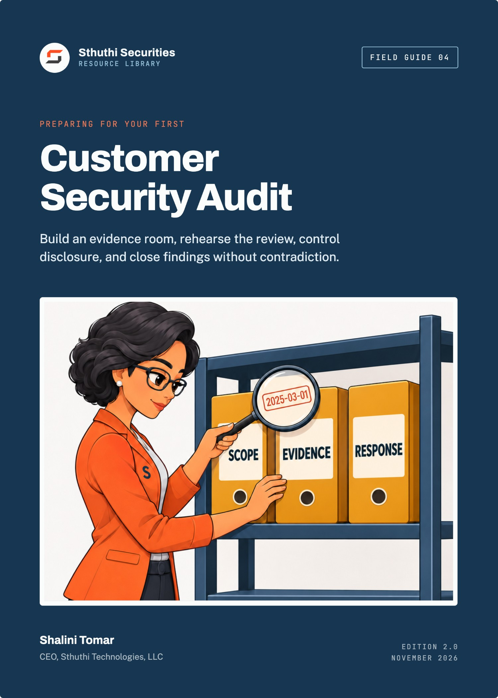
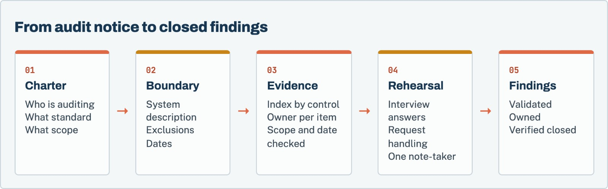

# Preparing for Your First Customer Security Audit

*Build an evidence room, rehearse the review, control disclosure, and close findings without contradiction*

**Shalini Tomar**, CEO, Sthuthi Technologies, LLC  
Sthuthi Securities · Field Guide 04 · Edition 2.0 · November 2026

---

**Preparing for Your First Customer Security Audit**  
Edition 2.0, November 2026.

© 2026 Sthuthi Technologies, LLC. All rights reserved. No part of this publication may be reproduced or distributed for commercial purposes without written permission from the publisher. You may copy the companion worksheets for internal use within your own organization.

This guide is educational material. It is not legal advice, an audit opinion, a certification, or authorization to test any system. Security testing requires written permission from the system owner. Contract, privacy, employment, sector, and regional obligations should be reviewed with qualified advisers.

CareRoute, the hospital group, and every other organization in the worked examples are fictional. Any resemblance to a real organization is coincidental.

SOC 2 is a trademark of the AICPA. ISO, CSA, Shared Assessments, NIST, HHS, and FTC names are used for identification only and imply no endorsement.

Framework versions, provider policies, and publication dates were checked against primary sources in November 2026. Requirements change; confirm the current edition before relying on a specific clause.

---

# Contents

[**Before you start**](#intro)

**PART I · SCOPE AND EVIDENCE**

[**01   Determine what the customer is actually requesting**](#ch1)

  Charter, standard, scope, and how results are shared.

[**02   Fix the product and service boundary**](#ch2)

  One dated system description everyone answers from.

[**03   Build a control-to-evidence index**](#ch3)

  One row per control, with owner, artifact, and scope check.

**PART II · TESTING YOUR OWN EVIDENCE**

[**04   Test identity, access, change, and personnel evidence**](#ch4)

  Run the auditor’s samples before they do.

[**05   Test vulnerability, logging, incident, and continuity evidence**](#ch5)

  Show the loop, the logs, the exercise, and the restore.

[**06   Prepare policies that match operations**](#ch6)

  Policies that describe real practice, with owners and dates.

[**07   Review suppliers, privacy, retention, and customer data**](#ch7)

  Suppliers, data handling, and deletion you can demonstrate.

**PART III · PEOPLE, FINDINGS, AND A WORKED AUDIT**

[**08   Rehearse interviews and evidence requests**](#ch8)

  Direct answers, one note-taker, and no guessing.

[**09   Manage gaps, exceptions, corrective actions, and dates**](#ch9)

  Validate, plan, commit, and verify.

[**10   Worked example: CareRoute’s first customer audit**](#ch10)

  One audit, from notice to closed findings.

**TOOLS AND REFERENCE**

[**W   Companion worksheet pack**](#worksheets)

  9 worksheets as a separate printable PDF, Word, and Excel download.

[**A   Common evidence requests**](#appendix-a)

[**S   Sources**](#sources)

---

**INTRODUCTION**

# Before you start

*A customer audit is a structured request to see proof. Most of the preparation is making sure the proof exists, is current, and agrees with itself.*

A questionnaire asks what you do. An audit asks you to show it. That difference catches many SaaS companies off guard the first time a large customer exercises the audit clause in a contract, or a regulated buyer sends a document request list and a set of interview slots instead of a spreadsheet.

The audit will probably be narrower than you fear and more detailed than you expect. The customer’s assessor wants to understand a specific service, see evidence that the controls described in your contract and questionnaire really operate, and leave with findings their organization can track. They are not trying to fail you. They are trying to write a report someone else will rely on.

This guide is for SaaS founders, security owners, engineering leaders, legal teams, and the customer-facing staff who will sit in the interviews. It covers the weeks between “the audit is confirmed” and “the findings are closed”.

## How to use it

Chapters 1 and 2 set the scope. Chapters 3 to 7 build and test the evidence, domain by domain. Chapter 8 prepares the people. Chapter 9 handles what the audit finds. Chapter 10 follows one company through the whole process.

*Figure 1. Preparation runs in this order because each step depends on the one before it. Rehearsal only works once the evidence is settled.*

Each chapter points to worksheets in the companion pack, a separate download in PDF, Word, and Excel formats.

> **What this guide is not**
>
> It is not legal advice and it does not replace an independent audit. A customer audit is governed by your contract with that customer. Read the audit clause with counsel before you agree to dates, scope, or on-site access.

---

**PART I · CHAPTERS 1–3**

# Scope and evidence

*Find out exactly what is being audited, fix the description of the system, and build an index that ties every control to its proof.*

---

**CHAPTER 01 · SCOPE AND EVIDENCE**

## Determine what the customer is actually requesting

*Audits vary enormously. Before you prepare anything, find out which kind you are facing.*

“Customer audit” covers everything from a two-hour video call walking through your SOC 2 report to a week-long assessment with technical testing. Preparing for the wrong one wastes weeks. Spend the first days getting a written charter.

### Ask for the audit charter

Request the following in writing, ideally in a short kickoff call followed by an email you both confirm:

- **Who is auditing.** The customer’s internal team, a third party engaged by the customer, or both. Names and roles.
- **What standard or criteria.** Their own control framework, your contract’s security schedule, an industry framework, or a regulator’s expectations.
- **Which service.** The product, plan, environments, regions, and legal entity in scope.
- **What period.** A point in time, or how controls operated over the last six or twelve months.
- **Method.** Document review, interviews, observation, sampling, technical testing, or a combination.
- **Logistics.** Remote or on site, dates, who must attend, and how documents will be exchanged.
- **Findings.** How they are rated, how you can respond before the report is final, and who receives the report.
- **Confidentiality.** How your documents will be stored, who can see them, and when they will be destroyed.

> **Worksheet 01 · in the companion pack**
>
> **Audit charter intake.** Use the printable or editable version from the [companion worksheet pack](#worksheets).

### Check the contract

Your contract defines what the customer is entitled to. Look for limits on frequency, notice periods, scope, cost allocation, confidentiality, and whether independent reports such as SOC 2 can satisfy the audit right in whole or part. If the request goes beyond the contract, you can still agree to it, but it should be a conscious decision with the right people involved.

### Offer what you already have

If you hold a SOC 2 report, ISO/IEC 27001 certificate, or a recent penetration-test summary, offer it at the start. Many customers will narrow the audit to areas those reports do not cover. That is the single fastest way to reduce the work.[1][2]

**Before you move on**

- [ ] The charter is confirmed in writing by both sides.
- [ ] The audit request has been checked against the contract’s audit clause.
- [ ] Existing independent reports have been offered.
- [ ] A single internal audit lead is named.

---

**CHAPTER 02 · SCOPE AND EVIDENCE**

## Fix the product and service boundary

*Every interview and every document will be read against one description of the system. Write it once, date it, and make everyone use it.*

An auditor’s first job is to understand what they are looking at. Give them a system description that answers the obvious questions before they ask. Your second job is to make sure every person who speaks to the auditor describes the same system.

### What the system description covers

Keep it to a few pages:

- The service and the plans or features in scope.
- Infrastructure: cloud provider, regions, and major components.
- Customer data: what you receive, where it is stored, and how it moves.
- Users: customer roles, and internal roles with access to customer data.
- Support access: how staff reach customer accounts or data, and how that is approved and logged.
- Environments: production, staging, development, and how they are separated.
- Suppliers that process customer data.
- Exclusions: products, features, or entities outside the audit.

> **Worksheet 02 · in the companion pack**
>
> **System description checklist.** Use the printable or editable version from the [companion worksheet pack](#worksheets).

### Resolve disagreements before the auditor finds them

Circulate the draft to engineering, support, and whoever owns customer contracts. Ask each person to mark anything that is wrong or missing. You will find disagreements: the support team uses a tool engineering forgot, or a staging environment holds real data. Resolve each one now, either by changing the description or by fixing the system.

### Freeze it

Put a version number and date on the description and tell the team that this is the version used for the audit. If the system changes during the audit, update the description deliberately and tell the auditor, rather than letting interview answers drift.

> **Exclusions are not evasions**
>
> Stating clearly that the mobile app or a recently acquired product is outside scope helps the auditor plan. It only becomes a problem when an exclusion is discovered rather than declared.

**Before you move on**

- [ ] The system description covers support access and suppliers, not just infrastructure.
- [ ] Engineering, support, and contracts have each reviewed it.
- [ ] It carries a version and date, and the team knows to use it.

---

**CHAPTER 03 · SCOPE AND EVIDENCE**

## Build a control-to-evidence index

*An audit is a long series of “show me”. The index is how you answer each one in minutes rather than days.*

The control-to-evidence index is a table. Each row is a control you claim to operate. Each row names the person who owns it, the artifacts that prove it, the period they cover, and where they are stored. It is the most valuable thing you will build for the audit, and you will reuse it for every audit after.

### Start from the criteria, not from your folders

If the customer gave you a control list or framework, start from that. If not, start from the commitments in your contract and your most recent questionnaire. Each commitment becomes a row. This keeps the index focused on what you will actually be asked about.

### Assign an owner who can explain the control

The owner is the person who runs the control, not the person who uploads documents. An engineer who configured branch protection should own that row. When the auditor asks how exceptions work, the owner should be able to answer without checking with someone else.

> **Worksheet 03 · in the companion pack**
>
> **Control-to-evidence index.** Use the printable or editable version from the [companion worksheet pack](#worksheets).

### Prefer evidence that is produced by the system

The most convincing evidence comes from systems doing their normal work: identity-provider policy exports, access-review records, merged pull requests with approvals, ticket histories, scan reports, and alert logs. Screenshots are acceptable when nothing better exists. They should show the date, the system, and enough context to interpret them, with any secrets or other customers’ information removed.

### Check every artifact for scope and date

For each artifact, ask three questions:

1. Does it cover the system in the system description, or a different product or environment?
2. Does it cover the audit period, or only the day it was captured?
3. Does it contain anything that should not be shared, such as credentials, personal data, or other customers’ names?

An artifact that fails any of these is either fixed, replaced, or removed before the audit.

**Before you move on**

- [ ] Every commitment in the contract and questionnaire has a row.
- [ ] Every row has an owner who runs the control.
- [ ] Every artifact has been checked for scope, date, and sensitive content.

---

**PART II · CHAPTERS 4–7**

# Testing your own evidence

*Before the auditor samples your controls, sample them yourself. Find the gaps while you still have time to close them.*

---

**CHAPTER 04 · TESTING YOUR OWN EVIDENCE**

## Test identity, access, change, and personnel evidence

*These are the controls auditors sample most often, because they are easy to test and frequently fail.*

Auditors test operating controls by sampling. They ask for a list, such as everyone who left the company in the period, and then ask for evidence about a few items on it. If you run the same test first, you will know what they will find.

### Joiners, movers, and leavers

Pull the list of people who joined, changed role, or left during the audit period. For a sample of each, check that access was granted on approval, changed when the role changed, and removed promptly on departure, with timestamps. The most common failure is an account in a system outside single sign-on that was missed at offboarding.

### Privileged access

List everyone with administrative access to production, identity, code hosting, and DNS. Check that each person still needs it, that MFA is enforced, and that administrators use phishing-resistant methods where your commitments say so.[5] Find the most recent access review and confirm it was completed, signed off, and acted on.

### Change management

Pull a sample of production changes from the period. For each, confirm review by someone other than the author, passing checks, and deployment through the approved path. Look for changes that bypassed the process, such as emergency fixes or direct console changes, and check that they were recorded and reviewed afterwards.

### Personnel controls

If your commitments include background checks, security training, or confidentiality agreements, sample new starters and confirm each was completed. Where local law limits background checks, make sure your written commitments say so.

> **Worksheet 04 · in the companion pack**
>
> **Evidence sample test.** Use the printable or editable version from the [companion worksheet pack](#worksheets).

> **When the sample fails**
>
> Do not hide it. Record the failure, fix the cause, and decide with the audit lead whether to disclose it proactively. A control failure you found, fixed, and documented reads very differently from one the auditor discovers.

**Before you move on**

- [ ] Joiner, mover, and leaver samples have been tested for the full period.
- [ ] Privileged access has been reviewed and the review is signed off.
- [ ] A sample of production changes shows review and approved deployment.
- [ ] Personnel commitments match what was done and what local law allows.

---

**CHAPTER 05 · TESTING YOUR OWN EVIDENCE**

## Test vulnerability, logging, incident, and continuity evidence

*These controls are harder to sample, so auditors ask more questions about them. Prepare the records and the people.*

### Vulnerability management

Show the sources that feed your vulnerability backlog, the targets you have committed to, and how you actually performed against them in the period. Pull a sample of high-priority findings and show each one from discovery to verified fix. If you missed targets, show the exception approvals. If you have had a penetration test, have the summary letter ready, along with remediation and retest status for each finding.

### Logging and monitoring

Be ready to show what is logged, where logs are stored, how long they are kept, who can alter them, and what alerts exist. Pick one alert and walk through a real occurrence: when it fired, who received it, what they did, and how it was closed. A single real example is more convincing than a policy.

### Incident response

Have the incident plan, the record of your most recent tabletop exercise, and any real incidents in the period with their timelines. The auditor will want to see that roles, severity, and customer notification match what your contract promises. NIST’s current incident-response guidance, SP 800-61 Revision 3, is a useful reference for what a mature program covers.[6]

### Continuity and recovery

Show the backup scope, the most recent restore test with its date and duration, and how the result compares with any recovery objectives in your contract. If you claim a recovery time you have never tested, expect a finding.

> **Worksheet 04 · in the companion pack**
>
> **Evidence sample test.** Use the printable or editable version from the [companion worksheet pack](#worksheets).

**Before you move on**

- [ ] At least one high-priority vulnerability is traceable from discovery to verified fix.
- [ ] One real alert can be walked through from firing to closure.
- [ ] The incident plan matches contractual notification commitments.
- [ ] The most recent restore test supports any recovery objective you have promised.

---

**CHAPTER 06 · TESTING YOUR OWN EVIDENCE**

## Prepare policies that match operations

*A policy that describes what you wish you did is a finding waiting to happen. Make every policy true.*

Auditors read your policies and then check whether people follow them. The most common policy finding is not a missing policy. It is a policy that says something the company does not do: quarterly access reviews when the last one was a year ago, or a seven-day patch window that has never been met.

### Read every policy against practice

For each policy in scope, go through it line by line with the control owner. For every “must” or “will”, ask: do we do this, can we show it, and is the frequency or timeline correct? Mark each statement as true, partly true, or not true.

> **Worksheet 05 · in the companion pack**
>
> **Policy-to-practice check.** Use the printable or editable version from the [companion worksheet pack](#worksheets).

### Fix the gap in one direction or the other

Where a statement is not true, either change practice to match the policy or change the policy to match practice, and record which you chose and why. Changing the policy is legitimate when the original was copied from a template and never fit the company. It is not legitimate when it lowers a commitment you have made to customers in a contract. That needs the contract owner’s involvement.

### Make the basics visible

Every policy should show an owner, an approval date, a version, and a next review date. Keep a policy index that lists them all. If a policy was approved after the audit period started, say so. Auditors care about when a control began as much as whether it exists.

**Before you move on**

- [ ] Every policy in scope has been read against practice, line by line.
- [ ] Every untrue statement has been resolved and the decision recorded.
- [ ] Every policy shows an owner, version, approval date, and review date.

---

**CHAPTER 07 · TESTING YOUR OWN EVIDENCE**

## Review suppliers, privacy, retention, and customer data

*The customer’s data does not stop at your systems. Auditors will follow it to your suppliers and ask how long you keep it.*

### Suppliers

Have a current list of suppliers that process the customer’s data, with each one’s purpose, location, and the assurance you have reviewed, such as a SOC 2 report or ISO/IEC 27001 certificate, with the date you looked at it. If your contract requires notice before adding a supplier, show the notices you sent during the period.

> **Worksheet 06 · in the companion pack**
>
> **Supplier and data review.** Use the printable or editable version from the [companion worksheet pack](#worksheets).

### Privacy and data handling

Know your role. For most B2B SaaS products the customer controls the personal data and you process it on their instructions. Show the data processing agreement, how you handle data-subject requests the customer passes to you, and whether data leaves the regions in your system description. In regulated sectors, such as healthcare in the United States, your obligations may come from sector law as well as the contract. Involve counsel to confirm which rules apply.[8]

### Retention and deletion

Show the retention schedule for customer data, how deletion works at the end of a contract, and how long data persists in backups. If possible, show a real example: a former customer whose data was deleted on schedule, with the record of when.

### Support access to customer data

Auditors increasingly ask how support staff reach customer data. Show the approval path, the logging, and a sample of support access events with their justification.

**Before you move on**

- [ ] The supplier list is current and each supplier’s assurance has been reviewed.
- [ ] The data processing agreement and supplier notices are ready to share.
- [ ] Retention and deletion can be shown with a real example.
- [ ] Support access to customer data is approved, logged, and sampled.

---

**PART III · CHAPTERS 8–10**

# People, findings, and a worked audit

*Prepare the people who will speak to the auditor, manage what the audit finds, and follow one company from notice to closed findings.*

---

**CHAPTER 08 · PEOPLE, FINDINGS, AND A WORKED AUDIT**

## Rehearse interviews and evidence requests

*Most avoidable audit findings come from interviews where someone guessed, overstated, or contradicted a document.*

### Choose who speaks

Pick a small group: the audit lead, and one control owner per domain. Each person should be able to explain their controls, the exceptions, and the evidence without help. Avoid sending people who have not been briefed, even if they are senior.

### Use one answer pattern

Teach every speaker the same structure:

1. **Answer the question directly.** Yes, no, or partly.
2. **State the scope.** Which systems, users, or period the answer covers.
3. **Describe how it works** in one or two sentences.
4. **Point to the evidence** in the index.
5. **Name the exception**, if there is one.

If the speaker does not know, the answer is “I will confirm and come back to you by a stated time”. Guessing is the fastest way to create a finding that should not exist.

> **Worksheet 07 · in the companion pack**
>
> **Interview rehearsal sheet.** Use the printable or editable version from the [companion worksheet pack](#worksheets).

### Rehearse with hard questions

Run a mock interview for each domain. Have someone who did not prepare the evidence play the auditor. Ask follow-up questions: how do exceptions work, what happened the last time this failed, who approves it when the owner is away. Note every answer that was uncertain and fix the gap before the real interview.

### Handle requests through one channel

During the audit, every evidence request should go to the audit lead, who logs it, assigns it, checks the response for scope and sensitive content, and sends it. Nobody uploads documents directly. One person takes notes in every session and records every follow-up and every promise made.

> **Worksheet 08 · in the companion pack**
>
> **Audit request tracker.** Use the printable or editable version from the [companion worksheet pack](#worksheets).

**Before you move on**

- [ ] Each domain has a briefed speaker who can explain exceptions.
- [ ] Every speaker knows the answer pattern and the “I will confirm” rule.
- [ ] A mock interview has been run for each domain.
- [ ] One person owns the request tracker, and one person takes notes in every session.

---

**CHAPTER 09 · PEOPLE, FINDINGS, AND A WORKED AUDIT**

## Manage gaps, exceptions, corrective actions, and dates

*Findings are normal. What matters is that each one is validated, owned, and closed with evidence.*

### Validate each finding before accepting it

When the auditor shares draft findings, check each one. Is the observation accurate? Does it apply to the system in scope? Is the severity consistent with the criteria the audit used? If a finding is wrong, respond with evidence, not argument. If it is right, accept it plainly.

### Write a corrective action for each accepted finding

For each finding, record the affected scope, the cause, the planned change, any compensating control in the meantime, the owner, and the target date. Commit only to dates the owner has agreed to. A missed corrective-action date in a customer’s audit log is worse than a later date set honestly.

> **Worksheet 09 · in the companion pack**
>
> **Finding response and corrective action plan.** Use the printable or editable version from the [companion worksheet pack](#worksheets).

### Separate “done” from “verified”

When a corrective action is complete, collect evidence that the change is in place and working. If the customer requires it, send that evidence for verification. Track the finding as closed only when the customer or auditor confirms it.

### Update everything the finding touched

A finding often reveals that a policy, questionnaire answer, contract schedule, or security overview was inaccurate. Update all of them. The next customer will ask the same question.

**Before you move on**

- [ ] Each draft finding has been checked for accuracy and scope.
- [ ] Each accepted finding has an owner, a cause, a plan, and an agreed date.
- [ ] Closure requires evidence, and the customer’s confirmation where required.
- [ ] Policies, answers, and contract documents have been updated.

---

**CHAPTER 10 · PEOPLE, FINDINGS, AND A WORKED AUDIT**

## Worked example: CareRoute’s first customer audit

*A fictional healthcare workflow vendor prepares for a hospital group’s audit with document review and technical interviews.*

| Starting point | CareRoute in August |
|---|---|
| Company | 41 people. Scheduling and referral workflow software for outpatient clinics |
| Customer | A regional hospital group, exercising the audit clause in a three-year contract |
| Assurance held | SOC 2 Type II report for the prior twelve months; penetration test in March |
| Audit format | Document review, four remote interview sessions, and a sample of access and change records |

### Weeks 1–2: charter and boundary

CareRoute’s head of security, Daniel, asked for a kickoff call and confirmed the charter by email. The hospital group’s team would use its own vendor control framework, but agreed to rely on the SOC 2 report for change management and physical security. That removed roughly a third of the expected requests.

The first draft of the system description listed the production platform and its database. The support team’s review added two things nobody in engineering had mentioned: a reporting tool that support staff used to export clinic schedules, and a shared mailbox where clinics sometimes sent spreadsheets of patient referrals. Both handled patient information. Both went into the description, and the mailbox went into the gap list.

### Weeks 2–4: index and self-testing

The control-to-evidence index reached 64 rows. Daniel’s team tested their own samples. The leaver sample found that two of eleven departed staff still had accounts in the reporting tool, which was not connected to single sign-on. Both accounts were removed, the tool was added to the offboarding checklist, and a ticket was opened to connect it to SSO.

The policy review found that the access-control policy required quarterly reviews of production access. The records showed reviews in January and July only. Daniel chose to change practice rather than the policy, completed a review in August, and scheduled the rest of the year.

### Weeks 4–5: rehearsal

Four control owners ran mock interviews. The hardest question came in the support-access session: “How do you know a support agent only viewed the clinic that raised the ticket?” The honest answer was that the platform logged access but nobody reviewed those logs. The team added a monthly sample review before the audit and decided to describe it as newly introduced.

### Weeks 6–7: the audit

The auditor sent 38 evidence requests over two weeks. Each went through the tracker, and the median response time was under a day. In the interviews, one engineer began to describe a planned logging change as if it were in place. The note-taker flagged it, and the audit lead corrected the record in the session summary the next morning.

### Weeks 8–12: findings

The draft report had three findings. The first was the shared referral mailbox, rated moderate. The second was the reporting tool outside SSO, rated low because it was already disclosed and partly remediated. The third was that support-access log review had started only in August. CareRoute accepted all three and set corrective actions: retire the mailbox in favour of an in-product secure upload within 60 days, connect the reporting tool to SSO within 30 days, and provide three months of support-access review records at the next check-in.

All three were closed with evidence within the agreed dates. The hospital group renewed the following year with a shorter audit.

> **What made the difference**
>
> The support team’s review of the system description. Both of CareRoute’s real gaps were in tools engineering did not think of as part of the product. Finding them in week one turned likely serious findings into disclosed, managed ones.

---

**TOOLS · COMPANION DOWNLOAD**

# The companion worksheet pack

*The 9 worksheets referred to in this guide are a separate download, so you can print them, fill them in, and share them with your team without copying pages out of the book.*

Download the pack from the same page as this guide in the Sthuthi Securities resource library at [sthuthi-tech.com](https://sthuthi-tech.com). It comes in three formats:

- **Printable PDF.** Each worksheet starts on a new A4 page, with lined fields for writing by hand.
- **Editable Word document.** The same worksheets as fill-in tables you can type into.
- **Excel workbook.** One tab per worksheet, with registers set up as working trackers.

| # | Worksheet | Use with |
|---|---|---|
| 01 | Audit charter intake | Chapter 1 |
| 02 | System description checklist | Chapter 2 |
| 03 | Control-to-evidence index | Chapter 3 |
| 04 | Evidence sample test | Chapters 4, 5 |
| 05 | Policy-to-practice check | Chapter 6 |
| 06 | Supplier and data review | Chapter 7 |
| 07 | Interview rehearsal sheet | Chapter 8 |
| 08 | Audit request tracker | Chapter 8 |
| 09 | Finding response and corrective action plan | Chapter 9 |

---

**APPENDIX A · REFERENCE**

# Common evidence requests

*What auditors typically ask for, by domain. Use it to pre-fill the control-to-evidence index.*

| Domain | Typical requests |
|---|---|
| Governance | Security policy and index, organization chart, risk register, management review records |
| Asset and boundary | System description, architecture and data-flow diagrams, asset inventory |
| Identity and access | SSO and MFA configuration, privileged user list, access reviews, joiner/mover/leaver samples |
| Change management | Change policy, sample of production changes with approvals, emergency change records |
| Vulnerability management | Scan reports, remediation targets and performance, penetration-test summary and retest |
| Logging and monitoring | Log sources and retention, alert list, sample alert with response |
| Incident response | Incident plan, tabletop exercise record, incident log for the period |
| Continuity | Backup configuration, restore test record, recovery objectives |
| Suppliers | Supplier list, assurance reviews, data processing agreements, supplier notices |
| Privacy and data | Data processing agreement, retention schedule, deletion records, data-subject request handling |
| Personnel | Background check, training, and confidentiality agreement samples |

---

**SOURCES · REFERENCE**

# Sources

Sources were checked in November 2026. Recommendations in this guide are Sthuthi Securities guidance, not requirements of any framework listed here unless the text says so.

1. **AICPA.** System and Organization Controls: SOC suite of services. [https://www.aicpa-cima.com/resources/landing/system-and-organization-controls-soc-suite-of-services](https://www.aicpa-cima.com/resources/landing/system-and-organization-controls-soc-suite-of-services)
2. **ISO.** ISO/IEC 27001:2022, Information security management systems: Requirements. [https://www.iso.org/standard/27001](https://www.iso.org/standard/27001)
3. **Cloud Security Alliance.** Cloud Controls Matrix and CAIQ v4.1. [https://cloudsecurityalliance.org/artifacts/cloud-controls-matrix-v4-1](https://cloudsecurityalliance.org/artifacts/cloud-controls-matrix-v4-1)
4. **NIST.** The NIST Cybersecurity Framework (CSF) 2.0. [https://www.nist.gov/publications/nist-cybersecurity-framework-csf-20](https://www.nist.gov/publications/nist-cybersecurity-framework-csf-20)
5. **NIST.** SP 800-63B-4, Digital Identity Guidelines: Authentication and Authenticator Management, 2025. [https://csrc.nist.gov/pubs/sp/800/63/b/4/final](https://csrc.nist.gov/pubs/sp/800/63/b/4/final)
6. **NIST.** SP 800-61 Rev. 3, Incident Response Recommendations and Considerations for Cybersecurity Risk Management, April 2025. [https://csrc.nist.gov/news/2025/nist-revises-sp-800-61](https://csrc.nist.gov/news/2025/nist-revises-sp-800-61)
7. **Shared Assessments.** Standardized Information Gathering (SIG) Questionnaire. [https://sharedassessments.org/sig/](https://sharedassessments.org/sig/)
8. **U.S. Department of Health and Human Services.** HIPAA for Professionals. [https://www.hhs.gov/hipaa/index.html](https://www.hhs.gov/hipaa/index.html)
9. **U.S. Federal Trade Commission.** Start with Security: A Guide for Business. [https://www.ftc.gov/business-guidance/resources/start-security-guide-business](https://www.ftc.gov/business-guidance/resources/start-security-guide-business)

---

**ABOUT · STHUTHI SECURITIES**

# About the author

**Shalini Tomar** is the CEO of Sthuthi Technologies, LLC, and leads its cybersecurity practice, Sthuthi Securities. She works with SaaS teams that need to show enterprise buyers clear, scoped, and current evidence of how their products are secured.

# About Sthuthi Securities

Sthuthi Securities is the cybersecurity practice of Sthuthi Technologies, LLC. It tests web applications, APIs, cloud systems, and AI agents, then helps teams fix and retest what it finds. Engagements are scoped in writing and authorized by the system owner, and they end with findings and evidence a buyer’s reviewer can use.

Penetration testing

Web application, API, and cloud testing with clear scope and safe rules of engagement.

AI security assessment

Tool permissions, tenant isolation, and prompt-injection testing for AI agents.

Remediation support

Working with your engineers to fix the cause, not just the symptom.

Retesting and evidence

Independent verification and summary letters you can share with buyers.

More field guides at sthuthi-tech.com

Passing enterprise security reviews · Scoping a web app and API penetration test · The first 90 days of a security program · Repeatable security testing · AI security for support agents · Security proof for enterprise deals

---
