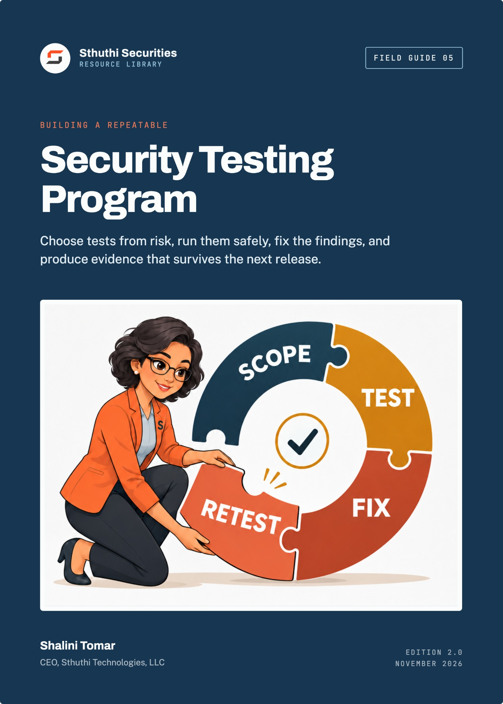
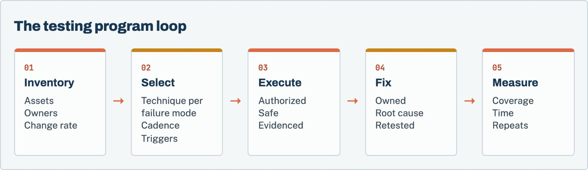
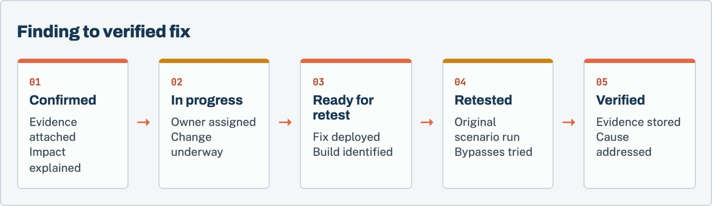

# Building a Repeatable Security Testing Program

*Choose tests from risk, run them safely, fix the findings, and produce evidence that survives the next release*

**Shalini Tomar**, CEO, Sthuthi Technologies, LLC  
Sthuthi Securities · Field Guide 05 · Edition 2.0 · November 2026

---

**Building a Repeatable Security Testing Program**  
Edition 2.0, November 2026.

© 2026 Sthuthi Technologies, LLC. All rights reserved. No part of this publication may be reproduced or distributed for commercial purposes without written permission from the publisher. You may copy the companion worksheets for internal use within your own organization.

This guide is educational material. It is not legal advice, an audit opinion, a certification, or authorization to test any system. Security testing requires written permission from the system owner. Contract, privacy, employment, sector, and regional obligations should be reviewed with qualified advisers.

SignalDesk and every other company in the worked examples are fictional. Any resemblance to a real organization is coincidental.

OWASP, NIST, CISA, FIRST, and AWS names are used for identification only and imply no endorsement.

Framework versions, provider policies, and publication dates were checked against primary sources in November 2026. Requirements change; confirm the current edition before relying on a specific clause.

---

# Contents

[**Before you start**](#intro)

**PART I · WHAT TO TEST AND WHY**

[**01   Define the decisions testing must support**](#ch1)

  The decisions, the audiences, and what they need to see.

[**02   Build an application and change inventory**](#ch2)

  Every testable asset, its owner, and how often it changes.

[**03   Choose test types by failure mode**](#ch3)

  Match techniques to the failures they can find.

**PART II · BUILDING TESTING INTO THE WORK**

[**04   Put security checks into design, code, build, and release**](#ch4)

  The right check at each stage, tuned so people trust it.

[**05   Design manual testing for authorization and business logic**](#ch5)

  Role matrices, tenant pairs, and workflow test cases.

[**06   Set cadence and event-driven triggers**](#ch6)

  A baseline calendar plus triggers tied to real change.

[**07   Control tools, test data, secrets, and production impact**](#ch7)

  Authorization, safe data, controlled tools, and stop rules.

**PART III · FINDINGS, MEASUREMENT, AND A WORKED PROGRAM**

[**08   Normalize findings without destroying context**](#ch8)

  One finding record, whatever the source.

[**09   Verify remediation and prevent recurrence**](#ch9)

  Retest the fix, then remove the cause.

[**10   Measure coverage, time, escape rate, and control health**](#ch10)

  A handful of measures that show improvement.

[**11   Worked example: SignalDesk’s annual testing program**](#ch11)

  One year of testing, planned from risk.

**TOOLS AND REFERENCE**

[**W   Companion worksheet pack**](#worksheets)

  8 worksheets as a separate printable PDF, Word, and Excel download.

[**A   Test catalog**](#appendix-a)

[**S   Sources**](#sources)

---

**INTRODUCTION**

# Before you start

*One annual penetration test is a snapshot. A testing program is a system that keeps finding the failures that matter as the product changes.*

Most companies start security testing the same way. A customer asks for a penetration test, the company buys one, fixes the findings, and files the report. A year later the customer asks again. In between, the product shipped forty releases, added two APIs, and launched an AI feature, none of which were tested by anyone outside the team that built them.

This guide is about replacing that cycle with a repeatable program: an inventory of what can be tested, a deliberate choice of techniques for each kind of failure, checks built into delivery, manual testing where automation cannot reach, triggers tied to real change, and a findings process that leads to verified fixes and fewer repeats.

It is written for security and engineering leaders building recurring testing across products, infrastructure, APIs, and AI-enabled workflows. The examples assume a SaaS company with a small security function, but the structure scales.

*Figure 1. A testing program is a loop. Measurement feeds back into what gets tested next.*

Each chapter points to worksheets in the companion pack, a separate download in PDF, Word, and Excel formats.

> **Authorization comes first**
>
> Every technique in this guide requires permission from the owner of the system being tested. Testing third-party services, other customers’ tenants, or cloud provider infrastructure requires that party’s authority or published rules, not just yours.

---

**PART I · CHAPTERS 1–3**

# What to test and why

*Decide which decisions the program has to support, know what exists and how often it changes, and match each technique to the failures it can actually find.*

---

**CHAPTER 01 · WHAT TO TEST AND WHY**

## Define the decisions testing must support

*Testing that is not tied to a decision becomes activity for its own sake. Start with who relies on the results.*

A testing program produces information. Before deciding how to produce it, decide who uses it and for what. Different audiences need different things from the same tests:

| Audience | Decision they make | What they need from testing |
|---|---|---|
| Engineering | What to fix, and in what order | Reproducible findings with a clear cause and affected component |
| Product leadership | Whether a release or feature is ready | Coverage of the change, residual risk, and blocking issues |
| Customers and procurement | Whether to trust the vendor | Independent testing evidence, scope, dates, and remediation status |
| Auditors | Whether controls operate | Testing cadence, method, independence, and follow-through |
| Executive and board | Where to invest | Trends in exposure, repeat failures, and time to fix |

Write down which of these the program serves, and in what priority. A program built mainly for customer assurance will emphasize independent tests and shareable reports. One built for engineering will emphasize fast feedback in the pipeline. Most need both, but knowing the balance prevents arguments later.

### Write the testing policy in one page

State the purpose, the audiences, who may authorize testing, the minimum testing for each kind of asset, how findings are rated and tracked, and who can accept risk. Keep the techniques and calendars in the program plan, which will change more often than the policy.

**Before you move on**

- [ ] The program’s audiences and their decisions are written down.
- [ ] A one-page testing policy names who authorizes testing and who accepts risk.

---

**CHAPTER 02 · WHAT TO TEST AND WHY**

## Build an application and change inventory

*You cannot plan testing for systems you do not know about, or schedule it around changes you cannot see.*

### List what can be tested

Build the inventory from the outside in:

- Internet-facing applications, APIs, and their versions.
- Mobile applications and the backends they call.
- Cloud accounts, subscriptions, and projects.
- Internal services and administrative tools.
- Source repositories and the pipelines that deploy them.
- Third-party integrations, OAuth applications, and webhooks.
- AI-enabled workflows: models, retrieval sources, tools, and the actions they can take.

### Add what makes each asset risky

For each asset, record the data it handles, who can reach it, the business impact of failure, and who owns it. Most importantly for a testing program, record **how often it changes**. An API that ships weekly needs a different testing rhythm from an internal tool that changes twice a year.

> **Worksheet 01 · in the companion pack**
>
> **Test universe inventory.** Use the printable or editable version from the [companion worksheet pack](#worksheets).

### Connect the inventory to change

The inventory is only useful if it stays current. Connect it to the signals that reveal change: new repositories, new cloud accounts, new DNS records, new OAuth applications, and release notes. Assign someone to review those signals monthly and update the inventory.

**Before you move on**

- [ ] Every internet-facing application and API is in the inventory with an owner.
- [ ] Each asset records data sensitivity, exposure, and change frequency.
- [ ] Someone reviews new repositories, accounts, and domains monthly.

---

**CHAPTER 03 · WHAT TO TEST AND WHY**

## Choose test types by failure mode

*Each technique finds some failures and misses others. Choose by the question you need answered, not by habit.*

The most common mistake in testing programs is renaming one technique as another: calling a vulnerability scan a penetration test, or assuming a code scanner will find authorization flaws. Each technique has a range. Use the right one for each question.

| Technique | Good at finding | Weak at finding |
|---|---|---|
| Dependency and composition analysis | Known-vulnerable libraries and licenses | Flaws in your own code |
| Static analysis | Injection patterns, unsafe functions, some data-flow issues | Business logic and authorization rules |
| Secret scanning | Credentials in code and history | Secrets stored elsewhere |
| Infrastructure and configuration scanning | Missing patches, exposed services, cloud misconfiguration | Application behaviour |
| Dynamic scanning | Common web flaws on reachable pages | Authenticated, multi-step, or role-dependent flaws |
| Manual penetration testing | Authorization, business logic, chained issues, real impact | Breadth across many assets at once |
| Architecture review and threat modeling | Design flaws before code exists | Implementation bugs |
| Tabletop and response exercises | Gaps in detection and decision-making | Technical vulnerabilities |

NIST’s technical guide to security testing (SP 800-115) separates review, target identification, and vulnerability validation for the same reason: each answers a different question.[1] OWASP’s Web Security Testing Guide and Application Security Verification Standard give detailed coverage for web applications and APIs.[2][3]

### Map failure modes to techniques

For each high-risk asset, list the failures that would hurt most, such as cross-tenant data access, privilege escalation, account takeover, payment manipulation, or data exposure through an AI tool. Then choose the technique that can actually find each one. For authorization and business-logic failures, that almost always means manual testing with multiple accounts.

> **Worksheet 02 · in the companion pack**
>
> **Technique selection matrix.** Use the printable or editable version from the [companion worksheet pack](#worksheets).

**Before you move on**

- [ ] Every high-risk asset has its most damaging failure modes listed.
- [ ] Each failure mode is mapped to a technique that can find it.
- [ ] No scan is described as a penetration test.

---

**PART II · CHAPTERS 4–7**

# Building testing into the work

*Put automated checks where code changes, add manual testing where automation cannot reach, schedule testing around real change, and keep testing safe.*

---

**CHAPTER 04 · BUILDING TESTING INTO THE WORK**

## Put security checks into design, code, build, and release

*Automated checks catch problems when they are cheapest to fix. They work only if they are fast, accurate, and enforced.*

### Design

Ask for a short design review for changes that touch authentication, authorization, tenant isolation, payments, data export, or new suppliers. The review should name the trust boundaries, the assets at risk, and the controls expected. It takes thirty minutes and prevents the most expensive class of finding: the design flaw discovered after release.

### Code

Run secret scanning on every push, and block merges that introduce credentials. Run static analysis on the languages where it performs well, and tune it until the false-positive rate is low enough that engineers read the results. A noisy tool that everyone ignores is worse than no tool.

### Build

Run dependency analysis on every build, and fail builds for high-priority vulnerable dependencies that are reachable. Record what went into each build so you can answer “which releases contained this library?” when the next widely exploited vulnerability appears.

### Release

Require review and passing checks before deployment. Deploy only through the pipeline. Run a dynamic scan against staging for releases that change exposed routes. NIST’s Secure Software Development Framework (SP 800-218) and OWASP’s Software Assurance Maturity Model are useful references for building these practices in stages.[5][6]

> **Worksheet 03 · in the companion pack**
>
> **Pipeline check register.** Use the printable or editable version from the [companion worksheet pack](#worksheets).

> **Tune before you enforce**
>
> Introduce each check in report-only mode for two to four weeks. Fix the rules that produce noise. Then make it blocking. Engineers accept blocking checks they trust.

**Before you move on**

- [ ] Security-relevant changes get a recorded design review.
- [ ] Secret scanning blocks new credentials.
- [ ] Dependency analysis runs on every build, with a defined failure rule.
- [ ] Each blocking check was tuned in report-only mode first.

---

**CHAPTER 05 · BUILDING TESTING INTO THE WORK**

## Design manual testing for authorization and business logic

*The failures that hurt SaaS companies most are rarely found by scanners. They are found by someone with two accounts and a clear idea of the rules.*

Authorization and business-logic flaws are rule violations: a user does something the product should not allow. A scanner does not know the rules. A tester does, if you tell them.

### Write the rules down

For each high-risk workflow, write the expected rule in one sentence: “A customer administrator may invite users to their own tenant only.” “A refund over the approval limit requires a second person.” “An API key belongs to one organization and cannot read another’s objects.” These sentences become test cases.

### Give testers the accounts they need

Manual authorization testing needs at least two tenants, each with users at every relevant role, plus synthetic records with visible owners. Without them, testers spend their time setting up instead of testing. Build the accounts once and reset them between engagements.

### Test the rule from every angle

For each rule, test the obvious path and the indirect ones: list and search endpoints, exports, bulk operations, webhooks, background jobs, file references, and changes made by changing an identifier in a request. OWASP’s API Security Top 10 is a useful prompt for API-specific angles such as object-level and function-level authorization.[4]

> **Worksheet 04 · in the companion pack**
>
> **Authorization test case design.** Use the printable or editable version from the [companion worksheet pack](#worksheets).

### Decide who tests

Internal engineers can run authorization tests well if they have time, accounts, and a rulebook. Independent testers add a fresh view and produce evidence customers will accept. Most programs use both: internal testing on every major change, and independent testing at least annually and after significant architectural changes.

**Before you move on**

- [ ] High-risk workflows have written rules, one sentence each.
- [ ] Synthetic tenants and role accounts exist and can be reset.
- [ ] Test cases cover indirect paths, not only the user interface.
- [ ] Internal and independent manual testing each have a defined role.

---

**CHAPTER 06 · BUILDING TESTING INTO THE WORK**

## Set cadence and event-driven triggers

*A calendar alone misses the release that matters. Triggers alone miss slow drift. Use both.*

### Set a baseline calendar

Decide the minimum testing for each tier of asset. A typical pattern:

| Asset tier | Continuous | Periodic | Independent |
|---|---|---|---|
| Tier 1: internet-facing, sensitive data | Pipeline checks, external scanning | Internal manual testing each quarter | Independent test at least annually |
| Tier 2: internal or lower sensitivity | Pipeline checks | Internal review twice a year | As risk or customers require |
| Tier 3: low impact | Dependency and secret scanning | Annual review | Not usually required |

### Add triggers

Define the changes that require testing outside the calendar:

- A new internet-facing application, API version, or major feature.
- Changes to authentication, authorization, session handling, or tenant isolation.
- New integrations that receive customer data or can act on a user’s behalf.
- A new AI feature that can read customer data or take actions.
- Significant infrastructure changes, such as a new region or a move to a new platform.
- A security incident or near miss that suggests a control failed.

Each trigger should name the minimum test it requires and who decides whether it fired.

> **Worksheet 05 · in the companion pack**
>
> **Testing calendar and triggers.** Use the printable or editable version from the [companion worksheet pack](#worksheets).

**Before you move on**

- [ ] Every asset tier has a minimum continuous, periodic, and independent testing level.
- [ ] Triggers are defined, each with a required test and a decision owner.

---

**CHAPTER 07 · BUILDING TESTING INTO THE WORK**

## Control tools, test data, secrets, and production impact

*Testing can cause the incidents it is meant to prevent. Make safety part of the program, not an afterthought.*

### Authorize every engagement

Every test, internal or external, needs written authority naming the targets, techniques, window, and limits. Recurring internal testing can run under a standing authorization reviewed each year, as long as it names what it covers. Cloud providers publish their own testing rules. Check them for each engagement and record what you checked.[7]

### Use synthetic data

Testing should use synthetic tenants and records, not copies of production customer data. If a test must run in production, use synthetic accounts and records clearly marked as test data, and agree in advance how they will be cleaned up.

### Control tools and credentials

Keep a list of approved testing tools and where they may run. Give testing accounts only the access they need, store their credentials in the secret manager, and rotate them after each engagement. Treat test evidence, which may contain tokens or customer-like data, as sensitive.

### Define stop conditions

Write down what stops a test: unexpected access to real customer data, service degradation, a discovered third-party system, or a request from the system owner. Make sure every tester knows how to reach the person who can make the stop decision.

> **Worksheet 06 · in the companion pack**
>
> **Engagement safety checklist.** Use the printable or editable version from the [companion worksheet pack](#worksheets).

**Before you move on**

- [ ] Every engagement, including recurring internal testing, has written authority.
- [ ] Testing uses synthetic data, with a cleanup plan for production tests.
- [ ] Testing credentials are scoped, stored securely, and rotated.
- [ ] Stop conditions and contacts are known to every tester.

---

**PART III · CHAPTERS 8–11**

# Findings, measurement, and a worked program

*Record findings so they can be fixed, verify that fixes work, measure whether the program is improving, and follow one company’s annual plan.*

---

**CHAPTER 08 · FINDINGS, MEASUREMENT, AND A WORKED PROGRAM**

## Normalize findings without destroying context

*Findings arrive from many tools in many formats. Bring them together without stripping out what engineers need to fix them.*

### Use one finding record

Every finding, whatever its source, should end up in one tracker with the same fields: affected asset and component, the condition observed, evidence, steps to reproduce, impact, the rule or expectation violated, severity and the basis for it, owner, due date, state, and any exception.

### Keep the evidence

Normalizing findings into a ticket system often loses the evidence: the request, the response, the account used, and the version tested. Keep it attached or linked. An engineer who cannot reproduce a finding will close it as “cannot reproduce”, and it will come back in the next test.

### Rate severity consistently

Use one severity scheme across sources. CVSS is a common basis for technical severity,[9] but most programs adjust for exposure, data sensitivity, and whether the issue is known to be exploited, using sources such as CISA’s Known Exploited Vulnerabilities catalog.[8] Write down how you adjust, so two people rating the same finding reach the same result.

### Deduplicate carefully

The same root cause often appears as many findings. Group them under one parent with the cause, but keep each instance so the fix can be verified everywhere.

> **Worksheet 07 · in the companion pack**
>
> **Finding record template.** Use the printable or editable version from the [companion worksheet pack](#worksheets).

**Before you move on**

- [ ] Every source feeds one tracker with the same fields.
- [ ] Evidence survives the move into the tracker.
- [ ] Severity adjustments are written down and applied consistently.

---

**CHAPTER 09 · FINDINGS, MEASUREMENT, AND A WORKED PROGRAM**

## Verify remediation and prevent recurrence

*A fix is not done when the ticket closes. It is done when someone has shown the original path, and the obvious bypasses, no longer work.*

### Retest the changed control

For each fixed finding, repeat the original scenario against the corrected release. Then try the obvious variations: a different role, a different tenant, a related endpoint, the same input through another channel. Record the retest with its date, the version tested, and the result, linked to the original finding.

*Figure 2. “Ready for retest” is the team’s belief that a fix is deployed. “Verified” requires new evidence from someone testing the original scenario.*

### Look for the pattern

When the same kind of finding appears more than once, such as missing object-level authorization checks in several endpoints, fixing each instance is not enough. Ask what would make the whole class of finding impossible: a shared authorization layer, a framework default, a linting rule, or a design review checklist item. Fund that change.

### Track exceptions

Some findings will not be fixed quickly. Each exception should have a reason, a compensating control, an approver with authority to accept the risk, and an expiry date when it must be reviewed.

**Before you move on**

- [ ] Every closed high-priority finding has a linked retest record.
- [ ] Repeat finding classes have a root-cause fix planned or done.
- [ ] Every exception has an approver and an expiry date.

---

**CHAPTER 10 · FINDINGS, MEASUREMENT, AND A WORKED PROGRAM**

## Measure coverage, time, escape rate, and control health

*Measure whether the program is finding what matters and whether things are getting better, not how busy it is.*

Avoid measuring activity, such as number of scans run or findings opened. Measure outcomes:

| Measure | What it tells you |
|---|---|
| Asset coverage | Share of Tier 1 and Tier 2 assets that received their minimum testing |
| Trigger compliance | Share of triggering changes that were tested before or soon after release |
| Time to fix | Median days from confirmation to verified fix, by priority |
| Overdue findings | High-priority findings past their target date |
| Repeat rate | Share of findings in a class seen before |
| Escape rate | Issues found in production, by customers, or by external researchers that testing should have caught |
| Exception age | Exceptions past their review date |

Escape rate is the most revealing. Every issue found outside the program is a signal about what the program is missing. Review each one and ask which technique, trigger, or asset gap let it through.

> **Worksheet 08 · in the companion pack**
>
> **Program review.** Use the printable or editable version from the [companion worksheet pack](#worksheets).

### Review quarterly

Each quarter, compare the measures with the previous quarter, review every escape, and decide what to change: add an asset, add a technique, adjust a trigger, retire a check that finds nothing, or fund a root-cause fix.

**Before you move on**

- [ ] The program reports outcome measures, not activity counts.
- [ ] Every escape is reviewed for the gap that let it through.
- [ ] A quarterly review changes the plan based on what the measures show.

---

**CHAPTER 11 · FINDINGS, MEASUREMENT, AND A WORKED PROGRAM**

## Worked example: SignalDesk’s annual testing program

*A fictional SaaS company with quarterly releases, several APIs, a mobile client, and customers who demand annual testing.*

| Starting point | SignalDesk in January |
|---|---|
| Company | 70 people. Customer-communication SaaS with a web app, public API, partner API, and mobile app |
| Release rhythm | Weekly deploys; major features each quarter |
| Testing before | One annual external penetration test; dependency scanning on two of nine repositories |
| Trigger for change | Two enterprise customers found authorization issues the annual test had missed |

### Building the plan

SignalDesk’s security lead, Ana, started with the inventory. It listed 23 testable assets. Six were Tier 1: the web application, public API, partner API, mobile backend, administrative console, and the cloud production account. The partner API had launched in September and had never been tested by anyone outside its team.

Both customer-reported issues were object-level authorization failures in API list endpoints. The annual test had covered the web application in depth and the API only lightly. Ana mapped the most damaging failure modes for each Tier 1 asset and found that cross-tenant access through the APIs had no technique assigned except the annual test.

### The year’s calendar

| Quarter | Planned testing |
|---|---|
| Q1 | Pipeline checks on all nine repositories. Internal authorization testing of public and partner APIs using new synthetic tenants |
| Q2 | Independent penetration test of web app and both APIs, with authorization as a named objective. Tabletop exercise |
| Q3 | Internal testing of the new AI summarization feature before launch (trigger). Mobile backend review |
| Q4 | Retest of all Q2 findings. Independent test of the administrative console. Program review and next-year plan |

### What happened

Internal testing in Q1 found four more object-level authorization issues in list and export endpoints, all with the same cause: each endpoint implemented its own tenant check. Engineering built a shared authorization layer and moved all API endpoints to it over six weeks. The Q2 independent test found no cross-tenant issues in the APIs and two medium findings elsewhere.

The AI summarization feature triggered testing in Q3. Internal testers found that a prompt embedded in a customer message could cause the summary tool to retrieve another conversation from the same tenant that the requesting user should not see. The feature launched two weeks late, with the retrieval call bound to the requesting user’s permissions.

### Year-end measures

Tier 1 coverage reached 100 percent, up from roughly 40 percent. The median time to verified fix for high-priority findings fell from 51 days to 19. The repeat rate for authorization findings fell to zero after the shared layer shipped. One escape was reported by an external researcher: an outdated marketing subdomain. That led to adding DNS records to the monthly inventory review.

> **What made the difference**
>
> The failure-mode mapping. Seeing that cross-tenant API access had no technique except one annual test explained both customer reports and pointed directly at the fix, which was a shared authorization layer rather than more tests.

---

**TOOLS · COMPANION DOWNLOAD**

# The companion worksheet pack

*The 8 worksheets referred to in this guide are a separate download, so you can print them, fill them in, and share them with your team without copying pages out of the book.*

Download the pack from the same page as this guide in the Sthuthi Securities resource library at [sthuthi-tech.com](https://sthuthi-tech.com). It comes in three formats:

- **Printable PDF.** Each worksheet starts on a new A4 page, with lined fields for writing by hand.
- **Editable Word document.** The same worksheets as fill-in tables you can type into.
- **Excel workbook.** One tab per worksheet, with registers set up as working trackers.

| # | Worksheet | Use with |
|---|---|---|
| 01 | Test universe inventory | Chapter 2 |
| 02 | Technique selection matrix | Chapter 3 |
| 03 | Pipeline check register | Chapter 4 |
| 04 | Authorization test case design | Chapter 5 |
| 05 | Testing calendar and triggers | Chapter 6 |
| 06 | Engagement safety checklist | Chapter 7 |
| 07 | Finding record template | Chapter 8 |
| 08 | Program review | Chapter 10 |

---

**APPENDIX A · REFERENCE**

# Test catalog

*Common techniques, what they produce, and when to use them.*

| Technique | Output | Typical trigger or cadence | Who runs it |
|---|---|---|---|
| Secret scanning | Blocked commits, alerts | Every push | Pipeline |
| Dependency analysis | Vulnerable components per build | Every build | Pipeline |
| Static analysis | Code findings | Every pull request | Pipeline, tuned by security |
| Configuration scanning | Cloud and host misconfigurations | Daily or weekly | Security or platform team |
| External attack-surface scan | Exposed hosts and services | Weekly | Security |
| Dynamic scan | Common web flaws | Releases changing routes | Pipeline or security |
| Internal authorization testing | Role and tenant test results | Quarterly and on trigger | Trained engineers or security |
| Independent penetration test | Report, evidence, retest | Annually and on major change | External assessor |
| Architecture review | Design decisions and risks | New systems and major changes | Security with engineering |
| Tabletop exercise | Response gaps and actions | Annually | Security with leadership |

---

**SOURCES · REFERENCE**

# Sources

Sources were checked in November 2026. Recommendations in this guide are Sthuthi Securities guidance, not requirements of any framework listed here unless the text says so.

1. **NIST.** SP 800-115, Technical Guide to Information Security Testing and Assessment. [https://csrc.nist.gov/pubs/sp/800/115/final](https://csrc.nist.gov/pubs/sp/800/115/final)
2. **OWASP.** Web Security Testing Guide. [https://owasp.org/www-project-web-security-testing-guide/](https://owasp.org/www-project-web-security-testing-guide/)
3. **OWASP.** Application Security Verification Standard 5.0.0, May 2025. [https://asvs.owasp.org/](https://asvs.owasp.org/)
4. **OWASP.** API Security Top 10, 2023 edition. [https://owasp.org/API-Security/](https://owasp.org/API-Security/)
5. **NIST.** SP 800-218, Secure Software Development Framework (SSDF) Version 1.1. [https://csrc.nist.gov/pubs/sp/800/218/final](https://csrc.nist.gov/pubs/sp/800/218/final)
6. **OWASP.** Software Assurance Maturity Model (SAMM). [https://owaspsamm.org/](https://owaspsamm.org/)
7. **Amazon Web Services.** Penetration Testing policy. [https://aws.amazon.com/security/penetration-testing/](https://aws.amazon.com/security/penetration-testing/)
8. **CISA.** Known Exploited Vulnerabilities Catalog. [https://www.cisa.gov/known-exploited-vulnerabilities-catalog](https://www.cisa.gov/known-exploited-vulnerabilities-catalog)
9. **FIRST.** Common Vulnerability Scoring System version 4.0. [https://www.first.org/cvss/v4-0/](https://www.first.org/cvss/v4-0/)
10. **NIST.** The NIST Cybersecurity Framework (CSF) 2.0. [https://www.nist.gov/publications/nist-cybersecurity-framework-csf-20](https://www.nist.gov/publications/nist-cybersecurity-framework-csf-20)

---

**ABOUT · STHUTHI SECURITIES**

# About the author

**Shalini Tomar** is the CEO of Sthuthi Technologies, LLC, and leads its cybersecurity practice, Sthuthi Securities. She works with SaaS teams that need to show enterprise buyers clear, scoped, and current evidence of how their products are secured.

# About Sthuthi Securities

Sthuthi Securities is the cybersecurity practice of Sthuthi Technologies, LLC. It tests web applications, APIs, cloud systems, and AI agents, then helps teams fix and retest what it finds. Engagements are scoped in writing and authorized by the system owner, and they end with findings and evidence a buyer’s reviewer can use.

Penetration testing

Web application, API, and cloud testing with clear scope and safe rules of engagement.

AI security assessment

Tool permissions, tenant isolation, and prompt-injection testing for AI agents.

Remediation support

Working with your engineers to fix the cause, not just the symptom.

Retesting and evidence

Independent verification and summary letters you can share with buyers.

More field guides at sthuthi-tech.com

Passing enterprise security reviews · Scoping a web app and API penetration test · The first 90 days of a security program · Preparing for a customer audit · AI security for support agents · Security proof for enterprise deals

---
