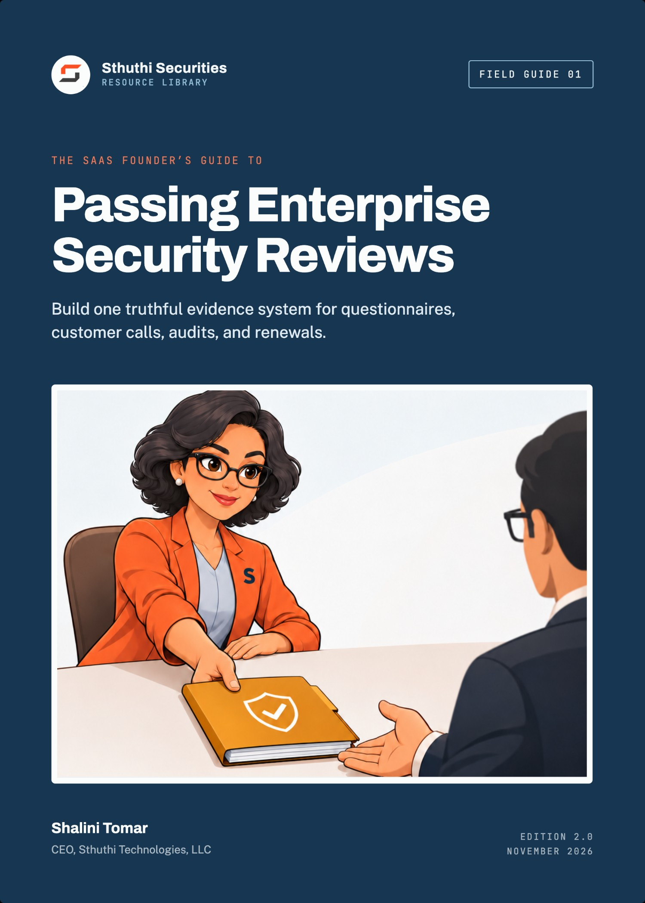

# The SaaS Founder’s Guide to Passing Enterprise Security Reviews

*Build one truthful evidence system for questionnaires, customer calls, audits, and renewals*

**Shalini Tomar**, CEO, Sthuthi Technologies, LLC  
Sthuthi Securities · Field Guide 01 · Edition 2.0 · November 2026

---

**The SaaS Founder’s Guide to Passing Enterprise Security Reviews**  
Edition 2.0, November 2026. First edition published 4 November 2026.

© 2026 Sthuthi Technologies, LLC. All rights reserved. No part of this publication may be reproduced or distributed for commercial purposes without written permission from the publisher. You may copy the worksheets for internal use within your own organization.

This guide is educational material. It is not legal advice, an audit opinion, a certification, or authorization to test any system. Security testing requires written permission from the system owner. Contract, privacy, employment, sector, and regional obligations should be reviewed with qualified advisers.

Northstar Metrics, Halden Trust, and every other company in the worked examples are fictional. Any resemblance to a real organization is coincidental. Examples show a method; they are not a control set that fits every company.

SOC 2 is a trademark of the American Institute of Certified Public Accountants. ISO and ISO/IEC 27001 belong to the International Organization for Standardization. CAIQ, CCM, and STAR are Cloud Security Alliance marks. SIG is a Shared Assessments product. Names are used for identification only and imply no endorsement.

Framework versions and publication dates were checked against primary sources in November 2026. Requirements change; confirm the current edition before relying on a specific clause.

---

# Contents

[**Before you start**](#intro)

**PART I · THE REVIEWER’S SIDE OF THE TABLE**

[**01   What an enterprise reviewer is actually deciding**](#ch1)

  Read the questionnaire as a risk memo someone else has to sign.

[**02   Build the review room before the questionnaire arrives**](#ch2)

  The dated, owned set of artifacts every answer points to.

[**03   Draw the product, data, tenant, and supplier boundary**](#ch3)

  One system description that keeps every later answer honest.

**PART II · ANSWERING THE TECHNICAL DOMAINS**

[**04   Identity and access, with evidence**](#ch4)

  Workforce access to your systems and customer access to your product.

[**05   Encryption, secrets, logging, and monitoring**](#ch5)

  Where precise wording matters more than anywhere else.

[**06   Vulnerability management and secure development**](#ch6)

  Show the loop: find, prioritize, fix, verify.

[**07   Incident response, continuity, privacy, and deletion**](#ch7)

  The promises that end up in the contract.

[**08   SOC 2, ISO 27001, CAIQ, SIG, and penetration tests**](#ch8)

  What each artifact proves, and what it doesn’t.

**PART III · RUNNING THE REVIEW**

[**09   Write answers a reviewer can approve**](#ch9)

  A five-part answer pattern and a status vocabulary.

[**10   Run the review as a controlled sales process**](#ch10)

  One owner, one tracker, and a rule for every commitment.

[**11   Worked review: Northstar Metrics and Halden Trust**](#ch11)

  Nineteen business days from questionnaire to signed security addendum.

**TOOLS AND REFERENCE**

[**W   Companion worksheet pack**](#worksheets)

  Eight worksheets, available as a separate printable PDF, Word, and Excel download.

[**A   Model answers for twelve common questions**](#appendix-a)

[**B   Sources**](#sources)

[**About the author and Sthuthi Securities**](#about)

---

**INTRODUCTION**

# Before you start

*Enterprise security reviews are passable. Most of the pain comes from answering them from memory instead of from records.*

The first enterprise security questionnaire usually lands at a bad moment. The deal is late in the quarter, the champion inside the buyer is pushing for a signature, and someone forwards a spreadsheet with a few hundred rows and a deadline. The founder, or whoever wrote the most infrastructure code, opens it and starts typing at row one.

Two weeks later the spreadsheet is done, the answers are mostly right, and nobody could say which ones were checked. Six months later a second buyer sends a different questionnaire, and the team does it again. They paste from the first one, and an answer that was true in March is quietly false in September.

This guide replaces that cycle with a small evidence system: a defined product boundary, a register of the security claims you make, the dated artifacts that support each claim, and a named owner for each. Once that system exists, a questionnaire is mostly retrieval. Reviews get faster and answers stay consistent, and the gaps you do have get disclosed on your terms instead of discovered on the buyer’s.

## Who this guide is for

It is written for SaaS founders, first security hires, engineering leaders, and the sales or solutions people who carry security questions back and forth during a deal. You do not need a security background. You do need access to the people who run your infrastructure, identity provider, code repositories, and support tooling, because the answers live in those systems, not in this book.

## How to use it

- **Read Part I first.** Chapters 1 to 3 set up the review room and the boundary statement. Everything after depends on them.
- **Use Part II as a reference.** Each chapter covers one domain reviewers ask about, what they are looking for, and the evidence that answers it. Read them when the questions come up.
- **Run Part III during a live deal.** Chapter 9 is about wording, chapter 10 about process, and chapter 11 follows one company through a full review.
- **Print the worksheets.** They are designed to be filled in by hand or copied into your own tracker. Complete them against one real product and one real request rather than in the abstract.

## Four words this guide keeps separate

Most contradictions in security reviews come from mixing up four kinds of statement. The rest of the guide uses these terms precisely.

| Term | What it is | Example |
|---|---|---|
| Claim | Something the company says about its security. | “Production access requires MFA.” |
| Control | What people and systems actually do. | An identity-provider policy that blocks sign-in without a second factor. |
| Evidence | A dated record showing the control operated. | A policy export and a sign-in log sample from last week. |
| Assurance | An independent conclusion, limited to a stated scope and period. | A SOC 2 Type II report covering the control over six months. |

A claim without evidence is a promise. Evidence without assurance is still useful, as long as you present it as your own record and not as an independent opinion. Most early-stage companies will be working mainly with the first three, and that is fine as long as nobody describes them as the fourth.

> **A note on honesty**
>
> Nothing in this guide will help you pass a review by sounding more secure than you are. Reviewers compare answers against reports, contracts, and their own testing, and a contradiction they find costs more trust than a gap you disclosed. Every pattern here is built to make true answers easier to give.

---

**PART I · CHAPTERS 1–3**

# The reviewer’s side of the table

*Before you answer a single row, understand who reads your answers, what they have to decide, and what you need in place so that every answer has somewhere true to point.*

---

**CHAPTER 01 · PART I · THE REVIEWER’S SIDE**

## What an enterprise reviewer is actually deciding

*A questionnaire looks like an exam. It is closer to the raw material for a memo that someone else has to sign.*

Picture the person on the other side. At a bank, an insurer, or a hospital group, a third-party risk analyst has a queue of vendors. Each one arrives with a business sponsor who wants the tool approved quickly. The analyst’s job is not to decide whether your product is good. It is to describe the risk of letting you hold their data or touch their systems, recommend whether to accept it, and list the conditions that would make it acceptable. That recommendation goes to someone more senior who owns the decision and will be asked about it if anything goes wrong.

Seen that way, the questionnaire is a data-collection instrument. Most of its rows exist because a standard template includes them, not because your deal depends on them. A handful of rows carry the real decision, and the analyst knows which ones they are before you start typing.

### Vendors are tiered before they are reviewed

Large buyers sort suppliers into tiers before choosing how hard to look. The tier is usually driven by what data you will receive, how many of their users or customers it covers, whether you connect to their internal systems, and how badly their operations suffer if you fail. A note-taking tool used by ten people with no customer data might get a short form. An analytics platform ingesting customer transaction records gets the full questionnaire, a document request, and possibly a call with their security architects.

Your first move is to find out which tier you are in. Ask the business sponsor, or ask the analyst directly. It is a normal question and it tells you how much effort the review deserves.

### The questions that actually gate the deal

The gating questions vary by buyer, but they cluster in the same places almost every time:

- **Data.** What data will you hold, where is it stored, and who else receives it?
- **Access.** Can the buyer’s users sign in through the buyer’s identity provider? Is multi-factor authentication enforced for your own staff?
- **Independent assurance.** Is there a SOC 2 report, an ISO/IEC 27001 certificate, or a recent penetration test, and does it cover the product being bought?
- **Incidents.** How quickly will you notify them of a breach, and is that written into the contract?
- **Exit.** What happens to their data when the contract ends?

If you answer those well, a weak answer about password rotation on row 187 rarely sinks a deal. If you answer them badly, nothing else on the sheet will rescue it.

> **Reviewer’s lens**
>
> The analyst is looking for reasons to trust your answers, not reasons to like your product. Specific, scoped, dated answers are easy to trust. Confident generalities send them looking for the evidence you didn’t supply.

### Three ways a review ends

A review rarely ends with a clean pass or a flat rejection. There are three common outcomes:

| Outcome | What it usually means for you |
|---|---|
| Approved | The residual risk fits the tier. You may still be scheduled for reassessment at renewal. |
| Approved with conditions | The buyer accepts the risk if you commit to changes, such as delivering a SOC 2 Type II report by a date, adding SSO, or agreeing to a notification clause. The most common result for a first enterprise deal. |
| Escalated or declined | A gating requirement cannot be met, or the answers contradict each other. Escalation can sometimes be recovered with a call and a written plan, but a contradiction is much harder to fix. |

Plan for the middle row. Conditions are not a failure. They are how a buyer says yes to a young company. Your goal is to make sure every condition you accept is one you can deliver, on a date someone in your company has agreed to.

### Questions to ask before you answer anything

Spend fifteen minutes with the buyer’s sponsor or analyst at the start. These questions often cut the work in half:

- Which product, plan, and features are being purchased, and what data will we receive?
- What tier have you assigned us, and which requirements are mandatory at that tier?
- Will you accept an existing report, such as SOC 2 or ISO, in place of some sections?
- What is the real deadline, and what happens if a section is late?
- Who will review our answers, and can we schedule a call before submission?
- How will you store and share the documents we send?

Write the answers down on [Worksheet 1](#worksheets). They define the scope of everything you do next.

**Before you move on**

- [ ] You know your vendor tier and the data you will receive.
- [ ] You have listed the five to ten questions that will decide the outcome.
- [ ] You have asked whether existing reports can replace sections of the questionnaire.

---

**CHAPTER 02 · PART I · THE REVIEWER’S SIDE**

## Build the review room before the questionnaire arrives

*Every answer you give should point to something. The review room is where those somethings live.*

A review room is a controlled folder, or a trust portal if you already use one, holding the current version of every artifact a reviewer is likely to ask for. Each artifact has an owner, a “valid as of” date, and a sharing tier. That is all it is. Its value comes from the discipline of keeping it current, not from the tool it sits in.

Companies that skip this step answer each questionnaire by asking engineers in chat, pasting from old spreadsheets, and taking screenshots under deadline pressure. Every review then produces a slightly different version of the truth. Companies that build the room once spend most of each review copying links.

### What goes in it

Start with the smallest set that answers the gating questions from chapter 1. You can add more later.

| Artifact | What it contains | Typical tier |
|---|---|---|
| System description | The product boundary from chapter 3: components, data, regions, suppliers, exclusions. | 2 |
| Security overview | Two to four pages in plain language covering each domain in Part II. | 1 |
| Architecture and data-flow diagram | Where customer data enters, is stored, is processed, and leaves. Trust boundaries marked. | 2 |
| Policy index | Title, owner, approval date, and review date for each policy. Full text on request. | 1–2 |
| Independent reports | SOC 2 report, ISO certificate and statement of applicability, bridge letters. | 2 |
| Penetration-test summary | Tester, dates, scope, method, findings by severity, and remediation status. Not the raw report. | 2 |
| Subprocessor list | Each supplier that processes customer data, its purpose, and its location. | 1 |
| Claim register and answer library | Approved wording for recurring claims, each linked to evidence. Internal only. | Internal |

### Sharing tiers

Not everything belongs in front of every prospect. A simple three-tier model covers most needs:

- **Tier 1, public or on request.** Security overview, subprocessor list, policy index. Nothing here should help an attacker.
- **Tier 2, under NDA.** System description, diagrams, SOC 2 report, penetration-test summary. Share these with qualified reviewers on a named-recipient basis.
- **Tier 3, by exception.** Full policy text, detailed configuration evidence, raw findings. Only when a reviewer has a specific need, ideally shown on a call instead of sent.

Record who received what and when on [Worksheet 7](#worksheets). If a report is later superseded, you will know who holds the stale copy.

### Three rules that keep the room trustworthy

**Every artifact carries a date and an owner on its first page.** A diagram with no date is a guess. Reviewers notice, and so will your own team when it is time to refresh it.

**Evidence names its scope.** A screenshot of an identity-provider policy should say which tenant, which user groups, and when it was captured. Crop out secrets, tokens, and other customers’ names before anything enters the room.

**One version is current.** Move superseded files to an archive folder. Never leave “Security Overview v3 FINAL (2)” beside “v4” and hope the right person picks the right one.

> **If you are starting from nothing**
>
> Write the system description and security overview first. Together they answer roughly half of a typical questionnaire in narrative form. Many reviewers will accept them as a starting point while you assemble the rest.

### Who owns it

Name one review lead. At a seed or Series A company this is often the CTO or a senior engineer. Later it becomes the first security hire. The lead does not have to write every artifact, but they decide what is current, they approve wording, and they are the only person who sends tier 2 and tier 3 material. Each artifact also has a control owner: the person who runs the thing the artifact describes and who can explain it on a call.

Put a review date on the calendar for every artifact. Quarterly works for most. Diagrams and subprocessor lists should also be reviewed whenever the architecture or supplier set changes.

**Before you move on**

- [ ] A review lead is named and has authority to approve wording.
- [ ] Each artifact in the room has an owner, a date, and a sharing tier.
- [ ] Superseded versions are archived, not deleted and not left beside the current one.

---

**CHAPTER 03 · PART I · THE REVIEWER’S SIDE**

## Draw the product, data, tenant, and supplier boundary

*Most wrong answers are not lies. They are true statements about a different part of the company.*

“We encrypt all data at rest” may be true of the production database and false of the analytics warehouse a data engineer set up last spring. “Only three people have production access” may be true of the cloud console and leave out the support tool that can read any customer’s records. A boundary statement prevents these errors by fixing, in one dated document, what system you are describing. Every later answer is about that system and nothing else.

### What the boundary statement covers

Keep it to two pages. Write it for a technical reader who has never seen your product. [Worksheet 2](#worksheets) walks through each field.

- **Service.** Product name, the plans or editions in scope, and the features that touch customer data.
- **Hosting.** Cloud provider, regions, and whether customers can choose a region.
- **Customer data.** The categories you receive (contact details, usage events, uploaded files, payment references), how each arrives, and where it is stored.
- **Tenancy.** How one customer’s data is kept apart from another’s, in plain terms.
- **Administrative paths.** Every way a person at your company can reach customer data: cloud console, database access, internal admin panel, support tooling, log search.
- **Environments.** Production, staging, development, and whether real customer data ever leaves production.
- **Suppliers.** Each third party that stores or processes customer data.
- **Exclusions.** What is not covered: the marketing site, internal corporate tools, beta features, products from an acquisition.

### Explaining tenant isolation honestly

Multi-tenant SaaS buyers will ask how you stop one customer from seeing another’s data. There is no single right architecture, but there is a right way to describe whichever one you have. Name the mechanism, say where it is enforced, and say how you test it.

> **Hard to approve**
>
> “Customer data is logically separated and fully isolated.”

> **Easy to approve**
>
> “All customers share one PostgreSQL cluster. Every table holding customer data carries a tenant identifier, and the data-access layer adds a tenant filter derived from the authenticated session. Application code cannot query those tables without it. Row-level security policies in the database enforce the same rule as a second layer. Cross-tenant access is covered by automated tests on every build and was a named objective of our last penetration test (June 2026), which found no cross-tenant issues.”

The second answer is longer, but the reviewer can stop reading after it. The first one invites five follow-up questions.

### Suppliers you forgot you had

Subprocessor lists are often incomplete because nobody owns them. Check these places before you publish one:

- Error tracking and application monitoring, which often capture request bodies or user identifiers.
- Log aggregation and search.
- Email delivery, in-app messaging, and customer-support platforms.
- Product analytics and session-replay tools.
- Data warehouses and the pipelines that feed them.
- AI and machine-learning providers that receive prompts containing customer content.

That last category is growing fast in questionnaires. Shared Assessments added AI-related content to recent editions of its SIG questionnaire, and many buyers now ask directly whether customer data is sent to a model provider, whether it is retained there, and whether it is used for training. Know the answer for each AI feature, and know the contract terms behind it.

### Draw the diagram last

Once the written statement is settled, draw one data-flow diagram that matches it. Show customer users, your application tiers, each data store, each supplier, and each administrative path. Mark the trust boundaries: the internet edge, the line between your cloud account and a supplier’s, and the line between production and everything else. Add the date and the version of the boundary statement it reflects. If the diagram and the text disagree, fix one before either goes into the room.

> **Reviewer’s lens**
>
> A clear exclusion is a sign of maturity. “The mobile app launched in September and is not yet covered by our SOC 2 scope” tells the reviewer exactly where to look harder. Silence tells them they cannot rely on any of your scope statements.

**Before you move on**

- [ ] The boundary statement lists every administrative path to customer data, including support tools.
- [ ] The subprocessor list has been checked against monitoring, analytics, support, and AI providers.
- [ ] Exclusions are written down, and the diagram matches the text.

---

**PART II · CHAPTERS 4–8**

# Answering the technical domains

*Five chapters, one for each cluster of questions reviewers return to. Each one covers what the reviewer wants to know, the evidence that shows it, and the wording traps that create contradictions later.*

---

**CHAPTER 04 · PART II · TECHNICAL DOMAINS**

## Identity and access, with evidence

*Two different populations, two different sets of questions. Reviewers ask about both, and they notice when you answer one and call it the other.*

Identity questions split cleanly in two. **Workforce access** is how your own employees and contractors reach your systems: email, code, cloud accounts, production databases, support tools. **Customer access** is how the buyer’s users sign in to your product and what controls the buyer gets over them. A reviewer wants confidence in both, but for different reasons. Weak workforce access is how attackers reach the buyer’s data through you. Weak customer access controls mean the buyer cannot manage their own users safely.

### Workforce access: what reviewers look for

- **Central identity.** One identity provider for workforce accounts, with business applications connected through single sign-on, so that disabling one account removes access everywhere.
- **Strong authentication.** Multi-factor authentication enforced by policy, not by habit. Phishing-resistant methods such as security keys or passkeys for administrators at minimum. NIST’s current authentication guidance, SP 800-63B-4, published in 2025, gives phishing resistance far more weight than earlier editions did.
- **Least privilege for production.** Few standing administrators. Elevated access granted for a task and then removed, with a record of who asked and why.
- **Joiners, movers, leavers.** Access granted on a ticket, changed when roles change, and removed promptly on departure, with timestamps.
- **Periodic review.** Someone with authority checks who has access to sensitive systems, removes what is no longer needed, and signs off.
- **Break-glass accounts.** Emergency credentials stored securely, monitored, and tested.

### Customer access: what reviewers look for

- **Single sign-on** using SAML or OpenID Connect, so the buyer’s users authenticate through the buyer’s identity provider and inherit its MFA policy.
- **Automated provisioning** through SCIM or an equivalent, so leavers lose access when the buyer’s HR system says they have left.
- **Roles and permissions** that let the buyer restrict who can export data, manage integrations, or invite users.
- **Audit logs** the buyer can see: sign-ins, permission changes, exports, and API key creation.

If SSO is only available on a higher plan, say so plainly and name the plan. A surprising number of reviews stall because the sales team quoted one plan and the security answer described another.

### Evidence that answers the question

| Claim | Evidence that supports it |
|---|---|
| MFA is enforced for all staff | Dated export of the identity-provider sign-on policy showing the groups it applies to, plus the list of any excluded accounts and why. |
| Access is removed on departure | A sample of recent leavers with HR end date, deprovisioning timestamp, and confirmation that sessions were revoked. |
| Production access is limited | Current list of people holding standing production roles, and a log of temporary elevation requests for the last quarter. |
| Access is reviewed quarterly | The completed review for the last quarter: systems covered, reviewer, changes made, sign-off date. |

A policy that says “access is reviewed quarterly” is not evidence that it was. If the last review happened eight months ago, the honest answer is that reviews are required quarterly, the most recent was completed in March, and the next is scheduled for a named date.

> **Hard to approve**
>
> “Yes. We take access security very seriously and use MFA everywhere.”

> **Easy to approve**
>
> “Yes. All 34 workforce accounts sign in through our identity provider, where MFA is enforced by policy for every user group. Administrators of the identity provider and of our cloud accounts must use hardware security keys. There are no exclusions as of 1 October 2026. A dated policy export is available in our review room under NDA.”

**Before you move on**

- [ ] You can list every person with standing production access by name.
- [ ] The last access review is complete, dated, and signed off.
- [ ] Your SSO and SCIM answers name the plan they apply to.

---

**CHAPTER 05 · PART II · TECHNICAL DOMAINS**

## Encryption, secrets, logging, and monitoring

*“Encrypted” is probably the most overclaimed word in security questionnaires. Be specific about what is encrypted, how, and who holds the keys.*

### Encryption at rest

Most cloud databases, object stores, and disks can be encrypted at rest using keys managed by the provider’s key-management service. That protects against a narrow set of threats, mainly lost physical media and some infrastructure-level access. It does not protect against someone who can query the database through your application or your admin tools. Reviewers know this. Say what you have, and do not imply more.

A complete answer names the stores covered (primary database, backups, file storage, search index, data warehouse, logs), the mechanism, and who can use the keys. If any store holding customer data is not encrypted, list it as an exception with a plan. If customers can bring their own keys, say which plan includes it and how revocation works.

### Encryption in transit

State the minimum TLS version on public endpoints and how you enforce it, such as at the load balancer or CDN. Then answer the question reviewers increasingly ask next: is traffic between your internal services and to your databases also encrypted? “Inside our private network” is not the same as “encrypted”. If internal traffic is unencrypted on a private network, say that, and describe the network controls.

### Secrets

Reviewers want to know that credentials, API keys, and signing keys live in a secret manager rather than in code, chat, or environment files on laptops. Back that claim with three things: the tool you use, a secret-scanning control on your repositories that blocks or alerts on commits containing credentials, and a rotation practice, especially when someone with access leaves. If you found and rotated a leaked key last year, that is evidence the scanning works. You do not have to volunteer it, but you should not deny it if asked.

### Logging

The logging question is really four questions. Answer each one separately:

| Question | A complete answer covers |
|---|---|
| What is logged? | Authentication events, administrative actions, access to customer data by staff, changes to production infrastructure, and application errors. |
| How long is it kept? | A retention period per log type, and whether it fits what customers and your own incident process need. |
| Who can change it? | Whether logs are sent to a separate account or service that production administrators cannot alter or delete. |
| Does anyone look? | The alerts that exist, where they go, and who responds. See below. |

Also check what your logs contain. Request bodies, access tokens, and personal data end up in application logs more often than teams expect. If they do, those logs become customer data, and your log provider becomes a subprocessor.

### Monitoring and alerting

Small companies rarely run a staffed security operations center, and reviewers do not expect one from a thirty-person vendor. They do expect a truthful description of what happens when something suspicious occurs. A good answer names a handful of specific alerts, such as root-account sign-in, MFA disabled on an account, a new administrator role granted, unusual data-export volume, or a public storage bucket. It says where alerts are routed, who is on call, and the expected response time outside business hours.

> **Words to retire**
>
> “Military-grade encryption.” “Bank-level security.” “24/7 monitoring” when alerts go to one engineer’s phone. Each one either means nothing or means something you cannot show. Replace them with the mechanism and the scope.

**Before you move on**

- [ ] Every data store in the boundary statement has a stated encryption status.
- [ ] Repository secret scanning is on, and you know what happens when it fires.
- [ ] You can name five security alerts, their destination, and their responder.

---

**CHAPTER 06 · PART II · TECHNICAL DOMAINS**

## Vulnerability management and secure development

*Reviewers are not asking whether you have vulnerabilities. You do. They are asking whether you find them, fix them in a sensible order, and can prove it.*

Think of this domain as a loop with four stages: find, prioritize, fix, verify. A questionnaire will ask about each stage in different words, often across several sections. Answer them all from the same records and the answers will agree with each other.

### Find

List the sources that feed your vulnerability backlog: dependency scanning on every repository, container image scanning, cloud configuration checks, infrastructure scanning of internet-facing hosts, a channel for external researchers to report issues, and periodic penetration testing. For each, say how often it runs and what it covers. A security.txt file or a published disclosure policy is worth having for its own sake, and it answers a question that appears on many questionnaires.

### Prioritize

Severity scores such as CVSS are a useful input, but most mature programs also weigh exploitability and exposure. A critical-rated flaw in a library function you never call matters less than a medium-rated flaw on your login endpoint that attackers are already exploiting elsewhere. CISA’s Known Exploited Vulnerabilities catalog is a free, practical signal for the second kind. Write down how you combine these, even in three sentences, so reviewers can see the reasoning behind your timelines.

### Fix, within targets you actually meet

Questionnaires usually ask for remediation timelines by severity. Many companies copy targets from a template, such as critical in 7 days and high in 30, and never measure against them. Before you write a number, export your backlog and check how long fixes really took over the last two quarters. If the honest median for high-severity issues is 45 days, either commit resources to bring it down or publish a target you meet and explain how exceptions are approved.

| Severity | Target | Measured (last 2 quarters) | Open past target |
|---|---|---|---|
| Critical | _________ | _________ | _________ |
| High | _________ | _________ | _________ |
| Medium | _________ | _________ | _________ |
| Low | _________ | _________ | _________ |

Fill in this table before your next review. The gap between the second and third columns is the most useful number in this chapter.

### Verify

A ticket marked “done” is not a verified fix. For scanner findings, the next scan should come back clean. For penetration-test findings, the tester or an independent engineer should retest the original issue and the obvious ways around the fix. Keep the retest result with the original finding. When a reviewer asks about your last penetration test, “three medium findings, two retested and closed in August, one accepted with a compensating control approved by the CTO” is a far stronger answer than “all findings remediated.”

### Secure development

The development questions ask whether security is built into how code reaches production. NIST’s Secure Software Development Framework (SP 800-218) is a good structure for your own answer even if the buyer never mentions it, and OWASP’s Application Security Verification Standard, version 5.0 since May 2025, is a solid source of concrete application requirements. In practice, reviewers want to see:

- Protected main branches, with review by someone other than the author required before merge.
- Automated checks in the pipeline: tests, dependency scanning, static analysis where useful, and secret scanning.
- Separate production and non-production environments, and no real customer data in development without a documented exception.
- A deployment path that only runs from the pipeline, with rollback.
- Some form of design review or threat modeling for features that change authentication, authorization, or data handling.

Evidence here is easy to collect and easy to date: repository protection settings, a pipeline definition, and a handful of recent merged changes showing review and passing checks.

**Before you move on**

- [ ] Your published remediation targets match measured performance.
- [ ] Every finding from the last penetration test has a status and, where closed, a retest record.
- [ ] Branch protection and pipeline checks are enforced, not just recommended.

---

**CHAPTER 07 · PART II · TECHNICAL DOMAINS**

## Incident response, continuity, privacy, and deletion

*These answers tend to end up in the contract. Write each one as if a lawyer will quote it back to you, because one probably will.*

### Incident response

Reviewers want three things: a written plan, evidence that people know how to use it, and a clear commitment about when the buyer will hear from you. The plan does not need to be long. It needs to say who declares an incident, how severity is set, who leads the response, who decides about notifying customers and regulators, how evidence is preserved, and how you communicate when your usual tools might be compromised.

NIST revised its incident-response guidance in April 2025. SP 800-61 Revision 3 is now organized as a community profile of the NIST Cybersecurity Framework 2.0 and treats response as part of overall risk management rather than a separate checklist. You do not have to adopt its structure, but mapping your plan to it is a quick way to spot gaps in preparation and recovery, the two areas small companies most often skip.

The strongest evidence is a tabletop exercise. Pick a realistic scenario, such as a leaked cloud access key or a support account used to export a customer’s data. Walk through it with engineering, support, leadership, and whoever handles legal. Record the date, participants, what went well, and what you changed afterwards. One exercise a year, written up in a page, answers a question that many vendors cannot.

> **Notification timelines**
>
> Buyers will ask how quickly you notify them of a security incident. Separate two clocks: the time from *discovery* to notification, and the time from *confirmation* that their data was affected. Agree only to a timeline your on-call process can meet on a holiday weekend, and make sure the same number appears in your policy, your questionnaire answers, and your contract template.

### Continuity and recovery

Continuity questions ask whether the service survives the failure of a component, a data center, or a supplier, and how much data could be lost. Answer with the architecture you have, not the one on the roadmap. Running across multiple availability zones in one region protects against a different set of failures than running in multiple regions, and reviewers know the difference.

Recovery time objective (RTO) and recovery point objective (RPO) are the two numbers you will be asked for. Base them on a restore you have actually performed. “Backups run every hour” supports an RPO claim. Only a timed restore test supports an RTO claim. Record the date, what was restored, how long it took, and what broke along the way. A successful backup job is not a demonstrated recovery.

### Privacy

For most B2B SaaS companies, the buyer is the controller of the personal data in your product and you are a processor acting on their instructions. Privacy questions test whether you behave like one. Have a data processing agreement ready, keep the subprocessor list current, and describe how you notify customers before adding a new subprocessor. Explain how you help customers respond to data-subject requests, and whether personal data leaves the regions in your boundary statement. If the buyer operates in a regulated sector or jurisdiction, involve counsel. This guide cannot tell you which laws apply.

### Deletion and exit

“What happens to our data when we leave?” deserves a precise answer with numbers in it:

- How the customer can export their data before termination, and in what format.
- How many days after termination their data is deleted from production systems.
- How long it then persists in backups before those backups expire, and whether backups can be selectively purged. Usually they cannot.
- Whether you will confirm deletion in writing on request.

Do not promise “immediate and permanent deletion from all systems” unless your backup design really allows it. A truthful answer with a 35-day backup tail is easy to approve. An impossible promise in a contract is a liability you have signed up for.

**Before you move on**

- [ ] Your incident plan has been exercised at least once, and the write-up is in the review room.
- [ ] Your RTO is based on a timed restore, not an estimate.
- [ ] The notification timeline is identical in policy, answers, and contract template.

---

**CHAPTER 08 · PART II · TECHNICAL DOMAINS**

## SOC 2, ISO 27001, CAIQ, SIG, and penetration tests

*Each artifact answers a different question. Most overclaiming happens when one is used to answer another’s question.*

Founders often ask which certification to “get” first, as if they were interchangeable badges. They are not. Two are independent assurance over a defined scope, two are standardized questionnaires you complete yourself, and one is a point-in-time technical test. Knowing which is which lets you offer the right artifact for each question and avoid the claims that reviewers are trained to catch.

### SOC 2

A SOC 2 report is an attestation by an independent CPA firm, under AICPA standards, about controls relevant to the Trust Services Criteria: security, and optionally availability, processing integrity, confidentiality, and privacy. A **Type I** report covers whether controls were suitably designed at a single point in time. A **Type II** report also covers whether they operated effectively over a period, commonly somewhere between three and twelve months.

When you share a SOC 2 report, reviewers will read four parts closely: the system description (does it match the product being bought?), the period, any exceptions in the testing results, and the complementary user entity controls, which are the things the customer must do for your controls to work. If your report period ended months ago, offer a bridge letter covering the gap and stating whether anything material has changed.

### ISO/IEC 27001

ISO/IEC 27001 certification means an accredited certification body has audited your information security management system against the standard. The current edition is ISO/IEC 27001:2022, whose Annex A lists 93 reference controls in four themes. The transition period for certificates against the 2013 edition ended in October 2025, so a 2013 certificate should no longer be current. Reviewers will want the certificate, its scope statement, and often the statement of applicability, which shows which Annex A controls you have included and why any were excluded. Certification runs on a three-year cycle with annual surveillance audits.

### CAIQ and SIG

The Consensus Assessments Initiative Questionnaire (CAIQ) is the Cloud Security Alliance’s questionnaire aligned to its Cloud Controls Matrix. The current version line is 4.1. You can complete it yourself and publish it to CSA’s STAR registry as a Level 1 self-assessment, which saves time with buyers who accept it. The Standardized Information Gathering questionnaire (SIG) comes from Shared Assessments, is licensed, and is revised every year. The 2026 edition was released in September 2025, and buyers typically send either the shorter SIG Lite or the broader SIG Core.

Both are self-assessments. A completed CAIQ is your own claim in a standard format, not an audit. Present it that way.

### Penetration tests

A penetration test is an authorized attempt by skilled testers to find and exploit weaknesses in a defined scope over a defined window. It shows what those testers found, with those accounts, against that version of the system, during those dates. It does not show that the system is secure, and it says nothing about anything outside its scope. Share a summary letter or executive summary stating the tester, the dates, the scope, the method, the findings by severity, and the current remediation status. Keep the full report with reproduction steps in tier 3.

| Artifact | Issued by | What it answers | What it does not prove |
|---|---|---|---|
| SOC 2 Type I | Independent CPA firm | Were controls suitably designed on a date? | That they operated over time. |
| SOC 2 Type II | Independent CPA firm | Did controls operate effectively over the period? | Anything outside the system description or after the period. |
| ISO/IEC 27001 | Accredited certification body | Does a conforming management system cover the stated scope? | That every control is strong, or that out-of-scope products are covered. |
| CAIQ / STAR Level 1 | You, published via CSA | What do you say you do, in a standard format? | Anything independently. |
| SIG Lite / Core | You, on the buyer’s licensed form | Same, in the format many financial and regulated buyers use. | Anything independently. |
| Penetration test | Independent tester | What could skilled testers find in this scope, in this window? | That nothing else exists, or that later releases are covered. |

### If you don’t have a report yet

Say so in the first sentence. Then offer what you do have: the security overview, a recent penetration-test summary, a completed CAIQ, and evidence for the gating controls. If an audit is underway, give the auditor’s name, the engagement date, and the expected report date, but only if an engagement letter is signed. “We are planning SOC 2” with no engagement behind it is a roadmap item, not a status.

> **Phrases that cause trouble**
>
> “SOC 2 certified” (SOC 2 is an attestation report, not a certification). “ISO compliant” without a certificate. “Pen tested and secure.” “Our cloud provider is SOC 2, so we are covered.” The last one is the most common. Your provider’s report covers their controls, and your own report has to describe how you rely on them.

**Before you move on**

- [ ] For each report you hold, you know its scope, period or date, and any exceptions.
- [ ] Nobody in sales, marketing, or support uses the word “certified” incorrectly.
- [ ] Your penetration-test summary is shareable without exposing exploit detail.

---

**PART III · CHAPTERS 9–11**

# Running the review

*How to word answers so they survive scrutiny, how to run the review alongside the sale, and one company’s review from first email to signed addendum.*

---

**CHAPTER 09 · PART III · RUNNING THE REVIEW**

## Write answers a reviewer can approve

*A good answer can be pasted straight into the reviewer’s memo. A bad one makes them write a follow-up question.*

Reviewers read hundreds of answers a month. They are fast, skeptical, and looking for the specific words that let them mark a row as satisfied. You help them by giving every answer the same shape, so the parts they need are always in the same place.

### The five-part answer

1. **Direct answer.** Yes, no, partially, or not applicable, in the first word or two.
2. **Scope.** Which product, environment, users, or data the answer covers.
3. **Mechanism.** How the control works, in one or two concrete sentences.
4. **Evidence.** The named artifact that shows it, and how to get it.
5. **Exceptions.** Anything the answer does not cover, or “none”.

Not every answer needs all five. A yes/no column with a short comment field may only fit the first two and the fourth. But when there is room, this order works because it puts the verdict first and the qualification last, where a careful reader will find it.

### A status vocabulary

Agree internally on five statuses and use them everywhere: in answers, the claim register, and the gap log.

| Status | Use it when |
|---|---|
| Implemented | The control operates today across the stated scope, and you have current evidence. |
| Partially implemented | It operates for part of the scope. Name the part that is not covered. |
| Planned | Work is owned and scheduled. Give the target date only if an owner has committed to it. |
| Not applicable | The question does not fit your service. Always give the reason, for example “we do not process card data; payments are handled by our payment provider.” |
| Being confirmed | You don’t know yet. Say when you will. This is far better than guessing. |

### Three rewrites

**Q · Do you perform background checks on employees?**

> **Before**
>
> “Yes, all employees are thoroughly vetted.”

> **After**
>
> “Partially. Employees in the United States hired since January 2025 complete a third-party background check before their start date, where local law permits. Two contractors in other countries with production access were verified through their agency. We will extend checks to all staff with production access by 31 March 2027; the owner is our Head of People.”

**Q · Is customer data encrypted at rest?**

> **Before**
>
> “Yes, we use AES-256 encryption for everything.”

> **After**
>
> “Yes. The production database, its automated backups, object storage for uploaded files, and the search index are encrypted at rest with keys managed in our cloud provider’s key-management service. Access to use those keys is limited to the production service roles and two named administrators. Exceptions: none in the production boundary described in our system description, version 2.3.”

**Q · Do you have a disaster recovery plan that is tested annually?**

> **Before**
>
> “Yes.”

> **After**
>
> “Yes. Our recovery plan was last tested on 14 August 2026 by restoring the production database from backup into an isolated account. The restore completed in 2 hours 10 minutes, with a data-loss window of under one hour. One issue, a missing permission on the restore role, was fixed the same week. A summary of the test is available under NDA.”

### Keep one source of truth

Once an answer has been approved, store it in the claim register ([Worksheet 3](#worksheets)) with its evidence link, owner, and review date. Next time, start from the register, not from the last questionnaire. When a control changes, update the register first, then every live questionnaire, the security overview, and the contract template that uses the same claim. Contradictions almost always come from a stale copy that someone pasted without checking.

**Before you move on**

- [ ] Your team uses the same five statuses everywhere.
- [ ] Every “not applicable” has a reason, and every “planned” has an owner.
- [ ] New answers are drafted from the claim register, not from old questionnaires.

---

**CHAPTER 10 · PART III · RUNNING THE REVIEW**

## Run the review as a controlled sales process

*The security review is part of the sale. Treat it with the same discipline as pricing and legal: one owner, one tracker, and clear rules about who can commit to what.*

Security reviews go wrong in predictable ways. An account executive promises SSO next month to save a call. An engineer answers a follow-up email directly and contradicts the questionnaire. The buyer’s legal team adds a 24-hour breach notification clause, and nobody checks it against the incident plan. None of this is malicious. It happens because the review has no owner and no process.

### Roles

- **Review lead.** Owns the response end to end, approves every answer, and is the only person who sends tier 2 or 3 material.
- **Account owner.** Manages the relationship and timeline, and brings buyer requests to the review lead instead of answering them.
- **Control owners.** Supply facts and evidence for their domain, and join calls when the reviewer wants to go deeper.
- **Approver for commitments.** Usually the CEO or CTO. Signs off on any new promise with a date, cost, or contract consequence.

### A typical timeline

| When | What happens |
|---|---|
| Day 0–2 | Intake. Complete Worksheet 1, confirm tier and gating questions, and offer existing reports. |
| Day 2–3 | Triage. Map rows to the claim register, flag rows with no approved answer, and assign them to owners. |
| Day 3–8 | Drafting. Owners draft new answers, and the review lead edits them for consistency and status. |
| Day 8–9 | Challenge. A second person reads every answer against the evidence and the boundary statement. |
| Day 10 | Submit with a short cover note summarizing gaps and commitments, and offer a call. |
| After | Follow-ups, review call, security addendum negotiation, closeout (Worksheet 8). |

The cover note matters more than its length suggests. A reviewer who reads “two partial controls and one planned item, summarized below with owners and dates” before opening the spreadsheet starts from trust. A reviewer who discovers the same three items on row 140 starts from suspicion.

### Requests you will be asked to accept

Enterprise security addenda contain a familiar set of clauses. Decide your position on each before you meet one in a live deal.

| Request | A workable response |
|---|---|
| Right to audit on site | Offer independent reports first, then a remote review once a year with reasonable notice, at the buyer’s cost, limited to the in-scope service. |
| Breach notice in 24 hours | Accept a timeline from confirmation of an incident affecting their data that your on-call can meet. Commit to initial notice followed by updates. |
| Annual penetration test shared in full | Commit to an annual independent test and to sharing the summary letter with remediation status. Show the full report only on a call, if at all. |
| Deliver SOC 2 Type II by a date | Accept only if the audit is engaged and the observation period has started. Tie the date to the auditor’s schedule, and agree what happens if it slips. |
| Advance approval of new subprocessors | Offer advance notice, such as 30 days, with a right to object, rather than approval, which no multi-tenant service can give each customer. |
| Unlimited liability for data breach | A legal and insurance question. Involve counsel and check your cyber insurance limits before you respond. |

> **The commitment rule**
>
> No one commits to a new security control, date, or contract clause during a call. They write it down, say “we’ll confirm in writing,” and bring it to the approver. Every accepted commitment goes into the gap and commitment log ([Worksheet 6](#worksheets)) with an owner and a date before the contract is signed.

### The review call

If the buyer asks for a call, send an agenda request in advance so you can bring the right control owners. Keep the group small. The review lead opens with the boundary statement, control owners answer in their domains, and one person takes notes on every follow-up and promise. Afterwards, send a written summary within a day. It becomes part of the record and corrects any misunderstandings before they reach the reviewer’s memo.

**Before you move on**

- [ ] Sales knows the commitment rule and who the approver is.
- [ ] You have a standard position on the six common addendum requests.
- [ ] Every submission goes out with a cover note that lists gaps up front.

---

**CHAPTER 11 · PART III · RUNNING THE REVIEW**

## Worked review: Northstar Metrics and Halden Trust

*A fictional company, a realistic review. Nineteen business days from questionnaire to signed security addendum, and what each decision looked like on paper.*

|   |   |
|---|---|
| **Vendor** | **Northstar Metrics**, 32 people. Multi-tenant product analytics SaaS on one cloud provider, two US regions. |
| **Buyer** | **Halden Trust**, a regional bank buying analytics for its digital banking team. |
| **Starting position** | SOC 2 Type I issued in May. Type II observation period running since June. Penetration test completed in April. |
| **The request** | A 240-row SIG Lite-based questionnaire, a document list, and a ten-business-day deadline. |

### Days 1–2: intake

Priya, Northstar’s CTO and review lead, did not open the spreadsheet first. She asked Halden’s vendor risk analyst for twenty minutes and came away with four facts. Northstar had been placed in Halden’s second-highest tier because the product would receive pseudonymous customer event data from the bank’s mobile app. The bank would accept the SOC 2 Type I report in place of about sixty rows. Three requirements were mandatory at that tier: SSO for bank users, an annual independent penetration test, and contractual breach notification. The real deadline was the bank’s monthly vendor risk committee, fifteen business days away, not the ten printed on the form.

She recorded all of this on the intake worksheet and sent the analyst the security overview and subprocessor list the same afternoon.

### Day 3: triage against the claim register

Northstar had built a claim register after its SOC 2 readiness work, with 61 approved claims. Priya’s team mapped the 180 remaining rows to it in an afternoon. 142 rows matched an approved claim. 26 needed light adaptation. Twelve had no approved answer at all, and those twelve became the real work of the review.

Four of the twelve were about AI. Northstar had launched a feature in August that summarized usage trends using a third-party language model. Nobody had added the model provider to the subprocessor list or the boundary statement.

> **Decision 1 · Fix the boundary before answering**
>
> Priya paused drafting for a day. The engineer who built the feature confirmed what was sent to the provider: aggregated metrics and event names, no raw event payloads. He also confirmed the contract terms on retention and training. The boundary statement went to version 2.4, the subprocessor list was updated, and existing customers were notified under the 30-day notice clause in Northstar’s data processing agreement. Then the AI rows were answered from the corrected boundary.

### Days 4–8: drafting the hard rows

Three of the remaining eight rows needed a decision, not just an answer.

**SSO and SCIM.** SAML single sign-on was available on Northstar’s Enterprise plan, which was the plan quoted. SCIM provisioning was not built. The answer said exactly that, and added that deprovisioning in the meantime happened when a user was removed in the bank’s identity provider, because sessions required a fresh SSO assertion every twelve hours. That was a true, testable compensating control, and the analyst accepted it.

**Penetration-test findings.** The April test had found two medium-severity issues. One, an IDOR on a report-sharing endpoint, had been fixed in May and retested by the same firm in June. The other, verbose error messages on an internal admin route, had been fixed but not retested. The draft answer first said “all findings remediated.” The challenge step in chapter 10 caught it, and the final answer separated the two and gave the date of the scheduled retest.

**Data residency.** A row asked whether data could be kept in the EU. It could not. The answer said “No,” gave the two US regions, and stopped. It did not mention a roadmap.

**Row 118 · Are all penetration-test findings remediated and verified?**

> **First draft**
>
> “Yes, all findings from our latest penetration test have been remediated.”

> **Submitted**
>
> “Partially. Our April 2026 test of the Northstar web application and public API found no critical or high findings and two medium findings. Finding M-1, an object-level authorization issue on report sharing, was fixed on 12 May and verified closed by the testing firm on 18 June. Finding M-2, verbose errors on an internal admin route, was fixed on 3 June. Its retest is scheduled with the testing firm for 21 November. The summary letter is available under NDA.”

### Days 9–10: challenge and submission

Northstar’s head of engineering, who had not drafted any answers, read all 240 rows against the boundary statement and evidence index. He found three more problems. Backup retention was given as 30 days in one row and 35 in another. One answer described the staging environment as having “no customer data,” but a sampled copy had been used for load testing in July. And a policy cited by name had been renamed in the policy index. All three were corrected before submission.

The submission went out with a one-page cover note. It listed the two partial controls, SCIM and the M-2 retest, the absent EU residency, the AI subprocessor added that week, and the SOC 2 Type II report expected at the end of the observation period in December, with the auditor named.

### Days 11–19: follow-ups and the addendum

Halden’s analyst came back with seven follow-up questions and a draft security addendum. The questions were narrow, which is a good sign: two about the AI provider’s retention terms, three asking for evidence already listed in the answers, and two about the staging-data exception. Priya answered them in writing and held a 40-minute call with the analyst and one of the bank’s security architects.

The addendum contained four clauses that needed decisions:

| Halden asked for | Northstar agreed to |
|---|---|
| Breach notice within 24 hours of discovery | Initial notice within 48 hours of confirming an incident affecting Halden data, with updates every 72 hours until closed. This matched the incident plan. |
| SOC 2 Type II by 31 December | Delivery within 30 days of the auditor’s report, expected in January, with a bridge letter if delayed. |
| SCIM within 90 days | SCIM by 31 March 2027, owner named, and the current session-based control documented in the meantime. |
| Approval of new subprocessors | 30 days’ advance notice with a right to terminate without penalty on objection. |

Each accepted clause went into the commitment log before signature, and the CEO signed off on all four. Halden’s vendor risk committee approved Northstar with conditions on day 19.

### Closeout

The following week Priya completed the closeout worksheet. The claim register gained nine new approved claims, including the AI-provider answers, and two corrected ones (backup retention and staging data). The staging-data exception got its own risk decision and an end date. The M-2 retest and SCIM delivery went on the engineering roadmap with the contractual dates attached. The next questionnaire, from an insurer three weeks later, took four days.

> **What made the difference**
>
> Not the SOC 2 report, which only replaced sixty rows. What made the difference was a boundary statement that was corrected before anyone answered from it, a register that turned most rows into retrieval, and a challenge step by someone who hadn’t written the answers. Each of those three caught something that would otherwise have reached the buyer as a contradiction.

---

**TOOLS · COMPANION DOWNLOAD**

# The companion worksheet pack

*The eight worksheets referred to in this guide are a separate download, so you can print them, fill them in, and share them with your team without copying pages out of the book.*

Download the pack from the same Sthuthi Securities resource-library page as this guide. It comes in three formats:

- **Printable PDF.** One worksheet per A4 page, with lined fields for writing by hand during a live review.
- **Editable Word document.** The same worksheets as fill-in tables. Type straight into them, or paste them into your own templates.
- **Excel workbook.** One tab per worksheet. The four registers (claims, evidence, gaps and commitments, disclosures) are set up as working trackers with status drop-downs.

| # | Worksheet | Use with | Purpose |
|---|---|---|---|
| 01 | Deal security intake | Chapter 1 | Scope the review in the first two days. |
| 02 | Boundary statement | Chapter 3 | Fix the system you are describing. |
| 03 | Claim register | Chapters 2, 9 | Approved wording for every recurring claim. |
| 04 | Evidence index | Chapter 2 | The contents list of your review room. |
| 05 | Answer drafting sheet | Chapter 9 | The five-part answer, for rows with no approved claim. |
| 06 | Gap and commitment log | Chapter 10 | Every gap and every promise, with an owner. |
| 07 | Disclosure log | Chapter 2 | Who received which sensitive artifact. |
| 08 | Review closeout | Chapters 10, 11 | What to carry into the next review. |

> **How to use the pack**
>
> Complete the worksheets against one real product and one real buyer request, not in the abstract. Keep the completed claim register and evidence index in your review room. They are the two records every later review starts from.

---

**APPENDIX A · REFERENCE**

# Model answers for twelve common questions

*Starting points, not copy. Replace every bracketed item with your own facts, and change the status word if it isn’t true for you.*

**A1 · Do you have a dedicated security team?**

“Security is owned by [name, title], who reports to the CEO and spends [proportion] of their time on it. Control owners in engineering, IT, and people operations run their own controls. We use [external firm] for penetration testing and [other specialist support]. We do not operate a staffed security operations center.”

**A2 · Do you have an information security policy approved by management?**

“Yes. Our information security policy was approved by [role] on [date] and is reviewed annually. It is supported by [number] topic policies listed in our policy index, which is available on request. Full text is available under NDA.”

**A3 · Where is customer data stored?**

“In [cloud provider] in [regions]. Customer data does not leave these regions except through the subprocessors listed in our subprocessor list, version [n], each of which is shown with its processing location.”

**A4 · Do you support SSO for customer users?**

“Yes, on the [plan] plan. We support SAML 2.0 and OpenID Connect. Administrators can require SSO for all users in their organization. SCIM provisioning is [available / planned for date, owner].”

**A5 · How quickly is access removed when an employee leaves?**

“Workforce accounts are disabled in our identity provider on the employee’s last working day, which removes SSO access to connected systems. Accounts outside SSO are removed using a checklist within [n] business days. Over the last [period], [n] of [n] departures met this target. A sample is available under NDA.”

**A6 · Who at your company can access our data?**

“[n] engineers hold standing production access, listed by role in our system description. Support staff can view account metadata through our admin tool; viewing customer content requires [customer permission / ticket-linked elevation] and is logged. All access is through SSO with MFA.”

**A7 · Is data encrypted in transit and at rest?**

“Yes. Public endpoints require TLS [version] or higher, enforced at [component]. [Stores] are encrypted at rest using keys in [key service]. Internal service traffic is [encrypted / on a private network without TLS, with controls described in section n].”

**A8 · When was your last penetration test?**

“[Month year], by [firm], covering [scope]. It found [counts by severity]. [Status of each above low, with retest dates.] A summary letter is available under NDA. We test annually and after major changes to authentication or data handling.”

**A9 · Do you have a SOC 2 report?**

“[Yes: Type II covering date to date, issued by firm, scope.] or [Not yet. We have engaged firm for a Type [I/II] audit. The observation period began on date and the report is expected in month year. In the meantime we can share list.]”

**A10 · How will you notify us of a security incident?**

“We will notify your designated security contact by email and phone within [n] hours of confirming an incident affecting your data, then provide updates every [n] hours until it is resolved, and a written summary afterwards. This commitment is in our standard security addendum.”

**A11 · Do you send our data to AI or machine-learning providers?**

“[Feature] sends [specific data] to [provider] for [purpose]. Under our agreement, [provider] [does / does not] retain this data beyond [period] and does not use it to train models. The feature can be [disabled by an administrator / is off by default]. No other feature sends customer data to a model provider.”

**A12 · What happens to our data when the contract ends?**

“You can export your data in [format] at any time before termination. We delete it from production systems within [n] days of termination. Encrypted backups containing it expire within a further [n] days and cannot be selectively purged. We confirm deletion in writing on request.”

---

**APPENDIX B · REFERENCE**

# Sources

Version facts and publication dates were checked against these sources in November 2026. Recommendations in this guide are Sthuthi Securities guidance. They are not requirements of any framework listed here unless the text says so.

1. **AICPA.** System and Organization Controls: SOC suite of services. [https://www.aicpa-cima.com/resources/landing/system-and-organization-controls-soc-suite-of-services](https://www.aicpa-cima.com/resources/landing/system-and-organization-controls-soc-suite-of-services)
2. **ISO.** ISO/IEC 27001:2022, Information security, cybersecurity and privacy protection: Information security management systems: Requirements. [https://www.iso.org/standard/27001](https://www.iso.org/standard/27001)
3. **Cloud Security Alliance.** Cloud Controls Matrix and CAIQ v4.1. [https://cloudsecurityalliance.org/artifacts/cloud-controls-matrix-v4-1](https://cloudsecurityalliance.org/artifacts/cloud-controls-matrix-v4-1)
4. **Cloud Security Alliance.** Security, Trust, Assurance and Risk (STAR) program. [https://cloudsecurityalliance.org/star](https://cloudsecurityalliance.org/star)
5. **Shared Assessments.** Standardized Information Gathering (SIG) Questionnaire. [https://sharedassessments.org/sig/](https://sharedassessments.org/sig/)
6. **NIST.** SP 800-63B-4, Digital Identity Guidelines: Authentication and Authenticator Management, 2025. [https://csrc.nist.gov/pubs/sp/800/63/b/4/final](https://csrc.nist.gov/pubs/sp/800/63/b/4/final)
7. **NIST.** SP 800-61 Rev. 3, Incident Response Recommendations and Considerations for Cybersecurity Risk Management: A CSF 2.0 Community Profile, April 2025. [https://csrc.nist.gov/news/2025/nist-revises-sp-800-61](https://csrc.nist.gov/news/2025/nist-revises-sp-800-61)
8. **NIST.** The NIST Cybersecurity Framework (CSF) 2.0. [https://www.nist.gov/publications/nist-cybersecurity-framework-csf-20](https://www.nist.gov/publications/nist-cybersecurity-framework-csf-20)
9. **NIST.** SP 800-218, Secure Software Development Framework (SSDF) Version 1.1. [https://csrc.nist.gov/pubs/sp/800/218/final](https://csrc.nist.gov/pubs/sp/800/218/final)
10. **NIST.** SP 800-115, Technical Guide to Information Security Testing and Assessment. [https://csrc.nist.gov/pubs/sp/800/115/final](https://csrc.nist.gov/pubs/sp/800/115/final)
11. **OWASP.** Application Security Verification Standard 5.0.0, May 2025. [https://asvs.owasp.org/](https://asvs.owasp.org/)
12. **CISA.** Known Exploited Vulnerabilities Catalog. [https://www.cisa.gov/known-exploited-vulnerabilities-catalog](https://www.cisa.gov/known-exploited-vulnerabilities-catalog)
13. **FIRST.** Common Vulnerability Scoring System version 4.0. [https://www.first.org/cvss/v4-0/](https://www.first.org/cvss/v4-0/)
14. **IETF.** RFC 9116, A File Format to Aid in Security Vulnerability Disclosure (security.txt). [https://www.rfc-editor.org/rfc/rfc9116](https://www.rfc-editor.org/rfc/rfc9116)
15. **U.S. Federal Trade Commission.** Start with Security: A Guide for Business. [https://www.ftc.gov/business-guidance/resources/start-security-guide-business](https://www.ftc.gov/business-guidance/resources/start-security-guide-business)

---

**ABOUT · STHUTHI SECURITIES**

# About the author

**Shalini Tomar** is the CEO of Sthuthi Technologies, LLC, and leads its cybersecurity practice, Sthuthi Securities. She works with SaaS teams that need to show enterprise buyers clear, scoped, and current evidence of how their products are secured.

# About Sthuthi Securities

Sthuthi Securities is the cybersecurity practice of Sthuthi Technologies, LLC. It tests web applications, APIs, cloud systems, and AI agents, then helps teams fix and retest what it finds. Engagements are scoped in writing and authorized by the system owner, and they end with findings and evidence a buyer’s reviewer can use.

Penetration testing

Web application, API, and cloud testing with clear scope and safe rules of engagement.

AI security assessment

Tool permissions, tenant isolation, and prompt-injection testing for AI agents.

Remediation support

Working with your engineers to fix the cause, not just the symptom.

Retesting and evidence

Independent verification and summary letters you can share with buyers.

More field guides in the Sthuthi Securities resource library

Scoping a penetration test · The first 90 days of a security program · Preparing for a customer audit · Repeatable testing · AI security for support agents · Security proof for enterprise deals

---
