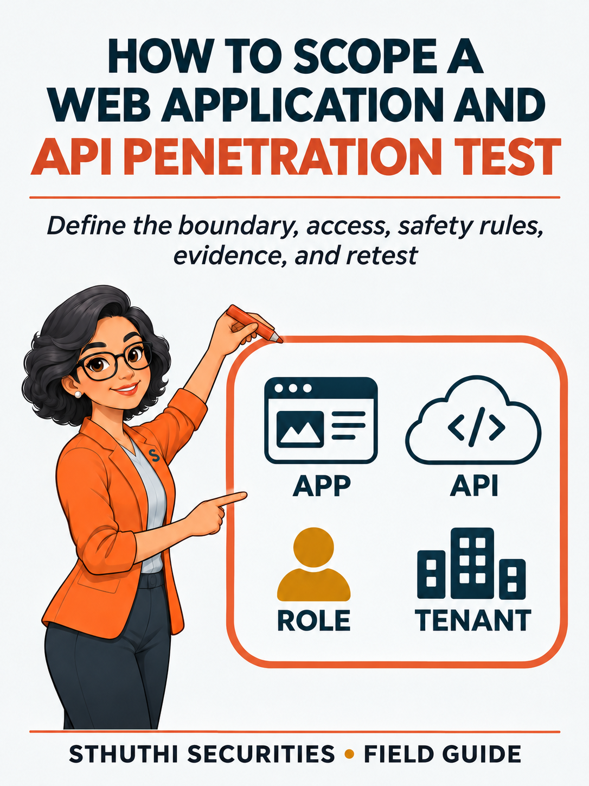

# How to Scope a Web Application and API Penetration Test

## Define targets, roles, tenants, workflows, safety rules, evidence, and retesting before testing begins

**A Sthuthi Securities field guide**  
Published by Sthuthi Technologies, LLC  
Edition 1.0 — 4 November 2026

---

## Who this guide is for

This guide is written for security leads, engineering managers, product owners, procurement teams, and assessors planning an authorized test. Its purpose is to turn an ambiguous request for a penetration test into a comparable, lawful, safe, and technically meaningful scope.

This is educational material, not legal advice, an audit opinion, a certification, or authorization to test a system. Penetration testing and security assessment require written permission from the system owner. Contract, privacy, employment, sector, and regional requirements should be reviewed with qualified advisers.

## How to use it

Read the operating model first. Complete the worksheets against one real product or customer request. Then use the technical field modules to challenge the scope and evidence. Keep dated copies of decisions and artifacts. Replace examples with facts from your own system.

The guide distinguishes an observation from an inference and a recommendation. A source can state what a framework contains. It cannot prove that a company operates a control. That proof must come from the company’s own records and testing.

# Core workbook

# Part I Define the assessment

# 1 Start with the decision the test must support

Penetration tests are bought for different reasons. A customer may require an annual report. An auditor may ask how a control was tested. A product team may be preparing a release. A board may want assurance after a major acquisition. Those are different decisions and may require different targets, timing, evidence, and report language.

Write the decision before naming tools or test cases. “Test our platform” gives no way to judge whether the result is useful. “Determine whether a customer user can access or change another customer’s records before the enterprise launch” gives the assessor a system rule, a role boundary, an impact, and a deadline.

NIST SP 800-115 treats planning as part of the assessment process, not administrative work that happens after the technical plan is set. It describes rules of engagement as detailed constraints established before testing and as the basis for authority to perform the defined activities.[1] OWASP likewise describes its testing material as a set of techniques that must be adapted to the application’s architecture, threat model, data, and business context.[2]

## Write one primary decision

Choose one sentence that the report must help someone answer. Examples:

- Can a customer cross the tenant boundary in the production-equivalent SaaS application?
- Can an authenticated user call administrative API functions without the required role?
- Can the mobile application expose account data through local storage, transport, or its backend API?
- Can an AI support agent read another customer’s order or issue a refund without approval?
- Does the current release provide the technical testing evidence requested for an audit or customer review?

Secondary goals can be recorded, but they should not crowd out the primary decision. If the company needs an application test, cloud-configuration review, source-code review, phishing exercise, and recovery exercise, it probably needs several workstreams rather than one vague “full security test.”

## Identify the relying audience

The same technical finding is presented differently to an engineer, a customer security team, an auditor, and a board. Record the people who will rely on the output and what they expect to receive. Do not promise a certification, compliance conclusion, or audit opinion when the assessor is only performing technical testing.

An auditor may want scope dates, methodology, tester independence, findings, remediation, and retest evidence. Engineering needs exact reproduction steps, affected components, and a specific fix. Procurement may need a short executive summary and proof that the report can be shared under controlled terms. The statement of work should name these outputs before testing begins.

## Define success without promising zero findings

“No vulnerabilities found” is not a sensible success condition. A test can be well executed and still identify serious weaknesses. Use conditions the engagement can control:

- Every named critical workflow received the agreed coverage.
- Each required role and tenant combination was tested.
- Confirmed findings contain reproducible evidence and a clear affected rule.
- Limitations and untested areas are stated.
- The report is delivered by the required date.
- Retesting uses the recorded scenario against the corrected release.

## Worksheet 1 Assessment decision brief

| Field | Response |
|---|---|
| Engagement name |  |
| Primary business decision |  |
| Trigger for the assessment |  |
| Deadline and reason for it |  |
| People or organizations relying on the output |  |
| Required report or evidence format |  |
| Primary security concern |  |
| Critical data or action at risk |  |
| What a successful engagement must complete |  |
| What the engagement must not claim |  |
| Executive owner |  |
| Technical owner |  |
| Scope version and date |  |

## Decision quality check

- [ ] The decision names a system or product boundary.
- [ ] The decision names the behavior or security rule under review.
- [ ] The deadline has a real business reason.
- [ ] The relying audience is known.
- [ ] Required deliverables are stated.
- [ ] Success does not depend on finding zero vulnerabilities.
- [ ] The test is not being described as an audit or certification unless it actually is one.

# 2 Name the systems and assets

The assessor cannot test an unnamed system. Start with the product as the user experiences it, then trace the components that accept requests, make decisions, store data, or call another service.

For a modern SaaS application, one “website” may include a browser application, public API, internal API, identity provider, file store, background workers, administrative console, payment provider, customer-support tooling, cloud infrastructure, and an AI model or retrieval system. The scope must distinguish client-owned components from third-party services. OWASP’s architecture-mapping guidance specifically calls for understanding technologies and components and recognizing that connected third-party systems are usually outside a tester’s authority unless separately included.[3]

*Figure 2. A connection does not create authority. Third-party services require their own permission or a test plan that stops at the client-controlled integration boundary.*

## Record targets at the level the tester can identify

Use exact identifiers where possible:

- Fully qualified domain names and base URLs
- API hostnames, base paths, versions, and specifications
- Mobile package or bundle identifier and build number
- Cloud account, subscription, tenant, project, and region
- Source repository and commit or release tag when code review is included
- Container image digest or deployed release identifier
- Administrative interfaces and non-public routes
- Webhook destinations and callback sources
- AI model, orchestration service, retrieval index, and enabled tools

Avoid “all company infrastructure” unless the company can produce a defensible inventory and truly intends to authorize that breadth. Avoid wildcard scope such as `*.example.com` without stating whether discovery is allowed, which host classes are included, and what happens when a third-party or abandoned service is found.

## Separate scope states

Give each asset one state:

- **In scope:** the assessor may perform the allowed tests.
- **Discovery only:** the assessor may identify and record the asset but may not actively test it.
- **Conditional:** testing requires a named condition, such as a maintenance window or separate approval.
- **Out of scope:** the assessor must not test it.
- **Unknown ownership:** testing is prohibited until ownership or authority is proved.

These states prevent a common error: treating every system discovered under a company domain as client-owned. DNS, content-delivery networks, hosted support pages, payment services, and acquisition-era systems can belong to another party.

## Worksheet 2 Asset register

| ID | Asset or component | Exact identifier | Owner | Environment | Scope state | Allowed test class | Notes |
|---|---|---|---|---|---|---|---|
| A-01 |  |  |  |  |  |  |  |
| A-02 |  |  |  |  |  |  |  |
| A-03 |  |  |  |  |  |  |  |
| A-04 |  |  |  |  |  |  |  |
| A-05 |  |  |  |  |  |  |  |
| A-06 |  |  |  |  |  |  |  |

## Worksheet 3 Ownership and authority record

| Asset ID | Legal or operational owner | Evidence of control | Third-party terms checked | Person granting authority | Status |
|---|---|---|---|---|---|
|  |  |  |  |  |  |
|  |  |  |  |  |  |
|  |  |  |  |  |  |
|  |  |  |  |  |  |

Acceptable evidence depends on the system. It may include cloud-console ownership, a domain record, a contract, a service account controlled by the client, or a written permission chain from the actual owner. The assessor should not decide that a client owns a target merely because the target contains the client’s name.

## Boundary review questions

- Which components enforce identity and authorization?
- Which component makes the final business decision?
- Where are tenant identifiers introduced and checked?
- Which stores contain customer, employee, payment, health, or regulated data?
- Which administrative interfaces are not linked from the normal application?
- Which background jobs continue after the browser request ends?
- Which integrations can read data or perform actions after a user signs out?
- Which assets were added through an acquisition or vendor relationship?
- Which systems cannot tolerate active testing?
- Which systems are being retired but remain reachable?

# 3 Map users roles tenants and critical workflows

Authorization testing needs more than one test account. The scope should describe who can act, which records they can reach, which operations they can perform, and how those rules change across tenants, teams, subscriptions, or lifecycle states.

OWASP’s authorization testing guidance separates unauthenticated access, horizontal access between equivalent users, and vertical access into higher-privilege functions.[4] A useful role matrix turns those categories into the product’s actual rules.

## Inventory identities before permissions

List human users, service identities, API clients, background workers, integration tokens, and emergency accounts. Record how each identity authenticates and where its permissions are enforced. A user may sign in through an identity provider but receive product permissions from a separate application database. An API key may belong to an organization rather than a person. A background worker may carry authority far beyond the user who triggered it.

Include lifecycle states. Newly invited, suspended, deleted, password-reset, trial, past-due, and former-employee accounts can behave differently from normal active users. A test that uses only the happy-path customer account misses these transitions.

## Map tenant boundaries explicitly

For a multi-tenant product, create at least two test tenants with distinct users and records. If resellers, parent organizations, workspaces, projects, or regions create nested boundaries, include those relationships. Give every test record a visible synthetic owner so cross-tenant evidence can be interpreted without exposing customer data.

The matrix should support tests such as:

- Customer A requests Customer B’s object by identifier.
- Customer A submits an API call captured from Customer B.
- A team administrator changes an organization-owner setting.
- A support user accesses an unassigned customer.
- A former member reuses a token after removal.
- A user changes a tenant identifier in a file, export, webhook, or background-job reference.

## Define critical workflows as state changes

“Test account management” is too broad. Write each workflow as a sequence with an expected rule:

1. Starting identity and state
2. Input or action
3. System decision
4. Data read or state change
5. Expected authorization result
6. Evidence that proves what happened

For example: “A customer administrator invites a new member to its own tenant. A standard customer must not invite members. No user from another tenant may accept or alter the invitation.” This description exposes role, tenant, state, and object boundaries.

## Worksheet 4 Identity and role matrix

| Role or identity | Authentication method | Tenant scope | May read | May change | May administer | Test account available |
|---|---|---|---|---|---|---|
| Anonymous | None | None |  |  |  | N/A |
| Standard customer |  |  |  |  |  |  |
| Customer administrator |  |  |  |  |  |  |
| Support user |  |  |  |  |  |  |
| Platform administrator |  |  |  |  |  |  |
| Service identity |  |  |  |  |  |  |

## Worksheet 5 Tenant test design

| Tenant | Synthetic users | Synthetic records | Subscription or state | Special relationship | Reset method |
|---|---|---|---|---|---|
| Tenant A |  |  |  |  |  |
| Tenant B |  |  |  |  |  |
| Parent or reseller |  |  |  |  |  |

## Worksheet 6 Critical workflow inventory

| ID | Workflow | Starting role | Sensitive object or action | Expected rule | Failure impact | Priority |
|---|---|---|---|---|---|---|
| W-01 |  |  |  |  |  |  |
| W-02 |  |  |  |  |  |  |
| W-03 |  |  |  |  |  |  |
| W-04 |  |  |  |  |  |  |
| W-05 |  |  |  |  |  |  |

## Minimum role coverage

- [ ] Anonymous or signed-out behavior
- [ ] Lowest-privilege authenticated user
- [ ] Equivalent users in different tenants
- [ ] Customer or team administrator
- [ ] Internal support or operations role
- [ ] Highest-risk administrative role, if permitted
- [ ] Service or integration identity
- [ ] Suspended, removed, expired, or otherwise changed identity

# Part II Describe the test surface

# 4 Choose coverage by application type

The scope should name coverage modules rather than claiming that one method covers everything. A browser test, API test, mobile test, cloud review, and AI-agent assessment can overlap, but each exposes a different part of the system.

OWASP WSTG organizes web testing across information gathering, configuration, identity, authentication, authorization, session management, input handling, error handling, cryptography, business logic, client behavior, and APIs.[2] The guide also warns that no fixed checklist can cover every application. Select the relevant techniques and tie them to the system rules recorded in this workbook.

## Web application coverage

Record all browser-accessible roles, routes, critical forms, upload and download functions, administrative interfaces, and client-side storage. Include authentication entry points, password recovery, invitations, federation, MFA enrollment, and session termination.

Browser coverage should address how the application behaves when requests are changed outside the user interface. A disabled button is not an authorization control. The assessor needs permission to capture, repeat, and modify relevant requests within the agreed limits.

Typical coverage areas include:

- Public and authenticated attack surface
- Authentication and account recovery
- Session cookies, tokens, logout, expiry, and concurrent sessions
- Horizontal and vertical authorization
- Input validation and injection paths
- File upload, download, preview, and processing
- Browser storage, cross-origin behavior, and client-side trust
- Business workflows, state transitions, and race conditions
- Error handling and sensitive-data exposure
- Security headers and transport configuration

## API coverage

An API scope needs the specification and the observed endpoints. They may differ. Record base URLs, versions, methods, object types, authentication schemes, webhook behavior, bulk operations, GraphQL operations, and administrative functions.

The OWASP API Security Top 10 highlights object-level authorization, authentication, object-property authorization, resource consumption, function-level authorization, sensitive business flows, server-side request forgery, configuration, inventory, and unsafe consumption of third-party APIs.[5] Use it as a risk prompt, not a claim that every relevant API test fits into ten labels.

API test planning should answer:

- Can one identity address another tenant’s object?
- Do list, search, export, batch, and indirect-reference endpoints apply the same checks as single-object endpoints?
- Can a client set server-controlled properties such as role, owner, status, price, or approval state?
- Are function permissions enforced at the API, not only in the interface?
- Can resource-intensive requests exceed agreed budgets or affect other tenants?
- Do webhooks verify source, freshness, and replay resistance?
- Does the application trust unsafe data returned by a supplier API?

## Mobile application coverage

Identify the exact iOS or Android build, distribution channel, supported operating-system versions, backend environment, and whether anti-tamper or certificate-pinning controls may affect testing. Mobile coverage can include local storage, logs, backups, inter-process communication, deep links, transport, authentication, runtime behavior, and backend APIs.

Do not treat the mobile binary and backend API as one unnamed target. A mobile assessment may need separate permission to analyze the application package, instrument the running app, bypass test-environment protections, and call the API outside the app.

## Cloud coverage

Cloud testing needs account-level identifiers and provider-specific rules. AWS currently allows customer testing of listed services without prior approval, but prohibits testing AWS infrastructure itself and requires prior approval for command-and-control activity.[6] Microsoft Azure allows testing of resources the customer owns or is authorized to test, subject to its published rules, and prohibits denial-of-service testing and access to other tenants.[7] Google Cloud does not require notice for testing a customer project, but the activity must follow its acceptable-use terms and affect only the customer’s projects.[8]

Record the current provider policy URL in the engagement file. Policies can change. The rules checked during scoping are part of the evidence for why a planned action was allowed.

Cloud coverage may include:

- Identity roles, trust policies, service accounts, and access keys
- Public endpoints and exposed storage
- Network paths, security groups, firewalls, and private connectivity
- Secrets, configuration, and workload identity
- Management-plane versus application-plane boundaries
- Logging, alerting, and response to test activity
- Container, serverless, and managed-service configuration
- Cross-account, cross-subscription, or cross-project trust

## Connected SaaS and OAuth coverage

List the integration, granted scopes, installation owner, token storage, refresh behavior, revocation behavior, and actions that remain possible after a user leaves. Define whether the assessor may install a test integration, change scopes, replay callbacks, or test only the client-owned portion.

## AI-enabled workflow coverage

An AI feature may connect user input to retrieved documents, memory, external tools, and real business actions. The scope should name the model or service, orchestration layer, retrieval sources, available tools, tool identities, approval requirements, and actions whose effects must be observed.

Prompt output alone does not establish impact. The evidence plan should capture the system’s deterministic decision, tool request, downstream authorization response, and resulting data access or state change. An AI assessment may include direct and indirect prompt injection, retrieval-boundary tests, tool-argument manipulation, cross-tenant context, memory behavior, sensitive-output handling, and approval bypass.

## Worksheet 7 Coverage module selection

| Module | Included | Named targets | Required inputs | Highest-priority rule | Material limitation |
|---|---|---|---|---|---|
| Web application |  |  |  |  |  |
| API |  |  |  |  |  |
| Mobile application |  |  |  |  |  |
| Cloud configuration |  |  |  |  |  |
| Connected SaaS or OAuth |  |  |  |  |  |
| AI-enabled workflow |  |  |  |  |  |
| Source-code review |  |  |  |  |  |
| Network or infrastructure |  |  |  |  |  |

## Worksheet 8 API inventory

| API or version | Base URL | Specification | Authentication | Roles | Object types | Webhooks or callbacks | Scope state |
|---|---|---|---|---|---|---|---|
|  |  |  |  |  |  |  |  |
|  |  |  |  |  |  |  |  |
|  |  |  |  |  |  |  |  |

# 5 Select environments data and dependencies

Production provides the most faithful behavior and the highest operational risk. Staging is safer but may differ in data, integrations, identity, configuration, or release version. Record those differences instead of describing one environment as “production-like.”

## Compare environments before choosing

| Question | Production | Test environment |
|---|---|---|
| Application version |  |  |
| Infrastructure and configuration match |  |  |
| Identity provider and role model match |  |  |
| API and integration behavior match |  |  |
| Customer data present |  |  |
| Monitoring and alerting active |  |  |
| Destructive test risk |  |  |
| Reset or recovery available |  |  |

If the test runs in production, identify safe synthetic accounts and records. If it runs in staging, state which findings may require a limited production confirmation and who can approve it. Never copy production customer data into a test environment merely to make the test realistic.

## Minimize sensitive data

The tester usually needs representative object relationships, not real customer content. Build synthetic records that show tenant, owner, state, and sensitivity without reproducing personal information. Record how test data is created, marked, reset, exported, and deleted.

Define evidence sanitization before testing. Screenshots, HTTP traces, logs, database results, model context, and files can contain tokens or customer data. State where raw evidence is stored, who can access it, how client-visible evidence is redacted, and when it is deleted.

## Map dependencies and failure paths

A workflow can depend on email, payment, identity, file processing, queues, analytics, model providers, or customer-managed endpoints. For each dependency, determine whether the tester may interact with the real service, a sandbox, a stub, or only the client-controlled integration code.

Do not send test emails, refunds, support messages, or webhooks to real recipients without explicit permission and controls. For a workflow that changes money or account access, define a synthetic or reversible path and a person who can stop or undo it.

## Worksheet 9 Environment and data plan

| Field | Response |
|---|---|
| Primary test environment |  |
| Exact release or build |  |
| Known differences from production |  |
| Production confirmation allowed |  |
| Synthetic tenants and records |  |
| Prohibited data classes |  |
| Evidence storage location |  |
| Client-visible redaction rule |  |
| Raw evidence retention period |  |
| Test data deletion owner and date |  |
| Reset or rollback method |  |

## Worksheet 10 Dependency boundary

| Dependency | Purpose | Owner | Test mode | Allowed interaction | Prohibited interaction | Contact |
|---|---|---|---|---|---|---|
| Identity provider |  |  |  |  |  |  |
| Email or messaging |  |  |  |  |  |  |
| Payment service |  |  |  |  |  |  |
| File processing |  |  |  |  |  |  |
| Model or AI service |  |  |  |  |  |  |
| Customer webhook |  |  |  |  |  |  |

# 6 Define reconnaissance and discovery boundaries

Testing a known URL and discovering the broader attack surface are different tasks. State which one the engagement includes.

OWASP’s attack-surface guidance explains that applications can exist on non-obvious hosts or paths and that the rules of engagement determine whether discovery should extend beyond the listed URL.[9] Discovery can find forgotten assets, but it can also reach third-party systems or targets the client is not prepared to test.

## Choose the discovery model

- **Closed list:** only the exact listed targets may be contacted.
- **Passive discovery:** public records, certificates, DNS data, and archives may be reviewed without active requests to discovered targets.
- **Active discovery within a boundary:** the assessor may enumerate hosts, paths, ports, or APIs inside a defined domain, address range, cloud account, or application.
- **Discovery with approval gate:** newly identified targets are reported and tested only after written addition to the scope.

Define whether subdomains, virtual hosts, IP addresses, alternate ports, archived URLs, JavaScript-referenced APIs, mobile backend hosts, and cloud endpoints may be collected. Then state which can receive active requests.

## Handle newly discovered assets

Discovery never automatically expands authority. Use one of three outcomes:

1. Record the asset as an observation and do not test it.
2. Ask the owner to prove authority and issue a written scope change.
3. Stop and escalate if the asset appears sensitive, unstable, or owned by another party.

## Worksheet 11 Discovery rules

| Discovery activity | Allowed | Boundary | Active requests allowed | Rate limit | New-target action |
|---|---|---|---|---|---|
| Certificate and public-record review |  |  | N/A | N/A |  |
| DNS and subdomain enumeration |  |  |  |  |  |
| Host and port identification |  |  |  |  |  |
| Content and route discovery |  |  |  |  |  |
| JavaScript and mobile endpoint review |  |  |  |  |  |
| Cloud resource discovery |  |  |  |  |  |
| API inventory comparison |  |  |  |  |  |

# Part III Make the engagement lawful and safe

# 7 Write authorization and rules of engagement

The rules of engagement turn the scope into permission and operating constraints. NIST defines them as detailed guidelines established before testing that give the test team authority to conduct the defined activities.[10] They should be approved by someone who can speak for the owner of every target.

An assessment request, purchase order, email introduction, or access credential is not automatically sufficient authority. The signed record should connect the legal parties, target identifiers, owner, allowed techniques, test window, and limits. If a customer wants a provider to test a system owned by its client, parent company, cloud customer, or integration partner, the permission chain must reach that owner.

*Figure 3. Testing stays locked until the four authorization conditions agree and a signed record is on file.*

## Name the authorizing parties

Record:

- The contracting client
- The legal or operational owner of each target
- The person granting permission and their authority
- The testing provider and named test lead
- Any hosting, platform, or third party whose rules apply
- Emergency contacts with authority to pause testing

If the owner is not the contracting client, attach the separate permission rather than summarizing it as “approved.”

## Define allowed actions by class

Do not rely on “standard penetration testing.” Mark which activities are allowed:

- Passive observation and public-source discovery
- Account creation and normal workflow use
- Request capture, replay, and parameter modification
- Authentication and authorization testing
- Automated crawling or scanning within rate limits
- File upload and parser testing with safe samples
- Controlled injection and command-execution proof
- Privilege escalation within client-owned systems
- Cloud identity and configuration review
- Mobile instrumentation or binary analysis
- Source-code review
- AI prompt, retrieval, memory, and tool tests
- Controlled changes to synthetic records
- Limited production confirmation

For actions that could change data, send messages, move money, affect availability, trigger fraud controls, or reach another tenant, record the safe method and approval condition.

## Write prohibited actions plainly

Common exclusions include:

- Denial-of-service and load testing
- Destructive data modification
- Persistence beyond what is required to prove impact
- Access to real customer records
- Social engineering or employee targeting
- Testing third-party services
- Using exposed credentials that do not belong to the client’s test identities
- Malware deployment
- Physical access attempts
- Lateral movement outside the named boundary
- Contacting real customers or suppliers

Cloud-provider rules may prohibit actions even when the client requests them. Azure’s current rules, for example, prohibit denial-of-service testing and testing another tenant. AWS requires prior approval for command-and-control activity and prohibits testing AWS services themselves.[6][7] The engagement record should preserve the policy version or access date used during planning.

## Set time and traffic controls

State the time zone, start, end, maintenance windows, blackout periods, and whether passive work may continue outside the active window. Record assessor source IP addresses or other identifiers when monitoring teams need them. Define concurrency, requests per second, scanner intensity, file size, test-account limits, and budgets for paid APIs or AI model calls.

Rate limits should match the weakest in-scope dependency, not the fastest endpoint. A login, search, export, payment, or model workflow may have different safe rates.

## Establish stop conditions

Testing should pause when:

- Service health crosses an agreed threshold.
- Unexpected real customer data appears.
- A test reaches an unapproved system or tenant.
- A destructive action occurs or becomes likely.
- Monitoring reports abnormal impact.
- The authorization window expires.
- A critical vulnerability requires immediate containment.
- The client or provider stop contact invokes the agreed phrase or channel.

Record who can stop the engagement, how they contact the test lead, and what evidence is preserved after a stop. A pause should not be treated as a failed test. It is a controlled response to a condition named in advance.

## Worksheet 12 Rules of engagement

| Field | Agreed value |
|---|---|
| Contracting client |  |
| Target owner or owners |  |
| Person granting authority |  |
| Testing provider and test lead |  |
| Scope version incorporated by reference |  |
| Active testing start |  |
| Active testing end |  |
| Time zone |  |
| Blackout periods |  |
| Source addresses or identifiers |  |
| Maximum request rate or concurrency |  |
| Allowed automated tools or classes |  |
| Allowed data-changing actions |  |
| Prohibited actions |  |
| Stop conditions |  |
| Emergency client contact |  |
| Emergency assessor contact |  |
| Evidence and data-handling terms |  |
| Provider policies checked |  |
| Client approval and date |  |
| Assessor acceptance and date |  |

## Authorization release check

- [ ] Every active target has a proved owner.
- [ ] The approver can grant authority for those targets.
- [ ] Third-party and cloud-provider conditions were checked.
- [ ] Allowed and prohibited actions are explicit.
- [ ] Dates, times, time zone, and source addresses are recorded.
- [ ] Rate and cost limits are recorded.
- [ ] Stop contacts and conditions are tested or confirmed.
- [ ] The signed authorization references the same scope version the assessor will use.

# 8 Prepare accounts access and monitoring

Access should be sufficient to test the intended roles without granting unrelated power. Create dedicated test accounts. Do not reuse employee credentials or send passwords through the workbook.

## Build the account set from the role matrix

Each required role should have a test identity with known ownership and synthetic data. For tenant testing, maintain equivalent users in at least two tenants. Record any account that carries global, support, billing, or infrastructure permissions separately.

If MFA, federation, device trust, IP allowlisting, or invitation workflows apply, decide whether the test evaluates those controls or uses an approved bypass. A bypass that is necessary for access becomes a report limitation if it prevents the assessor from testing the real control.

## Separate credential delivery

Record account names and required roles in the scope. Deliver passwords, recovery codes, private keys, and tokens through the agreed secret channel after authorization. Set an owner and expiry for every testing secret. Revoke or rotate them when the engagement closes.

## Prepare monitoring without hiding the test

The operations team should know the test window and stop procedure. Whether defenders know the exact actions depends on the engagement goal. A normal application assessment usually favors safe coordination. A detection exercise may intentionally limit foreknowledge, but that choice belongs in the rules of engagement.

Record the logs and alerts expected during testing. If a critical action cannot be tied to an identity and timestamp, the engagement may reveal an evidence gap even when the action itself was authorized.

## Worksheet 13 Access readiness checklist

| Item | Owner | Ready | Secure delivery method | Expiry or reset | Notes |
|---|---|---|---|---|---|
| Tenant A standard user |  |  |  |  |  |
| Tenant A administrator |  |  |  |  |  |
| Tenant B standard user |  |  |  |  |  |
| Tenant B administrator |  |  |  |  |  |
| Internal support role |  |  |  |  |  |
| API client or key |  |  |  |  |  |
| Mobile test build |  |  |  |  |  |
| Cloud read access |  |  |  |  |  |
| Architecture and data flow |  |  |  |  |  |
| API specification |  |  |  |  |  |
| Logging and alert contact |  |  |  |  |  |
| Reset and cleanup process |  |  |  |  |  |

# 9 State exclusions limits and unknowns

Every assessment has limits. Hiding them makes the report look broader than the work.

## Distinguish an exclusion from a limitation

An **exclusion** is a deliberate boundary: a third-party payment service is not tested. A **limitation** reduces coverage inside the intended boundary: the client could not provide an administrator account, so administrator-only workflows were not tested. An **unknown** has not been resolved: ownership of an old subdomain remains unclear.

Record all three. State the likely effect on assurance. “Mobile application excluded” is clear. “The backend API was tested through browser-observed calls only; unreferenced endpoints may remain untested” explains residual uncertainty.

## Avoid generic disclaimers

“No test can find every issue” is true but not specific enough. Useful limits name the missing access, unavailable environment, untested role, blocked technique, time constraint, or system difference.

Examples:

- Production payment settlement was excluded; sandbox behavior may differ.
- The test did not include source code, so findings based on internal code paths may remain undiscovered.
- Rate limits prevented high-volume resource-consumption testing.
- The client supplied one customer role; support and administrator workflows were not tested.
- Third-party model infrastructure was outside the client’s authority; testing stopped at the client-controlled API boundary.

## Worksheet 14 Exclusion limitation and unknown register

| ID | Type | Description | Reason | Coverage effect | Decision owner | Resolution or report wording |
|---|---|---|---|---|---|---|
| L-01 |  |  |  |  |  |  |
| L-02 |  |  |  |  |  |  |
| L-03 |  |  |  |  |  |  |
| L-04 |  |  |  |  |  |  |

# Part IV Agree on the output

# 10 Set evidence and reporting requirements

A report should prove what was observed, connect the observation to a broken rule, explain material impact, and give the owner a specific correction. Tool output without validation is not a finding.

OWASP’s current testing introduction describes useful reporting as reproducible, actionable, severity-ranked, and understandable to technical and business readers.[2] NIST SP 800-115 also connects testing to analysis and mitigation rather than stopping at discovery.[1]

## Define the evidence unit

For each confirmed finding, require:

- Finding identifier and plain-language title
- Affected target, release, endpoint, role, and tenant
- Expected security rule
- Preconditions and test identity
- Reproduction steps
- Sanitized request, action, log, or trace
- Observed result
- Business and technical impact
- Severity and rationale
- Recommended correction
- Owner and remediation state
- Retest result and evidence when performed

Evidence should prove the server-side or downstream result. A browser message may not prove a record changed. A model response may not prove a tool ran. A scanner alert may not prove exploitability. Capture the authoritative state where the system made or recorded the decision.

## Agree on severity language

Decide whether the report uses qualitative ratings, CVSS, a client risk matrix, or a combination. FIRST’s CVSS specification provides a standardized way to describe vulnerability severity, but business priority can still depend on asset value, exposure, data, and compensating controls.[11] Do not promise that one numeric score will settle every remediation decision.

Record who can change a severity rating and what evidence is required. Separate technical severity from remediation priority when the client’s business context calls for it.

## Protect sensitive evidence

Require redaction of passwords, session tokens, private keys, customer content, and unnecessary personal data. Decide whether raw evidence stays only in the assessor’s restricted store, whether the client receives a sanitized version, and how long both copies remain available.

Reports should carry a classification and an authorized distribution list. If customers will receive a summary, define whether it is a separate redacted report, an executive letter, or a controlled portal copy. Do not assume a full technical report can be forwarded without restriction.

## Define report versions and acceptance

Typical versions are:

1. Draft for factual review
2. Final initial report
3. Retest report or updated final report

The client may correct factual errors, target names, owners, or reproduction details. It should not remove a supported finding merely because the fix is inconvenient. Record the dispute and review process before it is needed.

## Worksheet 15 Finding acceptance criteria

| Requirement | Mandatory | Report location or format | Reviewer |
|---|---|---|---|
| Plain-language title |  |  |  |
| Affected target and release |  |  |  |
| Expected rule |  |  |  |
| Reproduction steps |  |  |  |
| Sanitized evidence |  |  |  |
| Material impact |  |  |  |
| Severity and rationale |  |  |  |
| Recommended correction |  |  |  |
| Owner and state |  |  |  |
| Retest evidence |  |  |  |

## Worksheet 16 Report acceptance criteria

| Field | Agreed value |
|---|---|
| Report audiences |  |
| Required executive summary |  |
| Technical detail level |  |
| Severity method |  |
| Required compliance or framework mapping |  |
| Evidence sanitization rule |  |
| Report classification |  |
| Authorized recipients |  |
| Draft review period |  |
| Final delivery date and format |  |
| Customer-shareable output |  |
| Report retention and deletion |  |

# 11 Define remediation and retesting

Client remediation and assessor verification are different events. A development team can report that a change was deployed. Only a retest shows how the corrected system behaved under the recorded scenario.

*Figure 4. Ready for retest means the client believes the correction is deployed. Fixed and verified requires new assessor evidence.*

## Keep review and remediation states separate

Finding review states can include Draft, Needs Review, Confirmed, and Rejected. Remediation states can include Open, In Progress, Ready for Retest, Fixed and Verified, Risk Accepted, and Not Reproducible. Mixing them creates false closure. A confirmed finding can still be open. A rejected result is not a fixed vulnerability.

## Define the retest unit

The retest should name:

- The original finding and evidence
- The corrected release or configuration
- The original reproduction scenario
- Any additional regression checks
- The environment and test identity
- The observed corrected result
- Residual or partial risk
- Reviewer and verification date

A narrow retest confirms the agreed correction. It is not automatically a new full assessment. If the fix changes architecture, permissions, workflows, or dependencies, the parties may need a revised scope.

## Set commercial and timing terms

State how many retest rounds are included, how long they remain available, expected scheduling notice, and what counts as a new finding or new scope. Record whether the client must resolve all findings before the retest or may submit them in groups.

## Worksheet 17 Retest agreement

| Field | Agreed value |
|---|---|
| Included retest rounds |  |
| Retest availability period |  |
| Required notice |  |
| Client evidence required before scheduling |  |
| Corrected release identifier |  |
| Environment |  |
| Original scenarios to repeat |  |
| Regression checks included |  |
| Treatment of partial fixes |  |
| Treatment of new findings |  |
| Verification approver |  |
| Updated report format |  |

# 12 Fix the schedule and responsibilities

Most engagement delays come from access, authorization, unavailable owners, unstable environments, and late factual review. The operating plan should make those dependencies visible.

## Name contacts by responsibility

Use roles, names, and backup contacts for:

- Executive scope owner
- Technical product owner
- Environment or cloud owner
- Identity and access owner
- Security monitoring contact
- Privacy or data contact
- Third-party integration owner
- Assessor test lead
- Assessor reviewer
- Emergency stop contact

## Set decision points

Recommended milestones include scope approval, signed authorization, access verification, test start, midpoint review, urgent-finding notification, testing end, draft report, factual review close, final report, remediation submission, and retest.

Define the channel for routine updates and a separate channel for critical issues or stop instructions. Record whether a critical finding is reported immediately and who may receive it.

## Worksheet 18 Engagement operating plan

| Milestone or responsibility | Owner | Backup | Date or service target | Channel | Acceptance evidence |
|---|---|---|---|---|---|
| Scope approval |  |  |  |  |  |
| Authorization complete |  |  |  |  |  |
| Access verification |  |  |  |  |  |
| Testing start |  |  |  |  |  |
| Routine status update |  |  |  |  |  |
| Critical issue escalation |  |  |  |  |  |
| Draft report |  |  |  |  |  |
| Factual review close |  |  |  |  |  |
| Final report |  |  |  |  |  |
| Retest request |  |  |  |  |  |

# Part V Issue the scope

# 13 Assemble the statement of work

The completed workbook is planning material. The statement of work and signed rules of engagement are the controlling engagement records. Transfer the final decisions without reducing them to a vague paragraph.

## One page scope brief

### Assessment identity

| Field | Final value |
|---|---|
| Client and product |  |
| Assessment type |  |
| Primary decision |  |
| Scope version |  |
| Test window and time zone |  |
| Assessor |  |

### In-scope targets

| Target ID | Exact identifier | Environment | Coverage module | Owner |
|---|---|---|---|---|
|  |  |  |  |  |
|  |  |  |  |  |
|  |  |  |  |  |

### Critical coverage

| Workflow or rule | Roles and tenants | Required test outcome | Priority |
|---|---|---|---|
|  |  |  |  |
|  |  |  |  |
|  |  |  |  |

### Boundaries

| Item | Final value |
|---|---|
| Discovery model |  |
| Allowed active techniques |  |
| Data-changing actions |  |
| Prohibited actions |  |
| Rate and concurrency limits |  |
| Stop conditions |  |
| Material exclusions |  |

### Deliverables

| Deliverable | Format | Due | Acceptance owner |
|---|---|---|---|
| Draft report |  |  |  |
| Final report |  |  |  |
| Customer-shareable summary |  |  |  |
| Retest output |  |  |  |

## Scope change control

Define how changes are proposed, approved, priced, and added to the authorization. A new hostname, environment, tenant, workflow, or test technique may change effort and risk. The assessor should not test it first and seek approval later.

A scope change record should contain:

- Requested change and reason
- New or removed targets
- Coverage and timing effect
- Additional access or data
- New provider rules or third-party rights
- Price or schedule change
- Updated scope version
- Named client and assessor approvals

## Final issue checklist

- [ ] The scope brief matches the detailed workbook.
- [ ] Exact target identifiers are included.
- [ ] Roles, tenants, and critical workflows are named.
- [ ] The environment and release are identified.
- [ ] Discovery rules are clear.
- [ ] Allowed and prohibited actions are clear.
- [ ] Authorization covers every target and action.
- [ ] Access and test data are ready.
- [ ] Evidence, report, severity, and retest terms are agreed.
- [ ] Exclusions and limitations will appear in the report.
- [ ] The client and assessor approved the same version.

# 14 Worked example for a multi tenant SaaS platform

This example uses a fictional support platform. No client systems or customer data are represented.

## Product description

Example Support App lets a company’s customers view orders and request refunds through a browser portal. Each customer belongs to one tenant. Customer administrators can invite team members. Internal support staff can search assigned customers. An AI support agent can look up orders through the same API and can prepare, but not approve, refund requests.

The application is preparing for an enterprise launch. The buyer requested a current penetration-test report. Engineering also wants proof that the AI agent cannot cross tenant boundaries or issue a refund without approval.

## Completed decision brief

| Field | Example response |
|---|---|
| Primary business decision | Determine whether a customer or AI support agent can access another tenant’s order or cause an unapproved refund before enterprise launch. |
| Trigger | Enterprise buyer requested an independent application penetration test. |
| Deadline | Final report due 15 December 2026 for buyer review. |
| Relying audiences | Engineering, product leadership, buyer security team. |
| Required output | Technical report, executive summary, evidence for confirmed findings, and one retest round. |
| Success | Agreed web, API, role, tenant, and AI tool workflows tested; limitations stated; verified retest recorded. |
| Non-claim | The engagement does not issue a SOC 2 opinion or certify the product. |

## Completed asset register

| ID | Asset | Identifier | Owner | Environment | State | Coverage |
|---|---|---|---|---|---|---|
| A-01 | Customer web portal | `https://app.example.test` | Example Support App | Staging | In scope | Web application |
| A-02 | Public product API | `https://api.example.test/v1` | Example Support App | Staging | In scope | API |
| A-03 | Administration console | `https://admin.example.test` | Example Support App | Staging | Conditional | Support role only |
| A-04 | AI orchestration service | `https://agent.example.test` | Example Support App | Staging | In scope | AI workflow |
| A-05 | Payment sandbox | Provider sandbox account | Payment provider | Sandbox | Boundary only | Client integration calls only |
| A-06 | Production application | `https://app.example.com` | Example Support App | Production | Out of scope | No active testing |

## Completed role and tenant plan

| Role | Tenant | Allowed behavior | Prohibited behavior | Test account |
|---|---|---|---|---|
| Customer user A | Tenant A | Read Tenant A orders | Read or change Tenant B orders | Ready |
| Customer admin A | Tenant A | Invite Tenant A members | Administer Tenant B | Ready |
| Customer user B | Tenant B | Read Tenant B orders | Read or change Tenant A orders | Ready |
| Support user | Assigned tenants | Search assigned customers | Search unassigned customer | Ready |
| AI support agent | Calling user context | Look up caller-owned order | Cross-tenant lookup or direct refund approval | Ready |

Synthetic orders are named `ORDER-A-101`, `ORDER-A-102`, and `ORDER-B-204`. The names make ownership visible in evidence. No real addresses, names, or payment details are used.

## Completed critical workflows

| ID | Workflow | Expected rule | Priority |
|---|---|---|---|
| W-01 | View order detail | API verifies the requesting user belongs to the order’s tenant. | Critical |
| W-02 | Export order history | Export contains only the caller’s tenant records. | High |
| W-03 | Invite member | Only a customer administrator can invite a member to its own tenant. | High |
| W-04 | Support search | Support user reaches only explicitly assigned tenants. | High |
| W-05 | AI order lookup | Agent carries the caller’s identity and cannot substitute another tenant’s order ID. | Critical |
| W-06 | Refund request | Agent may prepare a request; server requires customer confirmation and staff approval before execution. | Critical |

## Completed rules of engagement summary

| Field | Example agreement |
|---|---|
| Window | 1–10 December 2026, 09:00–18:00 America/New_York |
| Source | Two assessor VPN egress addresses listed in signed authorization |
| Allowed | Request capture and modification, web/API authorization testing, safe injection tests, synthetic file uploads, AI prompt and tool tests |
| Automated traffic | Maximum five requests per second; authentication endpoints limited to one request per second |
| Data changes | Synthetic invitations and refund requests in staging; all records reset nightly |
| Prohibited | Production requests, denial of service, real customer contact, payment-provider testing, persistence, third-party credential use |
| Stop conditions | Real customer data, unexpected production traffic, staging error rate above agreed threshold, third-party boundary crossed |
| Escalation | Dedicated client and assessor channel; critical confirmed findings reported immediately |

## Example finding acceptance criteria

A cross-tenant order finding must show the calling identity, requested order, expected tenant rule, sanitized request, server response, and proof that another tenant’s record was returned. A model statement such as “I found the order” is insufficient unless the downstream API response or state proves access.

For a refund finding, evidence must show whether a refund record was created, which identity authorized it, whether approval was required, and whether the payment sandbox received a request. The test stops at the client-controlled sandbox integration boundary.

## Example retest

The initial test records HTTP 200 when Customer A requests `ORDER-B-204`. Engineering adds an order-ownership check and deploys release `2026.12.12-rc2`. The retest repeats the same authenticated request and records HTTP 403 with no order data in the response or application logs. A reviewer signs the new evidence and changes the remediation state to Fixed and Verified. The original finding and evidence remain in report history.

# Appendix A Master pre test checklist

## Decision and scope

- [ ] Primary decision written
- [ ] Deadline and relying audience named
- [ ] Exact targets listed
- [ ] Owners proved
- [ ] Environment and release recorded
- [ ] Coverage modules selected
- [ ] Critical workflows prioritized

## Roles and access

- [ ] Required roles inventoried
- [ ] Two test tenants prepared where applicable
- [ ] Lifecycle states included
- [ ] Accounts and synthetic records ready
- [ ] Credentials have a secure delivery path
- [ ] Secrets have expiry and cleanup owners

## Safety and authority

- [ ] Written authorization signed
- [ ] Third-party permissions checked
- [ ] Cloud-provider rules checked
- [ ] Test window and source addresses recorded
- [ ] Rate limits recorded
- [ ] Prohibited actions recorded
- [ ] Stop contacts and conditions confirmed

## Evidence and delivery

- [ ] Evidence fields agreed
- [ ] Redaction and retention agreed
- [ ] Severity method agreed
- [ ] Draft and final dates agreed
- [ ] Distribution list agreed
- [ ] Retest rounds and timing agreed
- [ ] Limitations will be stated in the report

# Appendix B Vendor proposal comparison scorecard

Score each item from 0 to 3: 0 absent, 1 weak, 2 acceptable, 3 strong. Multiply the score by the weight. Do not select a provider from the total alone; unresolved authority, data-handling, or tester-quality concerns can disqualify a proposal.

| Criterion | Weight | Vendor A | Vendor B | Vendor C | Evidence or concern |
|---|---:|---:|---:|---:|---|
| Scope reflects named systems and workflows | 5 |  |  |  |  |
| Manual authorization and business-logic testing | 5 |  |  |  |  |
| Qualified named test lead and reviewer | 4 |  |  |  |  |
| Clear rules of engagement | 5 |  |  |  |  |
| Evidence and reproduction quality | 5 |  |  |  |  |
| Report serves engineers and executives | 4 |  |  |  |  |
| Data handling and retention | 5 |  |  |  |  |
| Retesting terms | 4 |  |  |  |  |
| Schedule and access dependencies | 3 |  |  |  |  |
| Transparent exclusions and assumptions | 4 |  |  |  |  |
| Price and change-control terms | 3 |  |  |  |  |
| Relevant application or industry experience | 3 |  |  |  |  |

# Appendix C Glossary

**Active testing:** Requests or actions sent to a target to evaluate security behavior.

**Attack surface:** Reachable systems, interfaces, inputs, identities, and trust relationships that can affect security.

**Authorization:** Permission from an owner for named parties to perform defined testing against defined targets.

**Business logic:** Product rules governing state, eligibility, price, ownership, approval, sequence, or another business decision.

**Coverage:** The systems, roles, workflows, test classes, and techniques included in the assessment.

**Evidence:** A sanitized record that supports what the assessor observed, including relevant identity, request or action, response or state, time, and target version.

**Exclusion:** A deliberate item outside the assessment.

**Finding:** A reviewed security issue supported by evidence, impact, and an expected rule.

**Horizontal authorization:** Access between users or tenants at a similar privilege level.

**Limitation:** A condition that reduces the depth, breadth, or confidence of the assessment.

**Passive discovery:** Collection of public or already available information without active requests to the discovered target.

**Penetration test:** An authorized technical assessment that attempts to identify and validate exploitable security weaknesses within an agreed boundary.

**Ready for retest:** A client state indicating that a correction is believed to be deployed. It is not proof of resolution.

**Retest:** Repetition of the relevant recorded scenario against a corrected system to collect new evidence.

**Rules of engagement:** The detailed permissions and constraints governing how the security test will run.

**Scope change:** A documented addition, removal, or modification to targets, techniques, timing, access, or outputs.

**Stop condition:** A defined event that requires testing to pause or end.

**Tenant:** A customer, organization, workspace, or another logical boundary intended to isolate identities and data.

**Vertical authorization:** Access from a lower-privilege identity into a higher-privilege function or record.

# Sources

1. National Institute of Standards and Technology. *Technical Guide to Information Security Testing and Assessment, NIST SP 800-115.* https://csrc.nist.gov/pubs/sp/800/115/final
2. OWASP Foundation. *Web Security Testing Guide.* https://wstg.owasp.org/
3. OWASP Foundation. *Map Application Architecture, WSTG-INFO-10.* https://wstg.owasp.org/latest/4-Web_Application_Security_Testing/01-Information_Gathering/10-Map_Application_Architecture/
4. OWASP Foundation. *Bypassing Authorization Schema, WSTG-ATHZ-02.* https://wstg.owasp.org/latest/4-Web_Application_Security_Testing/05-Authorization/02-Bypassing_Authorization_Schema/
5. OWASP Foundation. *OWASP API Security Top 10 2023.* https://api-security.owasp.org/
6. Amazon Web Services. *AWS Customer Support Policy for Penetration Testing.* https://aws.amazon.com/security/penetration-testing/
7. Microsoft. *Penetration testing on Azure.* https://learn.microsoft.com/en-us/azure/security/fundamentals/pen-testing
8. Google Cloud. *Cloud Security FAQ, penetration testing.* https://support.google.com/cloud/answer/6262505
9. OWASP Foundation. *Attack Surface Identification.* https://wstg.owasp.org/latest/4-Web_Application_Security_Testing/01-Information_Gathering/04-Attack_Surface_Identification/
10. National Institute of Standards and Technology. *Rules of Engagement glossary definition.* https://csrc.nist.gov/glossary/term/Rules_of_Engagement
11. Forum of Incident Response and Security Teams. *Common Vulnerability Scoring System version 4.0 specification.* https://www.first.org/cvss/v4.0/specification-document
12. OWASP Foundation. *Application Security Verification Standard.* https://asvs.owasp.org/
13. OWASP Foundation. *Mobile Application Security Verification Standard.* https://mas.owasp.org/MASVS/
14. PCI Security Standards Council. *Document Library.* https://www.pcisecuritystandards.org/document_library/

Sources were accessed in November 2026. Provider rules and standards can change. Recheck the current controlling document during each engagement.

# About Sthuthi Securities

Sthuthi Securities is the cybersecurity testing and remediation service from Sthuthi Technologies, LLC. It provides authorized penetration testing, AI security assessments, SaaS and cloud reviews, compliance-readiness support, remediation, and verified retesting.

The team’s assessment model connects scope, authorization, evidence, human review, specific corrections, and retesting. Testing begins only after ownership, targets, allowed actions, and the test window are recorded.

Website: https://sthuthi-tech.com  
Security application: use the assessment request page in Sthuthi Securities  

## Workbook completion record

| Field | Final value |
|---|---|
| Organization |  |
| Product or system |  |
| Scope version |  |
| Prepared by |  |
| Reviewed by |  |
| Approved by |  |
| Authorization reference |  |
| Date issued |  |
| Next review date |  |

# Part IV — Technical and evidence field modules

These modules answer recurring questions that appear across customer reviews, program design, penetration-test planning, and AI-agent assessment. Use only the modules that match the product and decision in scope.

## Field module 1: How to Scope a Web Application Penetration Test

*Primary keyword: web application penetration test scope. Originally prepared for the Sthuthi Securities knowledge base; revised here as a book module.*

**A useful web application penetration-test scope names the application, backing APIs, environments, authenticated roles, tenant boundaries, sensitive workflows, allowed testing actions, exclusions, dates, deliverables, and retest terms.** If one of those is missing, quotes will not be comparable and coverage will be ambiguous.

Good scoping is not administrative overhead. It controls safety, cost, testing depth, and the meaning of the final report. “Test our web app” can describe a three-day unauthenticated review or weeks of authenticated business-logic work. The tester needs enough detail to estimate effort without collecting secrets or customer records during sales.

#### Start with the decision the report must support

Write one sentence that explains why the assessment exists. Examples:

- An enterprise customer requires an independent application test before contract signature.

- An auditor asked for evidence that authenticated access controls were tested.

- The product now supports refunds and administrators want the approval flow tested.

- A new multi-tenant architecture needs an independent check before migration.

The decision determines the evidence. A launch review may prioritize high-risk workflows and release blockers. A customer-requested report may need an executive summary and defined remediation status. A regulated scope may need particular systems, tester qualifications, or dates.

#### 1. Name the application boundary

List the exact hosts, application names, and environment. Include alternate domains used for authentication, file delivery, administration, or regional deployments. State which systems are owned by your organization and which are operated by third parties.

The [OWASP Web Security Testing Guide](https://owasp.org/projects/web-security-testing-guide) covers configuration, identity, authentication, authorization, sessions, input validation, error handling, cryptography, business logic, client-side behavior, and APIs. That breadth is useful, but the guide is not a substitute for naming your specific product boundary.

> **Do not use a wildcard as the scope.** “Everything under example.com” can include marketing systems, vendors, abandoned hosts, and services the client is not authorized to test.

#### 2. Decide whether the backing API is included

A web application test normally exercises the endpoints used by the browser. That does not automatically cover every API endpoint, mobile route, partner API, service credential, GraphQL operation, or deprecated version. If the API is a product in its own right, give it a separate inventory and role matrix.

Read [API pentest versus web application pentest](/blog/api-pentest-vs-web-application-pentest) before combining the scopes. The [OWASP API Security Top 10](https://api-security.owasp.org/) highlights broken object and function authorization, unrestricted resource consumption, sensitive business flows, inventory problems, and unsafe third-party API use. Those risks often require endpoint and role coverage beyond the browser's normal path.

#### 3. Map roles, accounts, and tenants

Provide a role matrix showing what each account should be allowed to view and do. Common roles include unauthenticated user, customer member, customer administrator, support agent, finance operator, partner, and internal administrator. Add two test tenants when customer isolation matters.

| Role | Expected access | High-risk actions |
| --- | --- | --- |
| Customer member | Own tenant records | Export, file access, API tokens |
| Customer admin | Own tenant users and settings | Invite, role change, integration setup |
| Support agent | Assigned customer cases | Impersonation, resets, private records |
| Finance operator | Approved billing workflows | Refunds, payout details, credits |

Do not send passwords in the scoping form or ordinary email. Record the account types first, then arrange a controlled credential handoff after the scope and authorization are agreed. Sthuthi's [security and data-handling page](/security) explains this boundary.

#### 4. Identify the workflows where failure has material impact

Page count is a weak estimate of application complexity. A six-page product may contain payments, file imports, account recovery, administrative impersonation, and cross-tenant search. A hundred-page documentation portal may have little authenticated logic.

List the workflows that can expose data, change authority, move money, execute code, publish content, or connect another system. For each workflow, state the expected rule. A tester can then check whether the server enforces it rather than merely recording that the interface hides a button.

#### 5. Choose the access model

#### Black-box testing

The tester begins with public information and no authenticated context. This can model an outside attacker, but it may spend time rediscovering facts the team already knows and may provide shallow coverage of authenticated controls.

#### Gray-box testing

The tester receives representative accounts, architecture context, and agreed test data. For most authenticated SaaS products, this produces better coverage per testing hour because the assessor can compare roles and tenants directly.

#### Source-assisted testing

The tester can inspect selected source, configuration, or API definitions to target complex controls. This can be valuable for authorization middleware, cryptographic use, or unusual workflows. It should not be described as a complete secure-code review unless the scope and effort support that claim.

[NIST SP 800-115](https://csrc.nist.gov/pubs/sp/800/115/final) describes several testing and examination techniques and their limitations. Choose the access model based on the objective, not on which label sounds more adversarial.

#### 6. Define the environment and test data

A test environment should represent production controls closely enough for the result to matter. Confirm authentication, authorization, feature flags, integrations, and data shape. Use representative fake data where possible. If production testing is necessary, identify sensitive operations that require notice or approval.

State whether emails, webhooks, SMS messages, payments, refunds, deletion, file processing, third-party API calls, and background jobs are safe to trigger. Provide sandbox credentials for payment or messaging providers when those workflows are in scope.

#### 7. Write allowed actions, exclusions, and stop conditions

Written authorization should name the target, owner, test window, source addresses where relevant, allowed techniques, request limits, contacts, and stop conditions. Explicitly address denial-of-service testing, social engineering, persistence, destructive actions, data export, cloud metadata access, and third-party systems.

Cloud rules may add constraints. Review the provider's policy, such as the [AWS penetration-testing policy](https://aws.amazon.com/security/penetration-testing/), before fieldwork. Client authorization does not grant permission to attack a vendor's independent service.

#### 8. Define deliverables before testing starts

A strong report should include:

- scope, dates, targets, versions, roles, and exclusions;

- methodology and completed coverage;

- executive summary written for the decision maker;

- finding title, affected workflow, evidence, reproduction, and impact;

- severity rationale and recommended change;

- limitations and remaining untested areas;

- report version and reviewer;

- retest result tied to new evidence.

Ask for a redacted sample. Our [sample report](/sample-report) shows the minimum chain from observation to fix and retest. The [OWASP Application Security Verification Standard](https://owasp.org/www-project-application-security-verification-standard/) can help teams describe security requirements, while the WSTG provides testing techniques. Neither should be pasted into a report as proof that every check was completed.

#### 9. Agree on retesting

Define how long the included retest remains available, which findings it covers, whether design changes create a new scope, and what evidence marks a finding verified. Retesting should repeat the relevant scenario against the corrected version and record the observed result. “Developer says fixed” is a remediation status, not verification.

#### Scoping checklist

- Business reason and deadline

- Named application, domains, and environment

- Included API endpoints or inventory

- Roles, test accounts, and tenant pairs

- Critical workflows and expected rules

- Third-party services and ownership

- Allowed actions and explicit exclusions

- Request limits, contacts, and stop conditions

- Report recipients and required format

- Retest window and acceptance evidence

#### Frequently asked questions

#### How long does a web application penetration test take?

It depends on roles, workflows, APIs, integrations, and reporting needs. Sthuthi's standard launch scope is roughly ten business days after access and authorization are ready, but the written scope controls the estimate.

#### How many test accounts should we provide?

Provide at least one account for each material role and two representative tenants when isolation matters. More accounts may be needed for invitation, approval, support, or payment workflows.

#### Should the API be a separate test?

Use a separate API scope when it has endpoints, clients, credentials, roles, or business flows that the web application does not exercise.

#### Can the tester use production customer data?

Avoid it. Use representative fake data where possible. If production evidence is unavoidable, define collection, redaction, access, retention, and deletion before testing.

## Field module 2: API Pentest vs Web Application Pentest: What Each Scope Covers

*Primary keyword: API pentest vs web application pentest. Originally prepared for the Sthuthi Securities knowledge base; revised here as a book module.*

**A web application penetration test follows user-facing workflows through the browser and the application behind them. An API penetration test works from the API inventory, credentials, roles, objects, and business operations directly.** They overlap, but a web test does not automatically cover every API endpoint or client.

The correct scope depends on how the product is built and sold. If one browser application is the only API client, a combined test may be efficient. If mobile apps, partners, service accounts, and customer integrations use the same API, the API needs its own coverage plan.

#### The practical difference

| Area | Web application pentest | API pentest |
| --- | --- | --- |
| Starting point | User journeys and browser behavior | Endpoint inventory and API operations |
| Identity | Login, sessions, recovery, browser tokens | API keys, OAuth, service credentials, bearer tokens |
| Authorization | Roles and actions visible through the app | Object and function rules across every included operation |
| Business logic | Multi-step UI workflows | Direct calls, sequence changes, automation, bulk operations |
| Input surface | Forms, files, URLs, client-rendered content | Parameters, bodies, headers, schemas, GraphQL operations |
| Coverage risk | May miss unused or partner endpoints | May miss browser-only behavior and client-side failures |

#### What a web application penetration test covers

A web application test examines the system as a user and attacker encounter it through the browser. The assessor reviews public entry points, authentication, sessions, account recovery, role changes, tenant boundaries, file handling, input processing, client-side behavior, and application-specific workflows.

The [OWASP Web Security Testing Guide](https://owasp.org/projects/web-security-testing-guide) organizes these areas into practical testing domains. Its business-logic section matters because high-impact failures often follow valid requests in the wrong order, with the wrong identity, or against another customer's object.

During a web test, the assessor will also see API requests made by the browser. Those requests should be tested. The limit is inventory: the browser reveals the endpoints used by the tested workflows, not necessarily every endpoint the API exposes.

#### What an API penetration test covers

An API test begins with a defined inventory: hosts, versions, protocols, operations, schemas, authentication methods, roles, object types, and sensitive business flows. The tester sends requests directly rather than relying on the interface to generate them.

The [OWASP API Security Top 10](https://api-security.owasp.org/) puts broken object-level authorization first. The question is simple: if Account A changes an identifier to one owned by Account B, does the server reject it? The same discipline applies to function-level authorization: can a lower-privilege identity call an administrative operation directly?

An API scope may also cover:

- REST, GraphQL, gRPC, SOAP, or event-driven interfaces where supported;

- API keys, OAuth clients, machine identities, and service-to-service credentials;

- mass assignment and object-property authorization;

- rate limits, resource consumption, and cost-amplifying requests;

- bulk operations, exports, imports, and automation;

- versioning, deprecated endpoints, and undocumented operations;

- unsafe trust in third-party API responses.

#### The largest overlap is authorization

Both scopes should test authentication and authorization, but they approach coverage differently. The web test asks whether a user can misuse the product's workflows. The API test asks whether each included operation enforces the identity, role, tenant, object, and state rules the product depends on.

Suppose a support application lets an agent search orders. The web test may manipulate the order reference inside the normal search flow. The API test should also enumerate related endpoints: order detail, export, refund, note history, attachments, and bulk search. A secure browser route does not compensate for an unprotected export endpoint.

#### When a web test is enough

A web application scope may be enough when:

- the browser application is the only meaningful API client;

- the included workflows exercise the sensitive endpoints;

- there are few roles and no separate machine identities;

- the report need concerns the product rather than the complete API platform;

- the scope clearly states which API behavior was and was not tested.

Do not describe this as a complete API penetration test. State that the backing endpoints used by the included web workflows were assessed.

#### When the API needs its own scope

Create a separate or combined API scope when:

- customers or partners integrate directly;

- mobile, desktop, or IoT clients use endpoints the browser does not;

- service accounts or OAuth clients have distinct permissions;

- GraphQL exposes a broad schema;

- deprecated versions remain reachable;

- bulk operations or sensitive business flows can be called directly;

- the auditor or customer explicitly asked for API testing.

#### How to scope a combined assessment

Use one written system map. List the browser workflows, API operations, roles, tenants, and credentials. Mark which endpoints each client uses. Identify the expected authorization rule for sensitive objects and functions. Then allocate testing time to both workflow abuse and endpoint coverage.

Our [web application penetration-test scoping guide](/blog/how-to-scope-web-application-penetration-test) provides the complete checklist. The [OWASP ASVS](https://owasp.org/www-project-application-security-verification-standard/) can help define application security requirements, while the API Top 10 highlights recurring API risks. Neither replaces a product-specific threat model and role matrix.

#### What the report should say

The report must separate completed web and API coverage. It should list the application, hosts, API versions, operations or collections, roles, tenants, and excluded clients. Findings should name the affected workflow and endpoint, show the sanitized request and response, explain the expected rule, and record the server's observed decision.

Read [what a useful penetration-test report contains](/blog/what-a-penetration-test-report-should-contain) before reviewing proposals. A list of generic vulnerability names is not enough to prove which product rules were tested.

#### Frequently asked questions

#### Does a web application penetration test include APIs?

It normally tests API calls used by the included browser workflows. It does not automatically cover every endpoint, API version, client, or service credential.

#### Is API testing only automated?

No. Tools help enumerate and replay requests, but authorization, workflow, and business-impact testing require human reasoning and product context.

#### Do we need to provide an OpenAPI specification?

It helps establish inventory, but it may be incomplete. Provide the specification, collections, GraphQL schema, authentication details, role matrix, and known undocumented or deprecated routes.

#### Should mobile APIs be included in a web test?

Only when the written scope includes them. A mobile client may use different endpoints, tokens, device assumptions, or versions and often deserves explicit coverage.

# Sources and further reading

Sources were checked on 4 November 2026. Version facts are stated where material. Recommendations in this guide are Sthuthi guidance, not attributed requirements.

- [NIST Cybersecurity Framework 2.0](https://www.nist.gov/publications/nist-cybersecurity-framework-csf-20)
- [NIST SP 800-115 Technical Guide to Information Security Testing and Assessment](https://csrc.nist.gov/pubs/sp/800/115/final)
- [NIST SP 800-218 Secure Software Development Framework](https://csrc.nist.gov/pubs/sp/800/218/final)
- [CIS Controls v8.1](https://www.cisecurity.org/controls/v8-1)
- [FTC Start with Security](https://www.ftc.gov/business-guidance/resources/start-security-guide-business)
- [OWASP Web Security Testing Guide](https://owasp.org/projects/web-security-testing-guide)
- [OWASP API Security Project](https://owasp.org/projects/api-security-project)
- [OWASP Software Assurance Maturity Model](https://owasp.org/projects/samm)
- [Cloud Security Alliance CCM and CAIQ v4.1](https://cloudsecurityalliance.org/artifacts/cloud-controls-matrix-v4-1)
- [AICPA System and Organization Controls resources](https://www.aicpa-cima.com/resources/landing/system-and-organization-controls-soc-suite-of-services/)
- [CISA Secure by Design](https://www.cisa.gov/securebydesign)

# Completion record

| Record | Entry |
|---|---|
| Product or program |  |
| Scope owner |  |
| Executive approver |  |
| Version reviewed |  |
| Review completed |  |
| Open exceptions |  |
| Next review |  |

# About Sthuthi Securities

Sthuthi Securities is the cybersecurity practice of Sthuthi Technologies, LLC. It provides scoped penetration testing, AI security assessment, security remediation support, retesting, and evidence-focused guidance for teams that need clear technical findings and controlled proof.

Internal links: [Sthuthi Securities services](/services) · [Security knowledge base](/blog) · [Sample penetration-test report](/sample-report) · [Resource library](/resources)
