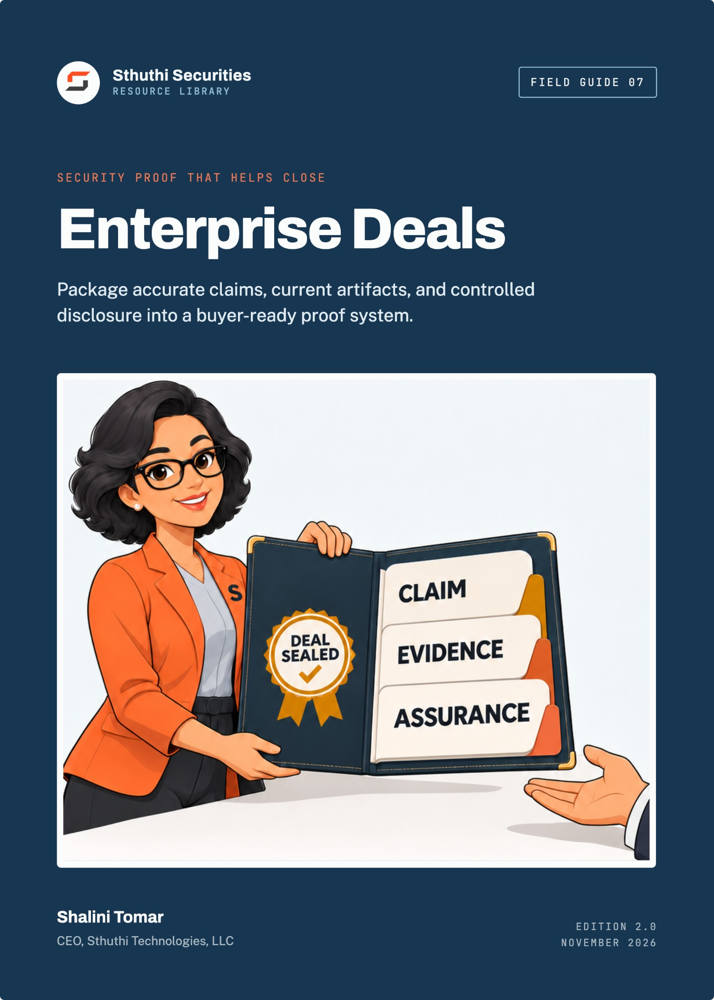
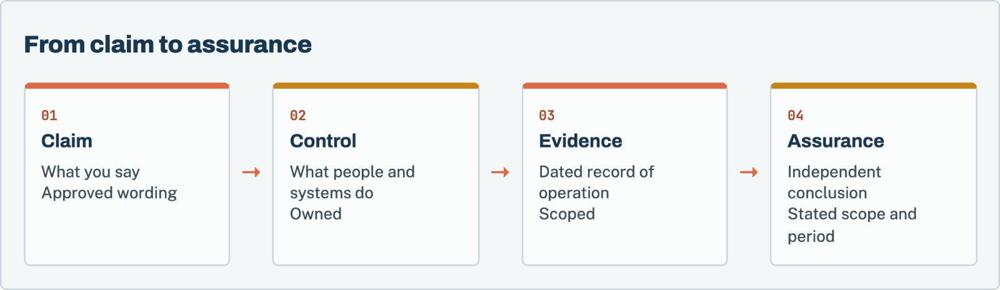

# Security Proof That Helps Close Enterprise Deals

*Package accurate claims, current artifacts, and controlled disclosure into a buyer-ready proof system*

**Shalini Tomar**, CEO, Sthuthi Technologies, LLC  
Sthuthi Securities · Field Guide 07 · Edition 2.0 · November 2026

---

**Security Proof That Helps Close Enterprise Deals**  
Edition 2.0, November 2026.

© 2026 Sthuthi Technologies, LLC. All rights reserved. No part of this publication may be reproduced or distributed for commercial purposes without written permission from the publisher. You may copy the companion worksheets for internal use within your own organization.

This guide is educational material. It is not legal advice, an audit opinion, a certification, or authorization to test any system. Security testing requires written permission from the system owner. Contract, privacy, employment, sector, and regional obligations should be reviewed with qualified advisers.

OrbitOps and every other organization in the worked examples are fictional. Any resemblance to a real organization is coincidental.

SOC 2 is a trademark of the AICPA. ISO, CAIQ, CCM, and STAR (Cloud Security Alliance), SIG (Shared Assessments), and NIST names are used for identification only and imply no endorsement.

Framework versions, provider policies, and publication dates were checked against primary sources in November 2026. Requirements change; confirm the current edition before relying on a specific clause.

---

# Contents

[**Before you start**](#intro)

**PART I · FOUNDATIONS**

[**01   Separate claims, controls, evidence, and assurance**](#ch1)

  Four kinds of statement, kept apart.

[**02   Build the minimum proof set**](#ch2)

  The smallest set that answers most reviews.

[**03   Explain scope, dates, exceptions, and ownership honestly**](#ch3)

  Every artifact says what it covers and when.

**PART II · PACKAGING THE PROOF**

[**04   Package architecture, data flow, identity, and encryption proof**](#ch4)

  Diagrams, access, and encryption, scoped and dated.

[**05   Package secure development, testing, incident, continuity, and supplier proof**](#ch5)

  Show the loop, the exercise, and the restore.

[**06   Use SOC 2, ISO, CSA STAR, and penetration tests without overclaiming**](#ch6)

  Report type, scope, period, issuer, and status.

[**07   Answer questionnaires quickly without creating contradictions**](#ch7)

  Approved answer blocks, linked to the claim register.

**PART III · SHARING, MEASUREMENT, AND A WORKED PACKAGE**

[**08   Operate a secure trust room and controlled report sharing**](#ch8)

  Tiered disclosure, with a record of who received what.

[**09   Measure whether proof helps**](#ch9)

  Cycle time, repeat questions, expiry, and contradictions.

[**10   Worked example: OrbitOps’ evidence package**](#ch10)

  One package, assembled and shared.

**TOOLS AND REFERENCE**

[**W   Companion worksheet pack**](#worksheets)

  7 worksheets as a separate printable PDF, Word, and Excel download.

[**S   Sources**](#sources)

---

**INTRODUCTION**

# Before you start

*Enterprise buyers do not need you to be perfect. They need enough clear, current, honest proof to make a risk decision they can defend.*

Security proof is the material a buyer’s reviewers use to decide whether to trust you: a security overview, diagrams, policies, reports, test summaries, and the answers your team gives on calls and in questionnaires. Good proof shortens deals. Bad proof slows them down, and inconsistent proof can end them.

Most young SaaS companies have more security than their proof suggests. The controls exist, but the evidence is scattered, undated, or described in language nobody can verify. Some companies have the opposite problem: their proof promises more than the controls deliver, and the gap shows up in the first serious review.

This guide is about building a proof system that is accurate, easy to share, and safe to share. It is for founders, security teams, sales engineers, legal teams, and product leaders who support enterprise procurement. It complements Field Guide 01 on passing security reviews, which focuses on running the review itself.

*Figure 1. Each layer depends on the one beneath it. Assurance is only as good as the evidence it examined, and claims should never outrun the controls.*

Each chapter points to worksheets in the companion pack, a separate download in PDF, Word, and Excel formats.

> **Accuracy over polish**
>
> Every pattern in this guide is designed to make true statements easier to share. None of it will help you look more secure than you are. Buyers compare documents, and a contradiction found by a reviewer costs more than a disclosed gap.

---

**PART I · CHAPTERS 1–3**

# Foundations

*Keep claims, controls, evidence, and assurance separate, build the smallest proof set that answers buyers’ real questions, and make the scope of every artifact obvious.*

---

**CHAPTER 01 · FOUNDATIONS**

## Separate claims, controls, evidence, and assurance

*Most proof problems come from confusing these four. Keep them distinct and many contradictions disappear.*

| Term | What it is | Example |
|---|---|---|
| Claim | Something the company says about its security | “Customer data is encrypted at rest.” |
| Control | What people and systems actually do | Database, backups, and file storage use encryption managed by the cloud key service |
| Evidence | A dated record showing the control operated | A configuration export from 3 October, with the stores listed |
| Assurance | An independent conclusion over a stated scope and period | A SOC 2 Type II report covering encryption controls for twelve months |

A claim without a control is a false statement. A control without evidence is an assertion. Evidence without assurance is still valuable, as long as it is presented as your own record rather than as an independent opinion.

### Where confusion causes trouble

- Marketing writes a claim that no control supports.
- A sales engineer describes a planned control as current.
- An old report is offered as assurance for a product it did not cover.
- A screenshot is offered as evidence without a date or scope.

Each of these becomes a contradiction when a buyer compares two documents. The fix is a single register of approved claims, each linked to its control, evidence, and owner.

> **Worksheet 02 · in the companion pack**
>
> **Claim register.** Use the printable or editable version from the [companion worksheet pack](#worksheets).

**Before you move on**

- [ ] Your team can explain the difference between a claim, a control, evidence, and assurance.
- [ ] Every recurring external claim is in the claim register with an owner.

---

**CHAPTER 02 · FOUNDATIONS**

## Build the minimum proof set

*Start with the documents that answer the questions buyers ask most. Add more only when buyers keep asking for it.*

### The core set

Most enterprise reviews can be answered largely from these artifacts:

| Artifact | What it answers |
|---|---|
| Security overview | A two- to four-page narrative covering every major domain |
| System description | What the product is, where it runs, what data it holds, and what is excluded |
| Architecture and data-flow diagram | Where data enters, is stored, is processed, and leaves |
| Access summary | How workforce and customer access is controlled |
| Secure development summary | How code is reviewed, tested, and deployed |
| Testing summary | Penetration-test scope, dates, findings by severity, and remediation status |
| Incident and continuity summary | Response plan, notification commitments, backup and restore testing |
| Supplier list | Subprocessors, their purpose, and their location |
| Privacy documents | Data processing agreement and retention terms |
| Independent reports | SOC 2, ISO/IEC 27001, or CSA STAR entries, where you have them |

### Build an index

The proof index maps the questions buyers ask to the approved answer and the artifact that supports it. It is the document your team uses to answer questionnaires and calls. It is internal, and it is the single most useful thing in this guide.

> **Worksheet 01 · in the companion pack**
>
> **Proof index.** Use the printable or editable version from the [companion worksheet pack](#worksheets).

**Before you move on**

- [ ] Each artifact in the core set exists or has an owner and a date.
- [ ] The proof index maps common buyer questions to approved answers and artifacts.

---

**CHAPTER 03 · FOUNDATIONS**

## Explain scope, dates, exceptions, and ownership honestly

*A buyer should never have to guess whether an artifact covers the service they are buying, or whether it is still current.*

### Put a header on every artifact

Every shared artifact should state, on its first page:

- The product, plan, and legal entity it covers.
- The environment and regions.
- The date or period it describes.
- The version and the owner.
- Known exclusions.
- Its confidentiality level and sharing terms.

> **Worksheet 03 · in the companion pack**
>
> **Artifact header checklist.** Use the printable or editable version from the [companion worksheet pack](#worksheets).

### State exceptions where the reader will see them

If a control does not cover part of the service, say so in the same document that makes the claim, not in a separate footnote. “SSO is available on the Enterprise plan” is a complete statement. “SSO is available” followed by a plan table on page nine is not.

### Track expiry

Reports, certificates, test summaries, and diagrams all go stale. Record when each one expires or must be reviewed, and who will refresh it. Expired proof sent to a buyer is worse than no proof, because it suggests nobody is maintaining the program.

> **Worksheet 05 · in the companion pack**
>
> **Expiry calendar.** Use the printable or editable version from the [companion worksheet pack](#worksheets).

**Before you move on**

- [ ] Every shared artifact carries a header with scope, date, version, owner, and exclusions.
- [ ] Exceptions appear next to the claims they qualify.
- [ ] Every artifact has an expiry or review date and an owner.

---

**PART II · CHAPTERS 4–7**

# Packaging the proof

*Assemble proof for each domain buyers ask about, describe independent reports accurately, and answer questionnaires from one source.*

---

**CHAPTER 04 · PACKAGING THE PROOF**

## Package architecture, data flow, identity, and encryption proof

*These are the first technical questions in most reviews. Clear proof here sets the tone for everything after.*

### Architecture and data flow

One diagram should show customer users, application tiers, data stores, suppliers, administrative paths, and trust boundaries. Label it with the system-description version and date. Avoid internal hostnames, IP addresses, and anything that would help an attacker. Buyers need structure, not configuration.

### Identity and access

Summarize workforce access (central identity, MFA, privileged access, access reviews, offboarding) and customer access (SSO, provisioning, roles, audit logs). For each, name the evidence you can show under NDA, such as a dated policy export or the most recent access review.

### Encryption

Name each data store and its encryption status, the mechanism, and who can use the keys. State the minimum TLS version on public endpoints. If internal traffic is not encrypted, say so and describe the network controls. Avoid phrases such as “military-grade encryption” or “end-to-end encryption” unless they are technically precise for your architecture.

> **The most common overclaim**
>
> “End-to-end encrypted” has a specific meaning: only the communicating users can read the content, and the service provider cannot. Most SaaS products do not work that way. Describe encryption in transit and at rest instead.

**Before you move on**

- [ ] The diagram shows trust boundaries and suppliers without exposing configuration detail.
- [ ] Identity proof covers both workforce and customer access.
- [ ] Encryption proof names each store and avoids imprecise terms.

---

**CHAPTER 05 · PACKAGING THE PROOF**

## Package secure development, testing, incident, continuity, and supplier proof

*Buyers want to see that you find and fix problems, and that you can recover when something goes wrong.*

### Secure development and testing

Describe how changes reach production: review, automated checks, separation of environments, and deployment from a pipeline. Then summarize testing: the sources of vulnerability findings, your remediation targets and how you perform against them, and your most recent independent penetration test.

A penetration-test summary letter should state the tester, the dates, the scope, the method, the findings by severity, and the remediation status of each finding above low. Keep the full report, with reproduction steps, for controlled viewing only.

### Incident response and continuity

Summarize the incident plan, the notification commitment you make to customers, the date of your last tabletop exercise, and your backup and restore testing. Make sure the notification timeline is identical in this summary, your contract template, and your questionnaire answers. NIST’s current incident-response guidance, SP 800-61 Revision 3, is a useful reference for what buyers expect a program to cover.[6]

### Suppliers

Publish a subprocessor list with each supplier’s purpose and location, and describe how you notify customers of changes. Be ready to show how you reviewed the security of your most important suppliers.

**Before you move on**

- [ ] The penetration-test summary is shareable and shows remediation status.
- [ ] The notification timeline is identical across summary, contract, and answers.
- [ ] The subprocessor list is current and change notices are documented.

---

**CHAPTER 06 · PACKAGING THE PROOF**

## Use SOC 2, ISO, CSA STAR, and penetration tests without overclaiming

*Independent reports are powerful proof, within their scope. Describe each one exactly.*

| Artifact | Issued by | What it shows | Common overclaim |
|---|---|---|---|
| SOC 2 Type I | Independent CPA firm | Controls were suitably designed at a point in time | Presented as proof the controls operate |
| SOC 2 Type II | Independent CPA firm | Controls operated effectively over a period | “SOC 2 certified” (it is an attestation report) |
| ISO/IEC 27001 certificate | Accredited certification body | A conforming management system covers the stated scope | Implied to cover products outside the certificate scope |
| CSA STAR Level 1 | Self-assessment published to the CSA registry | Your own answers in the CAIQ format | Presented as an audit |
| Penetration test | Independent tester | What testers found in a scope during a window | “Pen tested and secure” |

SOC 2 reports are issued under AICPA standards against the Trust Services Criteria.[1] ISO/IEC 27001:2022 is the current edition of the management-system standard.[2] The Cloud Security Alliance’s STAR program publishes self-assessments using the CAIQ, which is aligned to its Cloud Controls Matrix.[3][4]

### Describe each report in one sentence

Write one approved sentence for each report you hold, and use it everywhere. For example: “Our SOC 2 Type II report, issued by [firm], covers the security and availability criteria for the [product] service from 1 January to 31 December 2025, with no exceptions noted.” If there were exceptions, say how many and where.

### Bridge the gap

If a report period ended some time ago, offer a bridge letter stating that there have been no material changes since, or describing the ones there have been.

**Before you move on**

- [ ] Each report has one approved descriptive sentence, used everywhere.
- [ ] Nobody describes a SOC 2 report as a certification.
- [ ] Bridge letters are available for reports whose period has ended.

---

**CHAPTER 07 · PACKAGING THE PROOF**

## Answer questionnaires quickly without creating contradictions

*Speed and consistency come from the same place: answering from the register, not from memory.*

### Build approved answer blocks

For each common question, write an answer block using a consistent structure: a direct answer, the scope, how the control works, the evidence, and any exception. Store each block in the proof index, linked to the claim it supports.

### Answer from the blocks

When a questionnaire arrives, map its rows to existing blocks first. Most rows will match. Draft new blocks only for the rest, have the control owner check them, and add them to the index. Every new answer becomes a reusable one.

### Update everywhere when a control changes

When a control changes, update the claim register first, then every live questionnaire, the security overview, your website security page, and any contract template that uses the same claim. Most contradictions come from one copy that was missed.

> **Worksheet 06 · in the companion pack**
>
> **Contract claim check.** Use the printable or editable version from the [companion worksheet pack](#worksheets).

**Before you move on**

- [ ] Common questions have approved answer blocks with a consistent structure.
- [ ] New answers are reviewed by the control owner and added to the index.
- [ ] Control changes trigger updates to every document that uses the claim.

---

**PART III · CHAPTERS 8–10**

# Sharing, measurement, and a worked package

*Share sensitive proof safely, measure whether it is helping deals, and follow one company’s evidence package for a large enterprise contract.*

---

**CHAPTER 08 · SHARING, MEASUREMENT, AND A WORKED PACKAGE**

## Operate a secure trust room and controlled report sharing

*Some proof should be public, some shared under NDA, and some shown only on a call. Decide in advance.*

### Use three tiers

| Tier | Contents | Typical access |
|---|---|---|
| Public | Security overview, subprocessor list, policy index, report descriptions | Website or open trust page |
| Under NDA | System description, diagrams, SOC 2 report, penetration-test summary, bridge letters | Named reviewers after qualification |
| By exception | Full policies, detailed configuration evidence, full penetration-test report | Shown on a call, or shared with expiry and watermark |

### Control access

Share tier 2 and 3 material through a trust portal or controlled folder rather than email attachments. Use named access, expiry dates, and watermarks where your tools support them. Record who received what, and when.

> **Worksheet 04 · in the companion pack**
>
> **Disclosure decision.** Use the printable or editable version from the [companion worksheet pack](#worksheets).

### Handle requests for raw evidence

Some buyers will ask for full penetration-test reports or configuration exports. Ask what question they are trying to answer. Often a summary, a call, or a redacted excerpt will answer it with less exposure.

**Before you move on**

- [ ] Every artifact has an assigned tier.
- [ ] Tier 2 and 3 material is shared through controlled access with expiry.
- [ ] A disclosure log records every recipient.

---

**CHAPTER 09 · SHARING, MEASUREMENT, AND A WORKED PACKAGE**

## Measure whether proof helps

*If proof is working, reviews get faster and questions get narrower. Measure both.*

Track a few measures across deals:

| Measure | What it tells you |
|---|---|
| Security review cycle time | How long security adds to the sales process |
| Repeated questions | Topics where existing proof is unclear or missing |
| Expired artifacts sent | Whether the expiry calendar is being maintained |
| Contradictions found by buyers | Whether the claim register is being used |
| Requests for tier 3 material | Whether tier 2 proof answers the real questions |
| Security commitments added to contracts | Whether proof gaps are being filled by promises |

Review the measures each quarter with sales and security. When the same question keeps coming back, improve the artifact that should have answered it.

> **Worksheet 07 · in the companion pack**
>
> **Proof metrics.** Use the printable or editable version from the [companion worksheet pack](#worksheets).

**Before you move on**

- [ ] The measures above are tracked across deals.
- [ ] Repeated questions lead to improved artifacts.
- [ ] Each quarter’s review is attended by sales and security.

---

**CHAPTER 10 · SHARING, MEASUREMENT, AND A WORKED PACKAGE**

## Worked example: OrbitOps’ evidence package

*A fictional workflow SaaS vendor competing for a global enterprise contract with a formal security gate.*

| Starting point | OrbitOps in March |
|---|---|
| Company | 55 people. Workflow automation SaaS for operations teams |
| Buyer | A global manufacturer with a formal vendor security gate |
| Assurance held | SOC 2 Type II report for the prior calendar year; penetration test in November |
| Problem | Three earlier deals had stalled on security questions answered differently by different people |

### What the audit of existing proof found

OrbitOps’ head of security, Lena, collected everything the company had sent to buyers in the previous year. She found four different descriptions of the encryption controls, two backup retention periods, and a website security page stating that the product was “SOC 2 certified” and “end-to-end encrypted”. A diagram shared with one buyer showed a database that had been decommissioned.

### Building the package

Lena built a claim register of 48 approved claims, each linked to its control and evidence. She rewrote the security overview from the register in four pages, redrew the architecture diagram from the current system description, and added a header to every artifact. The website page was corrected to describe the SOC 2 Type II report accurately and to explain encryption in transit and at rest.

### Sharing it

The buyer’s security gate required a questionnaire, a SOC 2 report, a penetration-test summary, and a call. OrbitOps sent the public overview at qualification, then opened a trust-room folder with the system description, diagram, SOC 2 report, bridge letter, and penetration-test summary to three named reviewers, with access expiring after 60 days. The full penetration-test report was walked through on a call, not sent.

### The result

The questionnaire took four days instead of the three weeks earlier deals had needed, because 210 of its 260 rows matched existing answer blocks. The buyer’s reviewers asked eleven follow-up questions, all narrow. The security gate approved OrbitOps with one condition: delivery of the next SOC 2 Type II report within 30 days of issue. The condition went into the commitment log and the expiry calendar.

> **What made the difference**
>
> The claim register. Every earlier contradiction came from people writing answers from memory. Once every answer came from one approved register, the contradictions stopped, and the time saved went into the questions that actually needed thought.

---

**TOOLS · COMPANION DOWNLOAD**

# The companion worksheet pack

*The 7 worksheets referred to in this guide are a separate download, so you can print them, fill them in, and share them with your team without copying pages out of the book.*

Download the pack from the same page as this guide in the Sthuthi Securities resource library at [sthuthi-tech.com](https://sthuthi-tech.com). It comes in three formats:

- **Printable PDF.** Each worksheet starts on a new A4 page, with lined fields for writing by hand.
- **Editable Word document.** The same worksheets as fill-in tables you can type into.
- **Excel workbook.** One tab per worksheet, with registers set up as working trackers.

| # | Worksheet | Use with |
|---|---|---|
| 01 | Proof index | Chapter 2 |
| 02 | Claim register | Chapter 1 |
| 03 | Artifact header checklist | Chapter 3 |
| 04 | Disclosure decision and log | Chapter 8 |
| 05 | Expiry calendar | Chapter 3 |
| 06 | Contract claim check | Chapter 7 |
| 07 | Proof metrics | Chapter 9 |

---

**SOURCES · REFERENCE**

# Sources

Sources were checked in November 2026. Recommendations in this guide are Sthuthi Securities guidance, not requirements of any framework listed here unless the text says so.

1. **AICPA.** System and Organization Controls: SOC suite of services. [https://www.aicpa-cima.com/resources/landing/system-and-organization-controls-soc-suite-of-services](https://www.aicpa-cima.com/resources/landing/system-and-organization-controls-soc-suite-of-services)
2. **ISO.** ISO/IEC 27001:2022, Information security management systems: Requirements. [https://www.iso.org/standard/27001](https://www.iso.org/standard/27001)
3. **Cloud Security Alliance.** Security, Trust, Assurance and Risk (STAR) program. [https://cloudsecurityalliance.org/star](https://cloudsecurityalliance.org/star)
4. **Cloud Security Alliance.** Cloud Controls Matrix and CAIQ v4.1. [https://cloudsecurityalliance.org/artifacts/cloud-controls-matrix-v4-1](https://cloudsecurityalliance.org/artifacts/cloud-controls-matrix-v4-1)
5. **Shared Assessments.** Standardized Information Gathering (SIG) Questionnaire. [https://sharedassessments.org/sig/](https://sharedassessments.org/sig/)
6. **NIST.** SP 800-61 Rev. 3, Incident Response Recommendations and Considerations for Cybersecurity Risk Management, April 2025. [https://csrc.nist.gov/news/2025/nist-revises-sp-800-61](https://csrc.nist.gov/news/2025/nist-revises-sp-800-61)
7. **NIST.** SP 800-115, Technical Guide to Information Security Testing and Assessment. [https://csrc.nist.gov/pubs/sp/800/115/final](https://csrc.nist.gov/pubs/sp/800/115/final)
8. **U.S. Federal Trade Commission.** Start with Security: A Guide for Business. [https://www.ftc.gov/business-guidance/resources/start-security-guide-business](https://www.ftc.gov/business-guidance/resources/start-security-guide-business)

---

**ABOUT · STHUTHI SECURITIES**

# About the author

**Shalini Tomar** is the CEO of Sthuthi Technologies, LLC, and leads its cybersecurity practice, Sthuthi Securities. She works with SaaS teams that need to show enterprise buyers clear, scoped, and current evidence of how their products are secured.

# About Sthuthi Securities

Sthuthi Securities is the cybersecurity practice of Sthuthi Technologies, LLC. It tests web applications, APIs, cloud systems, and AI agents, then helps teams fix and retest what it finds. Engagements are scoped in writing and authorized by the system owner, and they end with findings and evidence a buyer’s reviewer can use.

Penetration testing

Web application, API, and cloud testing with clear scope and safe rules of engagement.

AI security assessment

Tool permissions, tenant isolation, and prompt-injection testing for AI agents.

Remediation support

Working with your engineers to fix the cause, not just the symptom.

Retesting and evidence

Independent verification and summary letters you can share with buyers.

More field guides at sthuthi-tech.com

Passing enterprise security reviews · Scoping a web app and API penetration test · The first 90 days of a security program · Preparing for a customer audit · Repeatable security testing · AI security for support agents

---
